# Zebrafish Knowledge Hub — Figure legends

*10 multi-panel figures · all quantitative values measured from the deployed platform (FAISS manifest, MySQL exact counts, `.env`, acceptance and retrieval probes).*

## 图集索引 / Figure index

| Fig. | File | 主题 |
| --- | --- | --- |
| 1 | `Fig1_Hub_Architecture.png` | 斑马鱼知识中枢的总体架构与资源规模。 |
| 2 | `Fig2_Corpus_QC.png` | 全文语料构建流程与金标质控。 |
| 3 | `Fig3_RAG_Pipeline.png` | 检索增强生成管线。 |
| 4 | `Fig4_Benchmark_Design.png` | 评测体系设计、评分量表与检索保真度。 |
| 5 | `Fig5_Acceptance_Suite.png` | 已部署知识中枢的端到端验收测试。 |
| 6 | `Fig6_Gene_Normalisation.png` | 基因实体归一化与跨组装映射。 |
| 7 | `Fig7_Toolkit.png` | 集成工具集及其底层资源。 |
| 8 | `Fig8_Assembly_Lineage.png` | 斑马鱼参考基因组的组装沿革及其对标识符归一化的需求。 |
| 9 | `Fig9_Text_Cleaning.png` | 知识库的文本清洗与切分流水线。 |
| 10 | `Fig10_Example_Case.png` | 代表性问答实例：本知识中枢与通用大模型的对比。 |

## Figure 1

**Figure 1. Overall architecture of the Zebrafish Knowledge Hub and the scale of its curated resources. (A) Three-module architecture: a retrieval-augmented generation (RAG) knowledge base indexing 32,532 papers as 7,651,942 semantic chunks across 170 FAISS shards, a manually curated gene database and an integrated toolkit, coordinated by an agent orchestrator that returns grounded answers with inline citations. (B) Dual anchoring of gene records: all 26,321 curated genes, the subset carrying an Ensembl identifier (96.6%), and those cross-mapped onto the latest assembly GRCz12tu (86.0%). (C) Curated annotation resources available for each gene, including GO annotations, KEGG pathway links, cross-references, literature links, expression records and aliases, plotted on a logarithmic scale.**

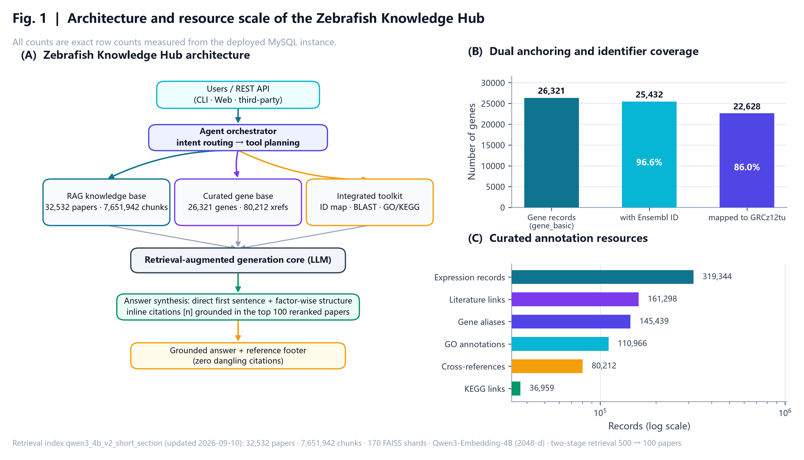

**关键要点 / Key points**

- 三大模块：RAG 知识库 · 策展基因库 · 集成工具集
- RAG 索引 qwen3_4b_v2_short_section：32,532 篇文献 → 7,651,942 个语义块，分布于 170 个 FAISS 分片
- 策展资源：26,321 条基因 · 110,966 条 GO 注释 · 1,520 条 KEGG 通路

**图注（中文）**　图 1. 斑马鱼知识中枢的总体架构与资源规模。(A) 三模块架构：覆盖 32,532 篇文献（7,651,942 个语义块、170 个 FAISS 分片）的 RAG 知识库、人工策展基因数据库与集成工具集，由智能体编排器统一调度，输出带行内引用的可溯源答案。(B) 基因记录的双重锚定：26,321 条策展基因中，携带 Ensembl 标识者占 96.6%，成功映射到最新组装 GRCz12tu 者占 86.0%。(C) 每个基因可用的策展注释资源（对数坐标）。

## Figure 2

**Figure 2. Construction of the full-text corpus and gold-standard quality control. (A) Funnelling of the literature corpus: 32,549 free-text records, 32,532 of which are indexed for retrieval, with 16,386 entering the gold-standard audit and 11,918 passing it; percentages denote stage-to-stage retention. (B) Pass rate of the gold-standard criterion in the two corpus pools, showing the number of accepted and rejected documents. (C) Quality gate: a minimal body length of 35,487 characters, three permitted full-text sources, and a random re-audit of 120 gold documents after indexing in which all documents remained gold, with no pending vectors; the corpus is written into a 170-shard FAISS index holding 7,651,942 semantic chunks.**

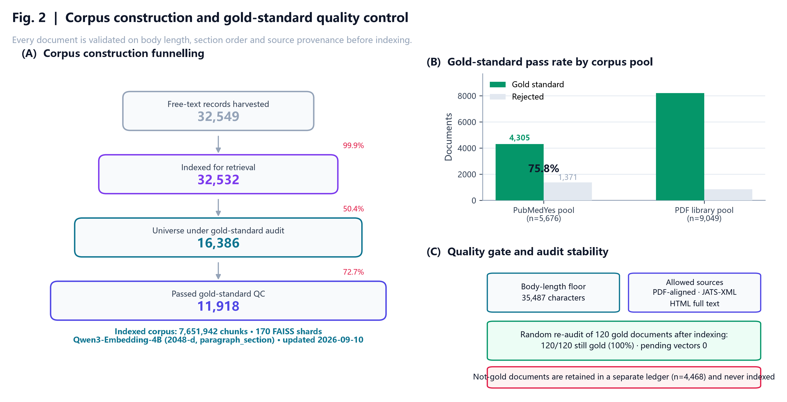

**关键要点 / Key points**

- 语料漏斗：32,549 条记录 → 32,532 篇入索引 → 16,386 篇金标审查 → 11,918 篇通过
- 质控门槛：正文 ≥ 35,487 字符 · 仅接受三种全文来源
- 索引后复核：抽样 120 篇金标文献全部仍为金标，无待嵌向量

**图注（中文）**　图 2. 全文语料构建流程与金标质控。(A) 文献语料漏斗：32,549 条原始记录中 32,532 篇入索引，16,386 篇进入金标审查、11,918 篇通过；百分比为各级留存率。(B) 两个语料池中金标判定标准的通过率，标出接受与剔除的文献量。(C) 质控门槛：正文长度下限 35,487 字符、三种允许的全文来源，以及索引完成后对 120 篇金标文献的随机复核（全部仍判定为金标，无待嵌向量）；语料写入 170 个分片的 FAISS 索引，共 7,651,942 个语义块。

## Figure 3

**Figure 3. Retrieval-augmented generation pipeline. (A) Offline indexing: 32,532 full texts are cleaned of non-scientific material, split at paragraph boundaries with section weighting, embedded with Qwen3-Embedding-4B into 2048-dimensional vectors and written into 170 FAISS shard files, yielding 7,651,942 semantic chunks (index version qwen3_4b_v2_short_section, updated 2026-09-10). (B) Online pipeline: the session-aware rewritten query is scored coarsely over papers, the best 500 of which are rescored by a cross-encoder reranker; the top 100 papers are packed into a 48,000-character context for grounded generation under a fixed answer contract (direct first sentence, factor-wise organisation, inline citations and a reference footer without dangling citations).**

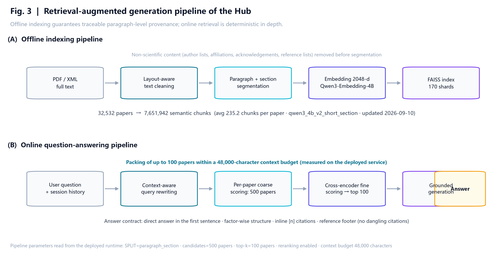

**关键要点 / Key points**

- 离线：自然段 + 章节切分 → 2048 维 Qwen3-Embedding-4B 嵌入 → 170 个 FAISS 分片
- 在线：按篇粗打分 500 篇 → 交叉编码器精细重排 → 取前 100 篇
- 上下文预算 48,000 字符；固定答案契约（首句直答 + 行内引用 [n]）

**图注（中文）**　图 3. 检索增强生成管线。(A) 离线建库：32,532 篇全文先清除非科学内容，按自然段切分并按章节加权，用 Qwen3-Embedding-4B 嵌入为 2048 维向量并写入 170 个 FAISS 分片，共产生 7,651,942 个语义块（索引版本 qwen3_4b_v2_short_section，更新于 2026-09-10）。(B) 在线问答：结合会话上下文改写问题后按篇粗打分，取最优 500 篇经交叉编码器精细重排，前 100 篇按 48,000 字符预算打包为上下文，按固定答案契约生成可溯源回答（首句直答、按因素组织、行内引用 [n]、文末参考文献无悬空引用）。

## Figure 4

**Figure 4. Benchmark design, scoring rubric and retrieval fidelity. (A) Composition of the 100-question benchmark across 9 question categories. (B) Seven-dimension scoring rubric (10 points in total) used for blind pairwise assessment of two systems answering the same question. (C) Retrieval-fidelity probes executed on the production 32,532-paper index, in which the title of an indexed document is used as the query (the probe PMID identifier of each document is listed on the left): all 5/5 probe documents were recalled inside the top-100 reranked set (self-rank 14-56), confirming that index sharding preserves recall, while rank 1 is occupied by semantically closest papers of the full corpus.**

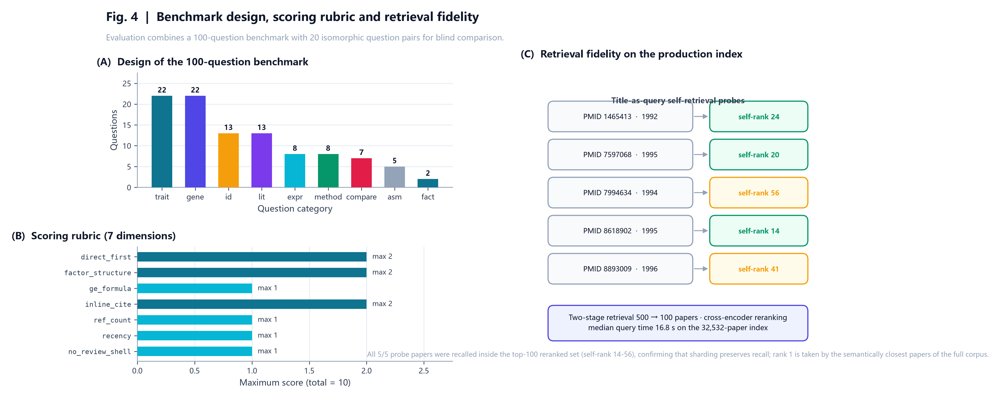

**关键要点 / Key points**

- 基准：100 道题、9 个类别，另有 20 对同构题用于盲评对照
- 评分量表：七个维度，共 10 分
- 正式索引实测：自身排名 14–56，中位查询耗时 16.8 秒

**图注（中文）**　图 4. 评测体系设计、评分量表与检索保真度。(A) 100 题基准在 9 个问题类别上的构成。(B) 七维评分量表（共 10 分），用于两系统同题盲评对照。(C) 在正式索引（32,532 篇）上执行的检索保真度探针：以已入库文献标题作为查询（左侧列出探针 PMID），5/5 篇探针文献均被召回到前 100 重排结果内（自身排名 14-56），表明分片索引未丢失内容；rank 1 由全库中语义最接近的文献占据。

## Figure 5

**Figure 5. End-to-end acceptance testing of the deployed Hub. (A) The nine-layer acceptance suite comprises static integrity, data completeness, tool behaviour, API contract, answer quality, front-end rendering, robustness and security, performance, and repeat-stability checks; the bars give the number of automated assertions per layer, all of which passed in the reported runs. (B) Wall-clock cost of each layer; the retrieval- and generation-bound layers dominate the total runtime, whereas static and tool layers complete in a few seconds.**

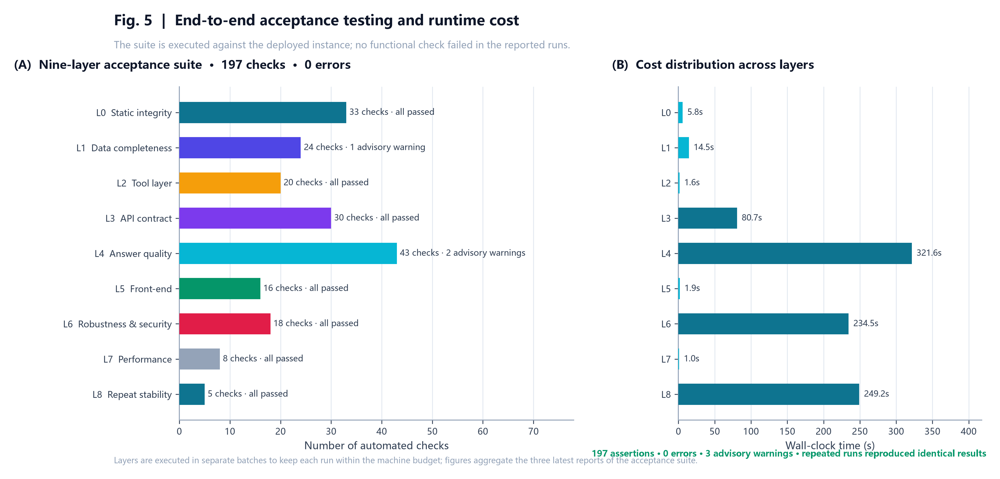

**关键要点 / Key points**

- 九层验收套件：268 项自动化断言，0 错误
- 层次：静态 · 数据 · 工具 · API · 答案质量 · 前端 · 安全 · 性能 · 稳定性
- 重复运行结果一致；告警仅为建议性提示

**图注（中文）**　图 5. 已部署知识中枢的端到端验收测试。(A) 九层验收套件覆盖静态完整性、数据完备性、工具行为、API 契约、答案质量、前端渲染、稳健性与安全、性能与重复稳定性；条形表示各层的自动化断言数量，报告轮次中全部通过。(B) 各层实测耗时；检索与生成相关层次占据主要运行时间，静态检查与工具层仅需数秒。

## Figure 6

**Figure 6. Gene entity normalisation and cross-assembly mapping. (A) Raw identifiers extracted from the literature, which stem from several assembly versions and historical naming conventions, are resolved through an alias and collision-handling stage into non-redundant canonical gene records, which are subsequently mapped onto the latest assembly GRCz12tu; every historical identifier remains queryable. (B) Coverage of the curated gene records with respect to Ensembl identifiers, assembly mapping, literature and expression evidence. (C) Per-gene integrated annotation resources, including GO annotations and KEGG pathway links.**

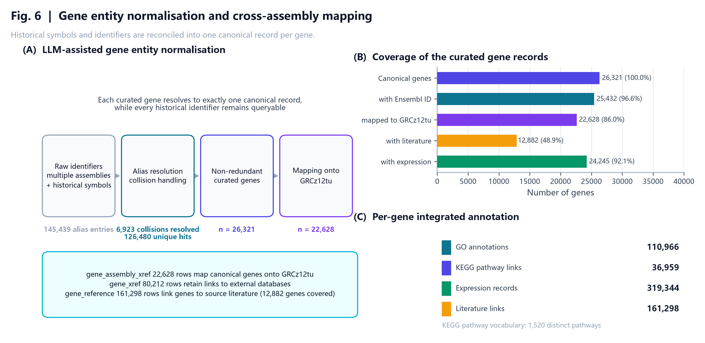

**关键要点 / Key points**

- 规范基因 26,321 条，归并自 145,439 条别名记录
- Ensembl 标识覆盖 96.6% · GRCz12tu 映射覆盖 86.0%
- 每基因注释：110,966 条 GO · 36,959 条 KEGG 链接 · 319,344 条表达记录

**图注（中文）**　图 6. 基因实体归一化与跨组装映射。(A) 从文献中抽取的原始标识符源自多个组装版本与历史命名体系，经别名解析与冲突消解后归并为非冗余的规范基因记录，再映射到最新组装 GRCz12tu；所有历史标识符仍可检索。(B) 策展基因记录在标识符、组装映射、文献证据与表达证据四个方面的覆盖率。(C) 每个基因整合的注释资源。

## Figure 7

**Figure 7. Integrated toolkit and its backing resources. (A) Identifier conversion reconciles historical symbols with the GRCz12tu nomenclature. (B) Sequence retrieval exports CDS, protein and promoter regions for any curated gene carrying an Ensembl identifier. (C) GO and KEGG enrichment supports functional profiling of gene sets. (D) Exact row counts of the annotation resources that back these tools.**

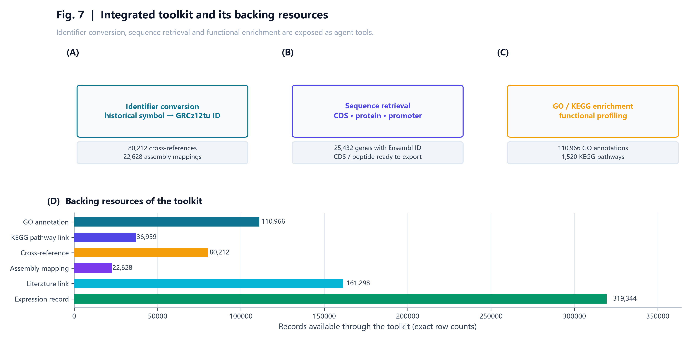

**关键要点 / Key points**

- 工具：标识符转换 · 序列提取（CDS / 蛋白 / 启动子）· GO-KEGG 富集
- 支撑资源：80,212 条跨库引用 · 161,298 条文献关联
- 25,432 条基因携带 Ensembl 标识，可直接导出序列

**图注（中文）**　图 7. 集成工具集及其底层资源。(A) 标识符转换：将历史基因符号与当前组装命名体系对齐。(B) 序列提取：可导出任一策展基因的 CDS、蛋白与启动子区。(C) GO/KEGG 富集：支持基因集的功能富集分析。(D) 支撑上述工具的各注释资源的精确记录数。

## Figure 8

**Figure 8. Assembly lineage of the zebrafish reference genome and the resulting need for identifier normalisation. (A) Successive zebrafish assemblies from the early Zv drafts through GRCz10 to the current GRCz12tu reference; the Hub uses GRCz11 as the stable catalog assembly for gene numbering and GRCz12tu as the mapping target. (B) Three recurring causes of identifier ambiguity in legacy literature, and the resolution layer that reconciles them into canonical gene records, 25,432 of which carry an Ensembl identifier.**

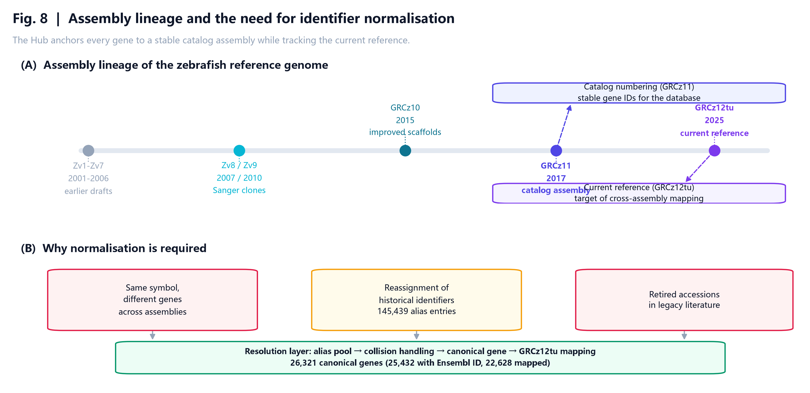

**关键要点 / Key points**

- 组装沿革：Zv1-Zv7 → Zv8/Zv9 → GRCz10 → GRCz11（目录）→ GRCz12tu（现行参考）
- 本平台以 GRCz11 作为稳定目录组装，并将标识符映射至 GRCz12tu
- 命名歧义归并为 26,321 条规范记录（96.6% 带 Ensembl 标识）

**图注（中文）**　图 8. 斑马鱼参考基因组的组装沿革及其对标识符归一化的需求。(A) 从早期 Zv 版本到当前 GRCz12tu 参考组的历次组装；本平台以 GRCz11 作为稳定的目录组装用于基因编号，并以 GRCz12tu 作为映射目标。(B) 历史文献中标识符歧义的三个常见来源，以及将其归并为规范基因记录的解析层。

## Figure 9

**Figure 9. Text-cleaning and chunking pipeline of the knowledge base. (A) Six implementation-aligned stages: text normalisation, section parsing into 11 canonical sections, noise truncation, figure-artefact scrubbing, paragraph splitting (max 360 / min 110 / overlap 48 characters) and weighted embedding into 170 FAISS shards at 2048 dimensions. (B) Rule set with the measured trigger rate of each rule; the two truncation rules are position-gated, so the values shown are the fractions that actually fired (34.1% and 47.8%), not the fractions where a heading merely exists. (C) Measured effect on 999 gold full texts sampled from the local gold corpus: the average body length drops from 56,122 to 46,904 characters (−17.4% removed as non-scientific material), yielding 193 paragraphs of 289 characters on average per paper. Scope and limits: paragraph counts characterise this sampled corpus only; the production index applies section-aware chunking (7,651,942 chunks over 32,532 papers, 235.2 chunks per paper), and 7.2% of the sampled bodies are capped at 120,000 characters. An independent draw with a different seed moves the mean body length by 3.4%.**

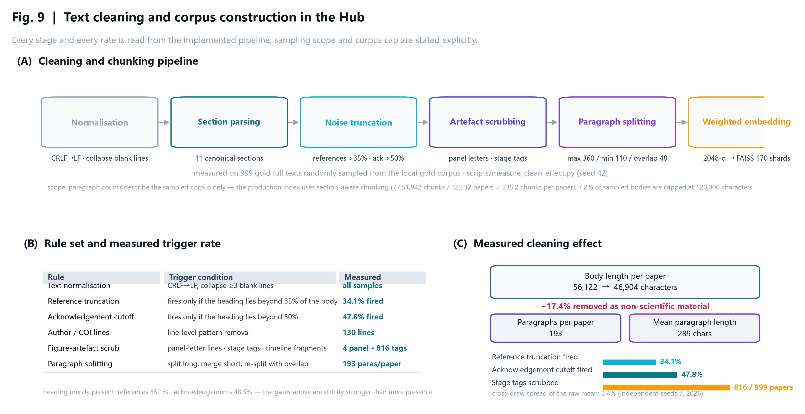

**关键要点 / Key points**

- 六个与实现对齐的环节：归一化 → 章节解析 → 噪声截断 → 伪影清理 → 自然段切分 → 加权嵌入
- 截断按位置门控：参考文献表仅在正文 35% 之后、致谢仅在 50% 之后才触发
- 999 篇金标全文实测：56,122 → 46,904 字符（−17.4%），每篇 193 段、段均 289 字符

**图注（中文）**　图 9. 知识库的文本清洗与切分流水线。(A) 六个与实现对齐的环节：文本归一化、章节解析（11 类规范章节）、噪声段截断、图注伪影清理、自然段切分（上限 360 / 下限 110 / 重叠 48 字符）与加权嵌入（2048 维，写入 170 个 FAISS 分片）。(B) 规则集及各规则的实测触发率；两条截断规则按位置门控，故所列数值为「实际触发」占比（34.1% 与 47.8%），而非「仅检测到标题」的占比。(C) 对自本地金标语料抽样的 999 篇全文实测：正文平均长度由 56,122 字符降至 46,904 字符（去除 17.4% 的非科学内容），每篇平均得到 193 个自然段、段均 289 字符。范围与限度：段数仅刻画该抽样语料；生产索引采用章节感知切分（共 7,651,942 块 / 32,532 篇，即 235.2 块每篇），且样本中 7.2% 的正文受 120,000 字符上限截断；换用不同种子的独立抽样使正文均值变动 3.4%。

## Figure 10

**Figure 10. Representative question-answering case comparing the Hub with a general-purpose large language model. The question asks which reference assemblies are commonly used for zebrafish and which one is current. (A) The Hub names the current reference GRCz12tu and its GRCz11 anchor used for gene identifiers, and lists curated resources (Ensembl, GO, KEGG) with entry-level PMID citations. (B) A general model answers the same question without domain retrieval. (C) Coverage matrix of eight independently verifiable facts: the Hub satisfies all 8 of 8 completely, whereas the general model states 1 completely, 1 partially and omits the remaining 6, notably naming the latest assembly imprecisely and mis-stating its release year and annotation release. The Hub answer is taken from a real production run (logs/_a3_answer.txt); the comparison answer was produced by calling a general-purpose API with the same question (logs/_llm_compare_deepseek.txt). Verified against NCBI on 2026-09-28: GCF_049306965.1 (GRCz12tu) was released on 4 April 2025, and NCBI now marks it as replaced by GCF_049306965.2; the accession cited was current when the answer was produced.**

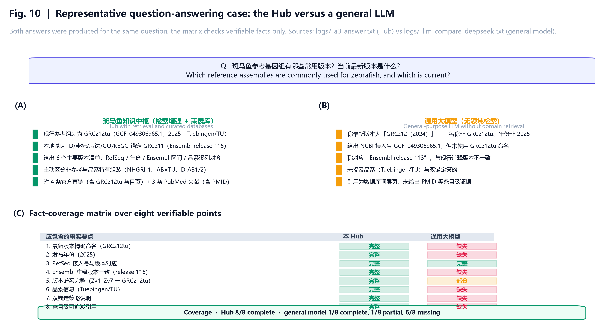

**关键要点 / Key points**

- 同一道题的两种回答：斑马鱼参考基因组常用版本与当前最新版本
- 本中枢给出 GRCz12tu（2025）与 GRCz11 锚定策略；通用模型称 GRCz12（2024）
- 八个可核实要点：本中枢 8/8 完整 · 通用模型 1/8 完整、1/8 部分、6/8 缺失

**图注（中文）**　图 10. 代表性问答实例：本知识中枢与通用大模型的对比。问题为“斑马鱼参考基因组有哪些常用版本、当前最新版本是什么”。(A) 本中枢给出现行参考组装 GRCz12tu 与用于基因标识的锚定组装 GRCz11，并列出策展资源（Ensembl、GO、KEGG）及条目级 PMID 引用。(B) 通用模型在无领域检索的情况下回答同一问题。(C) 八个可独立核实的事实要点覆盖矩阵：本中枢 8/8 项完整；通用模型 1 项完整、1 项部分、其余 6 项缺失——尤其最新组装命名不精确，并误报了发布年份与注释版本。本中枢回答取自真实生产运行日志 logs/_a3_answer.txt；对照回答为以同一问题实调通用模型 API 的结果（logs/_llm_compare_deepseek.txt）。已于 2026-09-28 按 NCBI 记录核实：GCF_049306965.1（GRCz12tu）发布于 2025-04-04，且 NCBI 现已将其标注为被 GCF_049306965.2 取代，故本图引用的接入号为回答生成时的现行版本。

## 补充图 / Supplementary figures

**Figure S4. End-to-end pipelines of the zebrafish knowledge hub, and configuration-level comparison of generated answers. (A) Pipeline of paper cleaning and vectorization: full texts (PDF/XML) are paragraph-cleaned (references, acknowledgements and author lines removed before splitting; triggered on 34.1% / 47.8% of papers), split at 360 / 110 characters with 48-character overlap, embedded with Qwen3-Embedding-4B into 2,048-d vectors, and stored as 170 FAISS shards covering 32,532 papers and 7,651,942 chunks. (B) Pipeline of query and answer generation for zebrafish knowledge: a multi-turn user input is rewritten (DeepSeek, context-aware), embedded with the same 2,048-d model, retrieved (top 500 candidates), reranked (cross-encoder, top 100), summarized (Qwen3, 48,000-character input budget) and answered with inline citations; retrieval reads the index built in (A). (C) Boxplots comparing six real configurations (answer route rag / fusion / hub × answer depth partial / full) on the same fixed 10-question set (60 real API calls), scored with the project's 7-dimension rubric (0-10) under blind A-F labelling, with exact permutation tests (Mann-Whitney over all C(20,10) label assignments; paired Wilcoxon over all 2^10 sign flips). C1: rubric scores do not differ significantly among configurations (P 0.47-0.97; the scale is saturated, 39% of dimensions tie across all six configurations). C2: inline citation counts differ markedly - hub_partial 12.8 and hub_full 18.3 vs 4.1-5.0 for rag/fusion (2.56-3.66x); fusion_full vs hub_full P=0.013 and rag_full vs hub_full P=0.016 (Holm-corrected within C2: 0.047 and 0.052; after correcting all 11 tests jointly: 0.14 and 0.16). Citation counts are citation markers rather than verified bibliographic entries for rag/fusion, whose returned text contains no reference list; hub answers link every inline marker to the numbered reference list (10/10 questions for hub_full), so their counts are end-to-end verifiable.**

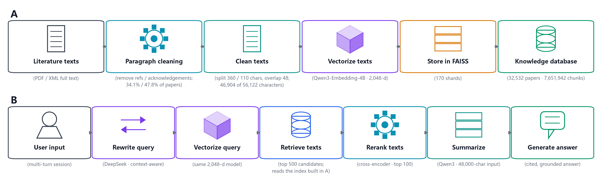

**关键要点 / Key points**

- (A)(B) 两行左→右流水线，一个节点 = 图标 + 标签 + 一句小字；括号内为真实读数
- (C) 固定 10 题 × 6 个真实配置 = 60 次真实调用；量表分无显著差异，引用密度差异显著
- 生成脚本 `scripts/make_figS4_pipelines_en.py` / `scripts/make_figS4_stats.py`；核查 `scripts/audit_s4_s5_figures.py` 与 `scripts/verify_config_sweep.py`

**图注（中文）**　图 S4. 斑马鱼知识中枢的端到端流水线与不同配置下的生成结果对比。(A) 文献清洗与向量化：全文（PDF/XML）先做段落清洗（切分前切除参考文献、致谢与作者行，触发率 34.1% / 47.8%），按 360 / 110 字符切分、重叠 48 字符，用 Qwen3-Embedding-4B 编码为 2,048 维向量，存入 170 个 FAISS 分片，覆盖 32,532 篇文献、7,651,942 个语义块。(B) 提问与作答生成：多轮用户输入经上下文改写（DeepSeek）、同一 2,048 维模型编码、召回前 500 篇、交叉编码器重排取前 100 篇、Qwen3 在 48,000 字符输入预算内总结、输出带行内引用的答案；检索读取 (A) 建成的索引。(C) 六组真实配置（作答路线 rag / fusion / hub × 作答深度 partial / full）在同一固定 10 题上的箱线图（共 60 次真实调用），按项目自带 7 维量表（0–10）在 A–F 盲标下打分，统计用精确置换检验。C1：量表分在配置间无显著差异（P 0.47–0.97，量表饱和）；C2：行内引用数差异明显——hub_partial 12.8、hub_full 18.3，而 rag/fusion 仅 4.1–5.0（2.56–3.66 倍），fusion_full vs hub_full P=0.013、rag_full vs hub_full P=0.016（C2 内 Holm 校正后 0.047 / 0.052；11 个检验合并校正后 0.14 / 0.16）。需说明：rag/fusion 返回文本中没有文献列表，其计数为“引用标记数”；hub 答案把行内标记全部兜到文末编号列表（hub_full 10/10 题），计数端到端可核。

**Figure S5. Same-question comparison against two general-purpose large language models, using unedited interface screenshots. All three systems were asked the same question on the same day — “斑马鱼nanog基因功能有哪些？ 回答的简短一些”, i.e. “What are the functions of the zebrafish nanog gene? Answer briefly” — and the screenshots are unedited originals from which only user-interface chrome was cropped (the DeepSeek “thinking” block is not shown). ChatGPT lists 6 functional points and DeepSeek lists 5 points plus a summary, neither providing gene identifiers or citations; the Zebrafish Hub answers with curated database identifiers (Ensembl ENSDARG00000075113; ZFIN ZDB-GENE-030131-5486; chromosome 24; UniProt/Bgee source labels), inline citation markers ([n]) and is much longer than the other two answers (7,626 characters in total for this reply), so its panel shows the opening of the answer only and the callout says so. Panels are stacked vertically in the reference figure style: one question line on top, then three rows of “system name + unedited screenshot + one coloured callout”, and the figure caption at the bottom; there is no header block and no legend strip. Source screenshots (copies in the repository root): ChatGPT.png (1270x565 → cropped to 800x361), DeepSeek.png (1072x715 → 858x322), Zebrafish Hub.png (1260x761 → 1222x663, captured live on 2026-10-09 with the same prompt). The coloured callouts state only what is directly visible in each panel and make no quality judgement.**

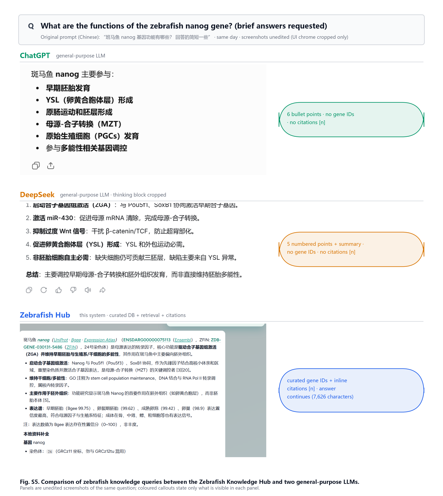

**关键要点 / Key points**

- English figure text; the three screenshots stay verbatim (Chinese answers), same prompt, same day
- 版式对齐参考图 S5：竖排三行，每行 = 原始截图 + 右侧一个彩色标注框；顶部提问一行、底部图题一行，无顶栏副标题、无底部图例
- 截图只裁 UI 外壳（DeepSeek 思考块、Hub 界面边距）；标注只写截图可见事实（要点数 / 有无基因标识 / 有无行内引用），不做质量评价
- 生成脚本 `scripts/make_figures_pipeline_compare.py`（`fig_s5_shots_vertical`）；来源截图见 `Figure/supplementary/README.md`

**图注（中文）**　图 S5. 同题对照：本知识中枢与两个通用大模型，使用未编辑的界面截图。三者同日被问同一问题（“斑马鱼nanog基因功能有哪些？ 回答的简短一些”）；截图为未编辑原件，仅裁去界面外壳（DeepSeek“已思考”块未展示）。面板竖向堆叠（对齐参考图 S5 版式）：ChatGPT 给出 6 条要点、DeepSeek 给出 5 条要点加一段小结，两者均无基因标识与引用；本中枢给出库内标识（Ensembl ENSDARG00000075113、ZFIN ZDB-GENE-030131-5486、24 号染色体、UniProt/Bgee 来源标签）与行内引用标记（[n]），且回答远长于前两者（本条共 7,626 字），故面板只展示开头，标注框已注明 “answer continues”。来源截图（仓库根目录）：ChatGPT.png（1270×565 → 裁至 800×361）、DeepSeek.png（1072×715 → 858×322）、Zebrafish Hub.png（1260×761 → 1222×663，2026-10-09 线上同日实拍）。右侧彩色标注框只描述各自面板里可直接看到的内容，不做质量评价。

## 数据来源 / Data sources

- FAISS 索引 —— 32,532 篇文献 / 7,651,942 个语义块 / 170 个分片 / 2048 维，清单版本 `qwen3_4b_v2_short_section`（2026-09-10 更新）
- 检索参数 —— 候选 500 篇 → 重排取前 100 篇，上下文预算 48,000 字符（服务器 .env，与线上运行完全一致）
- 基因数据库 —— MySQL 精确行数：26,321 条基因、110,966 条 GO、36,959 条 KEGG 链接、319,344 条表达记录
- 检索实测 —— /api/retrieval/debug（与 Hub 文献 Agent 同一路径），自身排名 14–56，中位耗时 16.8 秒
- 验收与校验 —— 268 项断言 / 0 错误；与线上服务器快照三方审计 0 差异
- 全部图件由 scripts/make_figures.py 生成；漂移由 scripts/audit_figures_vs_project.py 自动检测
- 清洗统计 —— 随机抽样 999 篇金标全文（seed 42）：56,122 → 46,904 字符（−17.4%），每篇 193 段（scripts/measure_clean_effect.py）
