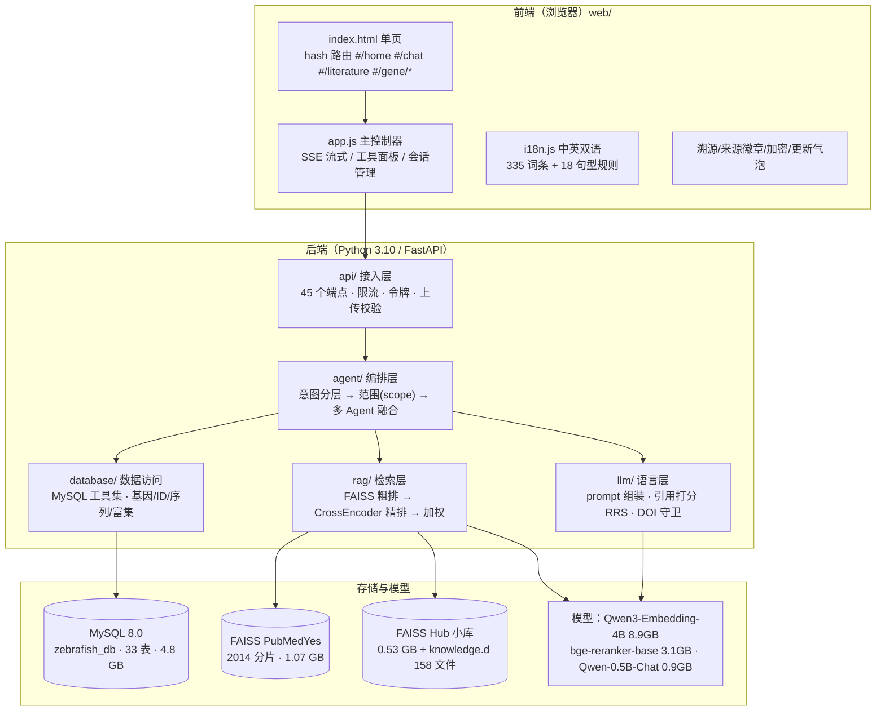
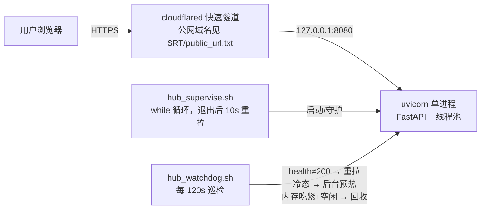
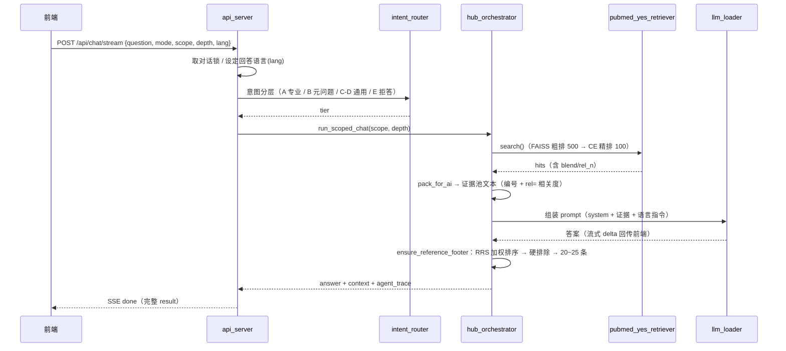

# Zebrafish Hub 系统架构总览（前后端 + 数据库）

> 本文是**架构级**文档：分层、模块职责、数据流、库表结构、部署与运行时。
> 所有数字均为 **2026-10-11 从线上环境实测**（数据库查询 / 目录扫描 / 代码解析），不是估计值。
> 相关专项文档见文末「文档地图」。

---

## 1. 系统概览

Zebrafish Hub 是一个**面向斑马鱼功能基因组学的问答与数据中枢**：把「人工策展的本地基因库」+「3.25 万篇文献的向量检索库」+「9 个生物信息工具面板（基因/BLAST/富集/KEGG/ID 解析/序列/注释/检索调试/入库）」统一到一个 Hub 编排器下，
输出**带行内引用、可溯源**的答案。



**一句话分层**：前端只管「展示 + 流式接收」；后端 `api → agent(编排) → {llm, rag, database}` 四层单向依赖；存储分三块（关系库 / 向量库 / 模型权重）。

---

## 2. 前端架构（`web/`）

### 2.1 技术形态

- **零框架**：原生 ES + 单页 `index.html`（522 行），`hash` 路由，无构建步骤（改完直接部署）。
- **视图**（`data-view`）：`home`（首页）、`chat`（问答 + 侧栏 + 详情栏）、`feature`（工具/文献等整合页）。
- **路由**：`#/home`、`#/chat`、`#/literature`、`#/gene/<symbol>`、`#/id/<ID>`、`#/sequence/<symbol>`。
- **缓存策略**：所有静态资源 URL 带 `?v=YYYYMMDDx`；`web/` 下任何文件改动**必须 bump 版本号**，否则浏览器复用旧缓存（曾因此 debug 过 i18n 字典不生效）。

### 2.2 模块清单（实测行数）

| 文件 | 行数 | 职责 |
| --- | --- | --- |
| `web/js/app.js` | 5111 | 主控制器：路由、聊天流式渲染、工具面板（11 个）、会话与草稿、错误处理 |
| `web/js/i18n.js` | 760 | 中英双语：`ZH2EN` 400+ 词条 + 句型规则 + `MutationObserver` 覆盖动态文案 |
| `web/js/live-update.js` | 391 | 状态栏/后台任务轮询与可视化 |
| `web/js/home-feed.js` | 412 | 首页左卡：论文条目（`daily_list` 2～3 条）/ 更新记录 / Cite Us（自带中英两套文案） |
| `web/js/agent-home.js` | 135 | 首页主视觉与右卡：标题副标题、语言胶囊、品牌卡与 Quick Start / 登录 / 注册（复用原弹窗） |
| `web/js/genes.js` | 283 | **Genes 页**：检索/浏览 + 基因卡（含别名、同源与复制体） |
| `web/js/crispr.js` | 342 | **sgRNA / 引物设计页**：本地引擎结果表 + T7 模板复制 + CHOPCHOP/CRISPRscan 跳转 |
| `web/js/provenance.js` | 147 | 「引用与溯源」面板（证据池条目、外链） |
| `web/js/nav-menu.js` | 140 | 顶栏下拉导航（Genomes / Genes / Expression / Phenotype / Tools / Agent） |
| `web/js/source-badges.js` | 115 | 来源徽章（PubMed/本地库/全文金标…） |
| `web/js/chat-polish.js` | 112 | 问答页增强：快速示例双语 + 行内引用样式开关 |
| `web/js/payload-crypto.js` | 65 | 请求体加密（与后端 `api/payload_crypto.py` 配对） |
| `web/js/ui-feedback.js` | 54 | 轻量 toast/按钮态 |
| `web/js/composer-fit.js` | 43 | 输入框自适应高度 |

样式（9 个）：`style.css`（基础/全站）、`refine.css`（设计令牌与主题）、`simplify.css`（结构收敛）、`home-2026.css`、`enrich-view.css`、`chat-2026.css`、`home-agent.css`（主界面改版，对齐设计稿 `docs/design/6_home_design.png`）、`tools-agent.css`（Genes / sgRNA 工具页）、**`theme-agent.css`（全站统一：浅蓝水下背景 + 白卡片语言，加载在最后，并关掉旧的动效/照片背景）**。

> **品牌图**：`web/assets/brand/zf-agent-emblem.png`（圆形徽标，顶栏 logo / 聊天空态 / 功能页空态 / favicon）与 `zf-agent-mark.png`（含字全图，首页右卡）均由 `scripts/make_brand_assets.py` 从根目录 `12.png` 生成；设计参考图归档在 `docs/design/`。

### 2.3 关键前端机制

| 机制 | 说明 |
| --- | --- |
| **流式回答** | `POST /api/chat/stream`（SSE）：`delta` 增量渲染 → `done` 收尾（重排引用、补操作按钮）。心跳与「已等待 Ns」提示避免"像卡死" |
| **语言一致性** | 界面语言 `hub_lang` 存 `localStorage`；切换时 `documentElement.lang` 改写 → 触发 `hub-lang-change`（各模块自行换文案）。**请求体带 `lang`**，后端据此决定**回答语言**（英文界面必须全英文） |
| **i18n 边界** | 刻意**不翻译**：`#chatLog`、`.md-body`（答案正文）、`pre/code`、工具结果 —— 保护用户数据与答案；但**状态/队列/错误提示**标 `data-i18n-live="1"` 显式放行 |
| **游客/登录** | 游客会话仅存本机 `localStorage`；登录后走 `/api/hub/conversations` 云端同步（按账号隔离） |
| **首页（6.png）** | 顶部白色胶囊导航（首项为蓝色品牌按钮）+ 居中大标题/副标题 + 两栏：左栏「Daily Zebrafish Research」（语言胶囊、绿色更新状态、**日期下拉框**、2～3 条论文、检索框、文献更新、Cite Us），右栏品牌卡（徽标 + Quick Start / 登录 / 注册，复用原有欢迎弹窗，不改认证流程） |
| **全站背景（6.png）** | `theme-agent.css` + `assets/brand/agent-bg.svg`：浅蓝渐变 + 淡水下剪影（鱼 / DNA / 水泡 / 海草）平铺，**所有页面共用**；问答页原来的真实照片轮播（5.5 s 一张）与功能页波浪/照片舞台**已停用**（`initChatReefFlow()` 内 early return，代码保留可一键恢复） |
| **日期下拉框** | 首页日期框改为 `select`（最近 14 天）；后端 `GET /api/hub/research-feed?day=YYYY-MM-DD` 在同一候选池内按日期做确定性选取（md5(day) % pool），界面明写“同候选池内按日期确定性选取” |
| **语言胶囊** | 卡内 `English / 中文` 与顶栏 `中 / EN` 调同一套 `HubI18n.setLang()`；`data-no-i18n` 区块的文案由 `agent-home.js` / `home-feed.js` 自己按语言渲染，避免两套机制互踩 |
| **请求加密** | `payload-crypto.js` ↔ `api/payload_crypto.py`：请求体可选加密，防隧道明文 |

---

## 3. 后端架构

### 3.1 进程与运行时



- **单进程模型**：`uvicorn api.api_server:app`，内存热重（模型常驻）；对话走**全局单并发锁** `_chat_run_lock`（抢不到 → `503 上一问仍在处理中`，不是限流）。
- **预热钩子**：`POST /api/warmup`（**仅本机可调**）后台加载 RAG/重模型，不占对话锁、不产生生成开销 —— 解决"重启后第一问要等 4 分钟"。
- **依赖版本（实测）**：Python 3.10.20、torch 2.3.1+cu121、sentence-transformers 4.1.0、fastapi 0.141.1、PyMySQL 2.2.8；MySQL 8.0.36（客户端在 `$RT/mysql80/bin`，不在 PATH）。

### 3.2 分层与职责

| 层 | 目录（行数） | 职责 |
| --- | --- | --- |
| **接入层** | `api/`（api_server 2237、web_security 445、hub_accounts 294、gallery_feed 785、file_security 205、payload_crypto 108） | 端点、限流、访问令牌（`logs/web_access_token.txt`）、上传校验、账号会话、图库/动态流 |
| **编排层** | `agent/`（hub_orchestrator 1689、answer_enrichment 1018、agent_scheduler 767、hub_maintenance 673、workflow_engine 327、intent_router 248） | 意图分层 → 回答范围 → 多 Agent 并行/融合 → 维护任务 |
| **语言层** | `llm/`（zebrafish_prompt 1357、ref_relevance 519、gene_alias_evidence 302、llm_loader 519、llm_api 171、doi_guard 139） | system/user prompt 组装、双通道 LLM（本地 0.5B / 远程 API）、引用排序（RRS）、**别名与复制体证据块**、DOI 守卫 |
| **检索层** | `rag/`（29 个模块） | PubMedYes 分片检索、Hub 小库 RAG、CrossEncoder 重排、期刊影响因子、刊名补全、全文抓取与对齐 |
| **数据访问层** | `database/`（22 个模块） | MySQL 客户端、基因/ID/序列/表达/富集工具集、**CRISPR/引物设计引擎（`crispr_toolkit` 657）**、文献入库、账号与工作流存储 |
| **基础设施** | `core/`（config 232、common_utils 785、bootstrap 124、log_io 109、entry 34、path_setup 14、transformers_compat 27） | 配置与环境、路径引导、日志、通用 LLM/DB 流水线、transformers 兼容补丁 |

### 3.3 API 端点总览（48 个，实测解析）

| 分组 | 端点 |
| --- | --- |
| 健康与运维 | `GET /api/health`、`POST /api/warmup`、`POST /api/embed/warmup`、`GET /api/usage` |
| 对话 | `POST /api/chat`、`POST /api/chat/stream`（SSE） |
| 账号 | `POST /api/hub/register|login|logout`、`GET /api/hub/me`、`GET/POST /api/hub/conversations`、`GET /api/auth/config`、`GET /api/auth/whoami` |
| 基因与数据 | `GET /api/gene/{name}`（含 `aliases` 别名块与 `paralogs` 复制体块）、`GET /api/genes/search`（`browse=1` 浏览）、`GET /api/genes/orthologs`（复制体/共直系同源，支持斑马鱼基因名或人/鼠符号）、`POST /api/retrieval/debug` |
| 工具 | `POST /api/tools/blast`、**`POST /api/tools/crispr/design`**、**`POST /api/tools/primer/design`**、`GET /api/tools/enrichment|kegg|sequence|annotate|stats`、`POST/GET /api/tools/id-convert*`、`GET /api/tools/gene-resolve` |
| 库与维护 | `GET /api/hub/stats`、`GET /api/hub/maintenance/status`、`POST /api/hub/maintenance/run`、`GET /api/hub/visit-stats`、`GET /api/hub/research-feed`、`GET /api/hub/bg-pools`、`GET /api/hub/gallery`、`GET /api/hub/stream-version`、`GET /api/hub/events` |
| 知识库 | `GET /api/knowledge/sources`、`POST /api/knowledge/upload` |
| 租户/工作流 | `GET /api/tenants/current`、`GET /api/workflows/presets|runs|runs/{id}`、`POST /api/workflows/run` |
| 静态 | `GET /`（单页入口 + StaticFiles 挂载 `/static`） |

### 3.4 编排层：从一句话到一条答案



**范围（scope）**：`hub`（默认全链路）、`literature`（仅文献）、`gene_db`（仅基因库）、`id_map`（跨库 ID）、`retrieval_debug`。
**深度（depth）**：`partial`（快）/ `full`（整体，含基因卡片与自动工具）。
**多 Agent**：`agent_scheduler` 按任务类型并行调度（文献 / 基因 / DB / 序列…），`_merge_partials` 融合，`agent_trace` 回传供详情栏展示。

### 3.5 语言层：引用打分与引用表（当前规则）

**条目分公式**（`llm/ref_relevance.py::score_paper`）：

```
RRS = 0.30·entity + 0.15·rank + 0.10·rel + 0.20·cite + 0.15·recency + 0.10·meta
      + K·ln(1+IF)        # 对数影响因子加成，K=REF_RRS_IF_K(默认 0.01)
```

| 维度 | 含义 | 数据来源 |
| --- | --- | --- |
| `entity` | 问句点名的基因/ID 是否出现在题名（独立词匹配） | 问句 + 题名 |
| `rank` | 上游综合排序名次（含年份/IF 的 blend） | 检索层 |
| `rel` | **连续语义相关度** `rel_n`（证据池 `rel=`） | 检索层（新增落盘） |
| `cite` | 模型正文是否引用 | 答案正文 |
| `recency` | 年份新旧 | 文献年份 |
| `meta` | DOI/PMID/真实刊名完整度 | 元数据 |
| `+K·ln(1+IF)` | 影响因子取对数作**加成**（不是归一化权重） | `journal_metric` 表 |

**三条硬规则**：① 点名实体但题名不含且正文未引用 → 直接淘汰（永不补回）；② 无实体问句时 `entity` 权重按比例分摊；③ 不足 2 条不出表并清掉正文悬空 `[n]`。
**数量**：加权序取前 `REF_FOOTER_MAX`（机制题 25 / 事实题 12）→ 补到 `REF_FOOTER_MIN`（20）→ **最终 20~25 条**；拿不到 `rel=` 分数时该维权重自动退回 `rank`（旧路径尺度不变）。
**兜底**：`api_server._ensure_footer_any_path()` 保证任何路径都不出现「正文有 `[n]` 而文末无表」或「`rel=` 泄漏进答案」。

### 3.6 检索层：两套索引 + 一次精排

| 组件 | 实现 | 说明 |
| --- | --- | --- |
| **PubMedYes（主）** | `pubmed_yes_retriever.py` + `data/faiss_indexes/faiss_pubmed_yes_qwen3_4b_v1` | 2014 个分片目录（每片 ~5000 篇 5000→`PUBMED_YES_SHARD_PAPERS`）+ `manifest.json`；4B 嵌入（CPU）+ bge-reranker CE；粗排 `candidates=500` → 精排 `100` → `blend = w_rel·rel_n + w_year·year* + w_if·if_score` |
| **Hub 小库（备用）** | `rag_builder.py` + `data/faiss_index`（0.53 GB）+ `rag/knowledge.d`（158 文件） | 主库不可用时**明确不**用它编答案（避免离题），仅用于知识库问答等场景 |
| **gte 旁路索引** | `faiss_pubmed_yes_gte_mbase_v1`（0.39 GB） | 新索引实验，默认不指向 |
| **期刊权重** | `journal_if.py`（IF/tier/blend 权重）、`journal_enrich.py`（刊名补全 + 6h 负缓存） | `if_score = log1p(IF)/log1p(40)` |
| **共享嵌入缓存** | `get_shared_embedding()` | 进程内按 (model, dim, device) 复用，避免双载 OOM；加载命中 `meta tensor` 竞态时**自动重试 3 次** |

### 3.7 文献数据链路（离线/半离线）

`literature_collector` / `multi_literature_collector` / `wos_collector`（WoS RIS）/ `europepmc_collector`（Europe PMC）
→ 去重与判别（`pubmed_live_refs`、判别 prompt 见 `docs/pubmed_judgement_prompt.md`）
→ 全文获取（`online_fulltext_fetch`、`fulltext_cascade`、`pdf_fulltext_align` 1538 行做 PDF↔正文对齐）
→ 分块（`pubmed_yes_chunking`、`_from_transcript_chunking`）→ 向量化 → 分片写入 FAISS + `manifest.json`
→ 登记进 `literature_paper` / `literature_fulltext_gold`；增量更新由 `hub_maintenance.refresh_recent_papers()` 驱动（首页「更新文献」按钮 → `POST /api/hub/maintenance/run`）。

### 3.8 三个新增能力（本轮交付）

**① 别名/历史名检索**（`llm/gene_alias_evidence.py` + `database/gene_toolkit.py:alias_block`）

- **触发**：仅在「基因身份 / 别名 / 历史名」类问句（`is_alias_question`，中英触发词表）触发，普通问题不额外增加耗时；
- **别名来源**：`gene_name_bundle`（ZFIN / NCBI / UniProt / Ensembl / 描述名五类 JSON）+ `gene_alias` 补充去重，带来源标签；
- **文献证据**：本地库 `literature_paper` 的 **题名级**匹配（`title_en` / `title_zh`，一次全表扫描 ≈1～2 s，3 万余篇）；该表**没有摘要列**，所以口径就是题名级，文档与提示词都不宣称是全文检索；
- **向量补检**：题名命中最多的历史别名（最多 2 个）再交给 PubMedYes 检索，命中的文献**合并进同一批 hits**，因此进入编号池、正文可正常引用（`hub_orchestrator._run_literature`）；
- **强制格式**：提示词要求回答**第一句**列出该基因全部历史别名并标注来源，随后说明哪些别名在文献中真正出现过。

**② 复制体 / 共直系同源（硬骨鱼 WGD）**（`database/gene_toolkit.py:paralog_block` / `co_orthologs_by_human`）

- **推导**（纯本地、可复现）：一个基因在 `homology_gene` 里的人类/小鼠同源基因名，若同时对应 ≥2 个斑马鱼基因，这些基因即该人/鼠基因的**共直系同源**（通常即保留的复制体）；
- **正向**：斑马鱼基因 → 人/鼠同源 + 同组复制体（`/api/genes/orthologs?name=sox9b` → `Human SOX9 → sox9b / sox9a`）；
- **反向**：人/鼠符号 → 斑马鱼全部复制体（`name=MITF` → `mitfa / mitfb`）；
- **展示**：问句含同源/复制/分工意图时，提示词要求加小节「基因组复制与分工」，用小表格列出 `斑马鱼复制体 | 人/鼠同源基因 | 相似度 | 证据文献编号`；**功能分工只依据检索到的文献**，证据不足就写证据不足；
- 基因卡（聊天详情栏与 Genes 页）同步展示别名 chips 与复制体列表。

**③ sgRNA / 引物设计本地引擎**（`database/crispr_toolkit.py`）

- 双链 PAM 枚举（SpCas9 NGG/NAG、Cas12a TTTV、SaCas9 NNGRRT）→ 透明规则打分（GC / polyT / 位置 / 同聚物 / 发夹 / 种子区 GC）→ 本地 BLAST+ **一次批量**脱靶筛查（近全长、≤3 错配，返回命中基因名如 sox8b/sox9a）→ T7/SP6 体外模板；
- **脱靶范围可选**（界面下拉框）：转录组库 `$RT/blast/cdna_db`（53 MB，实测 6.2 s、带基因名）或**全基因组库** `$RT/blast/genome_db`（345 MB 库 / 1.47 GB FASTA、25 条染色体，实测 **6.8 s**、只扫前 12 个候选、命中给 `NC_xxx:start-end (mmN)`）；
- 基因组库由 `$RT/blast/dl_genome.sh`（8 路分段并行 + 断点续传）与 `build_genome_db.sh`（下载完自动 makeblastdb）搭建；状态查询：`crispr_toolkit.genome_db_status()`；
- 引物：18～25 nt、**SantaLucia 1998 最近邻 Tm**、产物长度/ΔTm/二聚体/发夹规则打分，可选 T7 尾与引物特异性筛查；
- 输入支持基因名（自动取 GRCz12tu cDNA）或粘贴序列；页面对标 CHOPCHOP / CRISPRscan / Primer3web 提供一键跳转（先复制序列到剪贴板）；
- 详细口径与已知边界见 `docs/sgRNA与引物设计.md`。

---

## 4. 数据库架构

### 4.1 总览（实测）

| 项 | 值 |
| --- | --- |
| 引擎/字符集 | MySQL 8.0.36 / utf8mb4 |
| 库名 | `zebrafish_db` |
| 表数 | **33**（含 1 个兼容视图 `gene`） |
| 总大小 | **4788 MB**（其中 `literature_fulltext_gold` 2759 MB + `literature_pubmed` 1696 MB ≈ 93%） |
| 口径说明 | 行数为 **`COUNT(*)` 精确值**；容量来自 `information_schema`（InnoDB 估算，仅供量级参考） |

### 4.2 表清单与规模（按行数降序，实测）

| 表 | 行数 | 大小 | 用途 |
| --- | ---: | ---: | --- |
| `gene_expression` | 319,344 | 78.1 MB | 基因×组织×时期表达 |
| `gene_reference` | 161,298 | 11.0 MB | 参考序列/记录 |
| `gene_alias` | 145,439 | 29.9 MB | 别名/曾用名 |
| `name_hit_unique` | 133,677 | 25.1 MB | 名称解析唯一命中 |
| `gene_go` | 110,966 | 12.0 MB | GO 注释（`go_category` BP/CC/MF） |
| `gene_xref` | 80,212 | 16.6 MB | 跨库 ID 映射 |
| `literature_pubmed` | 67,746 | 1696.4 MB | PubMed 原始记录（含摘要/全文正文） |
| `gene_kegg` | 36,794 | 10.1 MB | 通路（KEGG/Reactome/WikiPathways） |
| `literature_paper` | 32,549 | 24.5 MB | 文献主表（题名/PMID/DOI/刊名/金标状态）｜`gold_status=ready` 32,539｜`has_fulltext=1` 32,549 |
| `literature_vector_chunk` | 32,549 | 6.5 MB | 分块→向量登记（与主表 1:1） |
| `literature_fulltext_gold` | 32,549 | 2759.4 MB | 金标全文（`body_text` 大字段，占库重 58%） |
| `homology_gene` | 31,630 | 3.0 MB | 同源基因 |
| `gene_basic` | 26,321 | 10.0 MB | 基因主表 |
| `gene_name_bundle` | 26,321 | 5.5 MB | 名称打包（检索用，与主表 1:1） |
| `gene_assembly_xref` | 22,628 | 7.6 MB | GRCz11 ↔ GRCz12tu 组装映射 |
| `ensembl_id_version` | 14,038 | 6.3 MB | Ensembl ID 版本 |
| `literature_vector_shard` | 2,114 | 1.8 MB | 分片→覆盖范围登记 |
| `literature_wos` | 1,408 | 82.3 MB | WoS 记录 |
| `journal_metric` | 52 | 0.1 MB | 期刊 IF / tier（`if_value`、`if_norm`、`tier_boost`） |
| 其余小表 | 见 §3.3 端点与 §7 目录 | — | `name_resolve_collision` 6,923；账号/会话/工作流/同步日志等均为个位数〜千行 |

### 4.3 核心表结构（实测列）

```
gene_basic               gene_id*(PK) gene_name gene_symbol ensembl_id zfin_id chromosome
                         gene_function interpro_domain uniprot_id expression_summary
gene_go                  id*(PK) gene_id go_term go_category
gene_kegg                id*(PK) gene_id pathway_id pathway_name category source
gene_expression          id*(PK) gene_id tissue expression_stage expression_level data_source
gene_xref                id*(PK) gene_id db_name db_id db_label source
literature_paper         doc_id*(PK) zfqa_id pmid entry_no doi pmcid source title_en title_zh
                         year journal judgement has_fulltext gold_status created_at updated_at
literature_fulltext_gold id*(PK) doc_id gold_version source_tier body_path body_text
                         sections_json content_sha256 campaign_id created_at updated_at
journal_metric           id*(PK) journal_key display_name issn_print issn_electronic if_value
                         if_year if_source tier tier_boost if_norm updated_at
```

**设计要点**：
- 基因侧以 `gene_id` 为枢纽，注释（GO/通路/表达/xref/同源）**分表**存放，避免宽表稀疏；
- 文献侧 `doc_id` 为枢纽，`literature_paper` 只存元数据（24.5 MB），**正文进 `literature_pubmed` / `literature_fulltext_gold`**（大字段单独放，保证主表查询快）；
- 名称解析链路（`gene_name_bundle` → `name_hit_unique` → `name_resolve_collision`）用于"跨库标准名 + 歧义三态（unique/ambiguous/not_found）"；
- 组装版本双轨：`gene_assembly_xref` 记录 GRCz11 → GRCz12tu 映射，回答里会显式标注版本，避免混用。

### 4.4 向量库与模型（存储层）

| 资产 | 路径 | 规模（实测） | 说明 |
| --- | --- | --- | --- |
| PubMedYes 主索引 | `data/faiss_indexes/faiss_pubmed_yes_qwen3_4b_v1/` | 2014 分片目录 + 3 个 manifest，1.07 GB | 每片 ~5000 篇；检索按 `manifest.json` 增量装载 |
| gte 旁路索引 | `data/faiss_indexes/faiss_pubmed_yes_gte_mbase_v1/` | 272 文件 0.39 GB | 实验索引，默认不启用 |
| Hub 小库 | `data/faiss_index/` | 3 文件 0.53 GB | 备用/知识库问答 |
| 知识库原文 | `rag/knowledge.d/` | 158 文件 0.06 GB | 上传/入库的知识条目 |
| 嵌入模型 | `$RT/models/Qwen3-Embedding-4B` | 32 文件 **8.92 GB** | 2048 维（`EMBEDDING_DIM`），CPU 推理 |
| 重排模型 | `models/bge-reranker-base` | 3.13 GB | CrossEncoder 精排 |
| 轻量 LLM | `models/Qwen-0.5B-Chat` | 0.93 GB | 本地兜底/分类 |
| 其它 | `models/gte-multilingual-base`（4.02 GB + 备份） | | 旁路实验 |

---

## 5. 部署与运行时

### 5.1 进程拓扑与保活

| 组件 | 脚本/命令 | 行为 |
| --- | --- | --- |
| 服务 | `python -m uvicorn api.api_server:app --host 127.0.0.1 --port 8080` | 单进程；`kill -9` 才能立即退出（SIGTERM 会等 SSE 长连接） |
| 守护 | `deploy/hub_supervise.sh` | `while` 循环，uvicorn 退出后 **10s 重拉**，pid 写 `$RT/hub.pid` |
| 巡检 | `deploy/hub_watchdog.sh`（**每 120s**） | ① health≠200 → 杀掉残留并重拉；② 冷态（RSS<8GB 且该 pid 未预热）→ `POST /api/warmup`；③ cgroup 匿名内存 ≥95% **且** 空闲 ≥15min **且** 存活 >10min → 回收 |
| 隧道 | `cloudflared` 快速隧道 | 公网地址每次重启会变，以 `$RT/public_url.txt` 为准 |
| 兜底 | `deploy/hub_guard.sh` | 依赖 root cron（**2026-10-09 起失效**，需管理员恢复）|

> 注意：`pkill -f hub_watchdog.sh` 不能与启动命令写在同一行（会把自己匹配掉）；用 `deploy/start_watchdog.sh`。

### 5.2 资源约束与已知瓶颈

| 项 | 实测值 | 处置 |
| --- | --- | --- |
| cgroup 上限 | `user-1005.slice` **35 GB**（`memory.max` 在祖先，自身 scope 是 `max`） | 判据只看 `memory.stat` 的 **anon**（页缓存会假报 99%） |
| 冷态 / 热态 RSS | 2.5 GB → **32 GB** | 冷态由巡检后台预热消化，不让用户等 |
| GPU | 机器 2×V100 常被占满 | 全链路 `EMBEDDING_DEVICE=cpu`、`PUBMED_EMBEDDING_DEVICE=cpu` |
| 冷启动首问 | 238s → 预热后 ~50s | `/api/warmup` + 巡检冷态检测 |

### 5.3 关键环境变量（`.env`）

| 变量 | 作用 |
| --- | --- |
| `MYSQL_HOST/USER/PASSWORD/DATABASE/PORT` | 数据库连接（**不是** `DB_*`） |
| `EMBEDDING_MODEL_PATH` / `EMBEDDING_DIM=2048` / `EMBEDDING_DEVICE=cpu` | 嵌入模型与维度 |
| `PUBMED_EMBEDDING_DEVICE=cpu` | PubMedYes 嵌入设备 |
| `HUB_WARMUP_RAG` / `HUB_PUBMED_WARMUP` | 启动预热开关（默认 0=按需加载，省内存） |
| `FAISS_PUBMED_YES_DIR` / `FAISS_INDEX_DIR` / `PUBMED_YES_SHARD_PAPERS=5000` | 索引路径与分片粒度 |
| `REF_FOOTER_MIN=20` / `REF_FOOTER_MAX=25` | 参考文献条数下限/上限 |
| `REF_RRS_IF_K=0.01` / `REF_RRS_HARD_ENTITY=1` / `REF_RRS_DEBUG=0` | 引用打分（对数影响因子系数 / 实体硬排除 / 逐条打印） |
| `CHAT_LOCK_WAIT_SEC=45` | 对话锁等待（超时返回 503） |
| `JOURNAL_ENRICH_TIMEOUT_SEC=6` | 刊名补全 HTTP 超时（配合 6h 负缓存） |
| `HUB_WATCH_INTERVAL_SEC` / `HUB_MEM_PCT` / `HUB_IDLE_SEC` | 巡检节奏与回收判据 |
| `WEB_ALLOW_UPLOAD` / `WEB_ACCESS_TOKEN` 等 | 上传开关与访问令牌（见 `docs/公网访问指南.md`） |

---

## 6. 安全与质量

| 方面 | 措施 |
| --- | --- |
| 接入安全 | `web_security.py`：请求守卫中间件、按 IP 限流、可选访问令牌（`logs/web_access_token.txt`）、响应头加固（CSP/XFO/nosniff/referrer-policy/permissions-policy） |
| 上传安全 | `file_security.py`：扩展名白名单、双扩展名伪装检测、PDF 脚本对象检测、UTF-8/空字节校验 |
| 传输 | 可选请求体加密（`payload-crypto.js` ↔ `payload_crypto.py`） |
| 引用可信 | `doi_guard.py`：一 DOI 多论文等不可信 DOI 不入外链，改走 PMID；参考文献元数据可复核 |
| 自检 | `scripts/selfcheck.py --git` **10/10**（依赖版本一致性 / METHODS 数值 / 数据包 / 前端 JS 语法 / Python 编译 / RRS 测试 / 富集标注 / 图表校验 / 敏感信息扫描 / 提交计划） |
| 回归测试 | `scripts/test_ref_relevance.py`（17 项，含 RRS 六维、对数影响因子、相关度维、DOI 守卫）、`test_phase_a_references.py`（8 项）、`test_mechanism_citation_routing.py`、`test_enrichment_labels.py`、`check_database_health.py`（只读 40 项） |
| 数据库体检 | `scripts/check_database_health.py`：A/B/C/D 四段 **41 项**（结构 / 规模 / 一致性 / 功能点），实测 **PASS 37 · WARN 4 · FAIL 0**；WARN 为可接受项（`ONLY_FULL_GROUP_BY`、GO 仅 ID 2129 行、DOI 重复 2423 个、刊名缺失 311 行）。本次体检曾抓到脚本自身的 bug（`literature_fulltext_gold` **没有 `pmid` 列** → 1054 报错），已改为按实际列探活 |

---

## 7. 目录职责速查

| 目录 | 一句话职责 |
| --- | --- |
| `web/` | 单页前端（HTML/CSS/JS，无构建） |
| `api/` | FastAPI 接入层与安全中间件 |
| `agent/` | 意图路由、多 Agent 编排、回答增强、维护任务 |
| `llm/` | Prompt 组装、模型加载、引用打分、DOI 守卫 |
| `rag/` | 文献检索、向量化、全文获取、期刊权重、重排 |
| `database/` | MySQL 访问与基因/ID/序列/富集工具集 |
| `core/` | 配置、路径引导、日志、通用流水线、兼容补丁 |
| `scripts/` | 自检、体检、修复、批量重建、测试 |
| `deploy/` | 守护/巡检/启动脚本 |
| `cli/` | 命令行问答入口（`.venv/Scripts/python -m cli.main`） |
| `sql/` `database/init_database.py` | 建表与初始化 |
| `data/` | 索引、参考序列、缓存、策展 CSV |
| `docs/` | 架构与专项文档（见下） |
| `Figure/` `results_md/` | 论文图表产物与统计结果 |
| `解析文件/` `项目阶段/` | 中间产物与分阶段归档（非运行时依赖） |

---

## 8. 已知限制与待办

1. **root cron 失效**：`hub_guard.sh` 自 2026-10-09 12:10 起不再执行，`deng` 无 crontab 权限 → 目前由 `hub_watchdog.sh`（每 120s）兜底，建议管理员恢复 cron 或授权。
2. **单并发对话**：全局锁导致并发提问排队（`503 上一问仍在处理中`）；如需并发需拆进程 + 共享模型服务。
3. **GPU 不可用**：全链路 CPU 推理，冷启动慢（已用预热缓解）；若 V100 可用可显著提速。
4. **文献检索曾有竞态**：嵌入模型加载偶发 `meta tensor` 错误 → 已加 3 次重试；若再现，看 `hub.log` 关键词。
5. **i18n 覆盖度**：聊天主流程已全覆盖（含动态文案）；工具页/上传/令牌等仍有 186 条中文串未登记，按需补 `web/js/i18n.js` 词条或 `RULES` 句型。
6. **删除/清理**：`literature_fulltext_gold` 占 2.7 GB，若要瘦身需评估金标可重建性。

---

## 9. 文档地图

| 文档 | 内容 |
| --- | --- |
| `docs/系统架构总览.md`（本文） | 前后端 + 数据库整体架构 |
| `docs/引用相关性打分RRS.md` | 引用打分（RRS）六维 + 对数影响因子 + 相关度维 + 调参 |
| `docs/sgRNA与引物设计.md` | 本地 sgRNA / 引物引擎的 PAM 表、打分口径、脱靶筛查与已知边界 |
| `docs/design/6_home_design.png`、`docs/design/12_brand_mark.png` | 主界面设计稿与品牌图原始文件（实现对照用） |
| `docs/界面升级方案.md` | 前端视觉与交互升级方案、验收标准 |
| `docs/前端改版与Methods方案.md` | 前端改版记录与论文 Methods 对应关系 |
| `docs/paper/DELIVERY_STATUS.md` | 交付状态、线上事故与修复、验收数据 |
| `docs/服务器部署与发刊指南.md` | 部署、发布与运维步骤 |
| `docs/公网访问指南.md` | 隧道/域名/令牌与访问控制 |
| `docs/文献向量化_操作步骤.md` / `文献向量化_技术推进指导手册.md` | 向量化流程与推进手册 |
| `docs/pubmed_judgement_prompt*.md` | PubMed「是否相关」判别提示词 |
| `docs/fulltext_section_prompt.md` | 全文分节抽取提示词 |

---

*生成时间：2026-10-11 · 数据来源：线上实测（MySQL 查询 / 目录扫描 / 代码解析），非估计值。*
