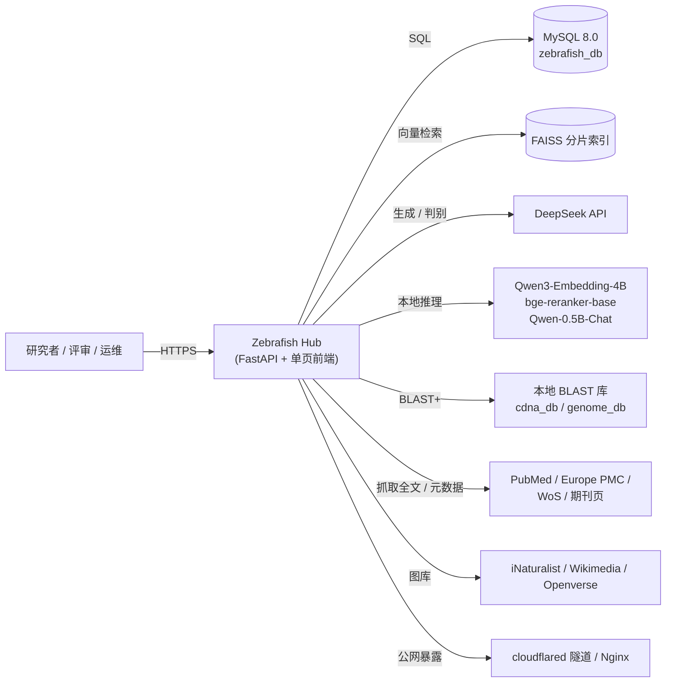
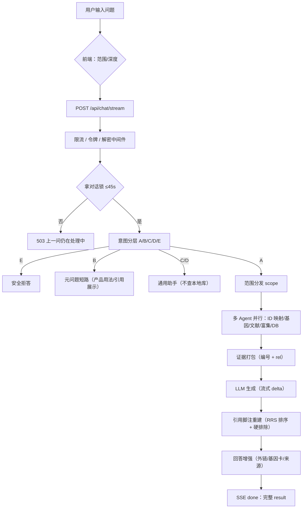

# 软件需求分析说明书
## 斑马鱼基因问答体（Zebrafish Hub）

| 项 | 内容 |
| --- | --- |
| 文档编号 | ZH-SRS-001 |
| 版本 | v1.0 |
| 状态 | 基线（根据仓库当前实现反向梳理 + 需求规范化） |
| 编制日期 | 2026-10-17 |
| 适用系统 | Zebrafish Hub / 斑马鱼基因问答体（`api` `agent` `llm` `rag` `database` `web`） |
| 需求来源 | 代码实现（实测）、`docs/系统架构总览.md`、`docs/METHODS/METHODS.md`、`docs/paper/DELIVERY_STATUS.md` |

> 说明：本项目为"先实现、后补文档"的科研工程型项目。本文不是凭空设想的需求清单，而是把**已在代码中成立的行为**抽象为可验收的需求条目，并标注实现证据与缺口。凡与实现不一致处，以代码为准，并在第 14 章列出待确认项。

---

## 1. 文档说明

### 1.1 目的

本文定义 Zebrafish Hub 的功能需求、非功能需求、数据需求、接口需求与验收标准，作为：

1. 概要设计（`02_概要设计说明书.md`）与详细设计（`03_详细设计说明书.md`）的输入基线；
2. 后续迭代（新工具、并发改造、GPU 启用）的范围控制依据；
3. 论文 Methods 与工程实现之间的可核对桥梁（每个需求可追到模块与端点）。

### 1.2 范围

**在范围内**

- 面向斑马鱼（*Danio rerio*）功能基因组学的**文献问答**（RAG + 引用）；
- **结构化基因库**查询与浏览（基因、别名、同源/复制体、表达、GO/KEGG、表型、基因组）；
- **生物信息工具集**（BLAST、富集、通路、ID 映射、序列提取、注释、sgRNA/引物设计、检索调试、文档入库）；
- **Web 前端**（单页、双语、SSE 流式、详情栏、会话管理）；
- **账号/会话/多租户**与**运维自愈**（预热、巡检、守护）；
- **文献数据工程链路**（采集 → 判别 → 全文 → 清洗 → 切块 → 向量化 → 增量更新）。

**不在范围内**

- 湿实验流程管理与实验数据采集；
- 通用生物信息云平台（非斑马鱼物种的全量支持）；
- 模型训练/微调（本系统将 LLM 作为冻结推理引擎，见 METHODS 2.4）；
- 商业化计费、发票、开放 API 配额售卖。

### 1.3 读者与用法

| 读者 | 关注章节 |
| --- | --- |
| 产品/课题负责人 | 2、5、11、12 |
| 后端开发 | 6、7、9、13 |
| 前端开发 | 6.6、7.7、9.2 |
| 运维/部署 | 7.4–7.6、9.3、10 |
| 论文写作/审稿支撑 | 2.4、6.3、11、13 |
| 测试 | 6（验收标准列）、11、13 |

### 1.4 术语与缩写

| 术语 | 含义 |
| --- | --- |
| Hub | 本系统的对外名称，指"问答 + 数据 + 工具"的统一入口 |
| RAG | Retrieval-Augmented Generation，检索增强生成 |
| FAISS | Facebook AI Similarity Search，向量近邻检索库 |
| Chunk | 文献切块后的最小检索单元（本系统 ≈360 字符/块） |
| Shard | FAISS 索引分片（每片约 5000 篇） |
| CE | Cross-Encoder，交叉编码器重排模型（bge-reranker-base） |
| RRS | Reference Relevance Score，文末参考文献六维加权打分 |
| Tier | 意图分层：A 斑马鱼科学 / B 产品元问题 / C 邻域生物 / D 通用 / E 有害 |
| Scope | 回答范围：`hub` / `literature` / `gene_db` / `id_map` / `retrieval_debug` |
| Depth | 使用策略：`partial`（部分，快）/ `full`（整体，全） |
| ORA | Over-Representation Analysis，过表征分析（Fisher 精确检验 + BH 校正） |
| GRCz11 / GRCz12tu | 斑马鱼参考基因组两个版本（本地注释锚定 GRCz11，标准名/BLAST 用 GRCz12tu） |
| PAM | Protospacer Adjacent Motif，CRISPR 靶向邻接基序 |
| SSE | Server-Sent Events，服务器推送事件（流式回答） |
| ZFQA | 本系统为文献分配的稳定业务编号（`ZFQA-\d{6}`） |

### 1.5 参考文档

| 文档 | 用途 |
| --- | --- |
| `README.md` | 仓库结构与公开发布边界 |
| `docs/系统架构总览.md` | 架构、端点、库表、部署实测数据 |
| `docs/METHODS/METHODS.md` | 论文方法学口径（数据、检索、评估） |
| `docs/引用相关性打分RRS.md` | 引用打分规则 |
| `docs/sgRNA与引物设计.md` | sgRNA/引物引擎口径与边界 |
| `docs/paper/DELIVERY_STATUS.md` | 交付状态、事故与验收数据 |
| `docs/服务器部署与发刊指南.md` | 部署与运维 |
| `requirements.txt` | 固定依赖（复现基线） |

---

## 2. 项目概述

### 2.1 背景与问题

斑马鱼是发育生物学、遗传学、毒理学与疾病模型研究的主力模式生物。研究者日常面临四类摩擦：

| 痛点 | 具体表现 | 后果 |
| --- | --- | --- |
| **命名混乱** | 同一基因在 ZFIN / NCBI / Ensembl / UniProt 与历史文献中符号不同；GRCz11 与 GRCz12tu 坐标不可混用 | 检索漏检、把不同基因当同一基因 |
| **文献过载** | 斑马鱼相关文献数以万计，关键词检索返回大量"仅在摘要提及"的噪声 | 读不完、抓不住机制证据 |
| **答案不可溯源** | 通用大模型回答流畅但无出处，甚至编造 PMID/DOI | 无法写进论文，学术风险高 |
| **工具割裂** | 查基因、比对、富集、设计 sgRNA、取序列分散在十几个网站 | 上下文反复搬运，效率低 |

### 2.2 产品定位

> **一句话**：把"人工策展的本地基因库 + 3.2 万篇文献的向量检索库 + 十余个生物信息工具"统一到一个带**行内引用、可溯源**的问答中枢下。

三条产品原则（代码中反复体现，属硬约束）：

1. **宁缺毋滥**：主文献库不可用时**不**改用备用小库编答案（`_run_literature` 明确注释"那是另一套索引，会把离题文章写成正式回答"）。
2. **不编造**：没有证据就写"证据不足"；坐标/表达量/PMID/DOI 必须来自本地表或可核验外链。
3. **可核对**：每个答案附 `agent_trace`（走了哪些 Agent、耗时、命中数）与 `context`（编号证据池），前端详情栏可展开。

### 2.3 目标用户与画像

| 角色 | 典型场景 | 关键诉求 | 使用频率 |
| --- | --- | --- | --- |
| **湿实验研究生** | "tp53 突变体有哪些表型？给我 20 篇文献" | 答案短、先给结论、文献能点开 | 每日 |
| **课题组 PI** | "sox9a/sox9b 在基因组复制后的功能分工" | 机制准确、引用权威、能直接进综述 | 每周 |
| **生物信息分析员** | 批量 ID 转换、富集、BLAST、sgRNA 设计 | 结构化结果、可导出、参数透明 | 每周 |
| **客座/评审** | 打开公网链接试问几个问题 | 免注册可试、有边界说明 | 一次性 |
| **运维/作者** | 看 Dashboard、跑文献更新、排查 503 | 健康可见、能自愈、日志可查 | 每周 |

### 2.4 业务目标与成功度量

| 编号 | 目标 | 度量指标 | 当前基线（实测/文档） |
| --- | --- | --- | --- |
| G1 | 答案可溯源 | 文末参考文献条数落在设计区间；正文 `[n]` 无悬空 | 机制类 20–25 条；事实类 6–12 条；出口有 `_ensure_footer_any_path` 兜底 |
| G2 | 检索相关性 | 粗排 500 → CE 精排 100 → RRS 重排 | 参数固定，可复现 |
| G3 | 覆盖度 | 文献 / 基因 / 工具三类问题均可答 | 32,549 篇文献；26,321 基因；13 类工具端点 |
| G4 | 可用性 | 服务可被巡检自动拉起；冷态自动预热 | 守护 10s 重拉；巡检 120s；首问 238s → 预热后 ≈50s |
| G5 | 学术可信 | 十项自检全绿；数据库体检无 FAIL | `selfcheck --git` 10/10；DB 体检 PASS 37 / WARN 4 / FAIL 0 |
| G6 | 国际化 | 中英双语界面，英文界面回答全英文 | 前端 1101 行 i18n；请求体带 `lang` 由后端强制 |

### 2.5 系统边界（上下文）

**边界外**：不提供 ZFIN/NCBI 的写回，不做基因编辑实验设计之外的湿实验验证，不托管用户原始测序数据（仅支持 PDF/文本入库）。

---

## 3. 现状与约束

### 3.1 已有资产（实测，2026-10）

| 资产 | 规模 | 证据 |
| --- | --- | --- |
| 文献主表 `literature_paper` | 32,549 篇（`gold_status=ready` 32,539） | 架构文档 §4.2 |
| 金标全文 `literature_fulltext_gold` | 32,549 篇 / 2,759 MB | 同上 |
| 文献切块 | 360 字符/块、48 重叠、section 感知 | `config.py`、METHODS 2.2 |
| FAISS 主索引 | 2,014 分片 / 1.07 GB / 2048 维 | `data/faiss_indexes/faiss_pubmed_yes_qwen3_4b_v1` |
| 基因主表 `gene_basic` | 26,321 | 架构文档 §4.2 |
| 表达 `gene_expression` | 319,344 行 | 同上 |
| 别名 `gene_alias` | 145,439 行 | 同上 |
| GO / 通路 / 同源 / xref | 110,966 / 36,794 / 31,630 / 80,212 | 同上 |
| 数据库总量 | 33 表 / 4,788 MB | 同上 |
| 后端代码 | `api`+`agent`+`llm`+`database`+`core`+`cli` ≈ 23,392 行 | 本次 `wc -l` 实测 |
| 检索层代码 | `rag/` ≈ 9,449 行 | 同上 |
| 前端代码 | JS ≈ 19,533 行（含 CSS） | 同上 |
| API 路由 | 61 个（含 GET/POST 别名端点） | 本次 `grep @app` 实测 |

### 3.2 技术约束

| 编号 | 约束 | 影响 |
| --- | --- | --- |
| C1 | LLM 仅通过 DeepSeek API 调用，不微调 | 回答风格依赖 prompt；离线不可用（可降级本地 0.5B，但质量显著下降） |
| C2 | 嵌入与重排模型在 CPU 上运行（GPU 常被占满） | 冷启动慢、单问时延高；必须预热 |
| C3 | 单进程 uvicorn + 全局对话锁 | 同刻只能处理一问；并发需拆进程/模型服务化 |
| C4 | 前端零框架、无构建步骤 | 改静态资源必须 bump `?v=` 版本号，否则浏览器缓存旧文件 |
| C5 | 索引按分片落盘（2,014 片） | 全量装载占用 30 GB 级内存；需分片/按需/预热策略 |
| C6 | 数据库 4.8 GB，其中 93% 为大字段（全文/摘要） | 主表查询与全文读取必须分离 |
| C7 | 参考基因组双轨（GRCz11 注释 / GRCz12tu 标准） | 坐标不可跨版本混用，界面必须标注版本 |

### 3.3 资源约束

| 项 | 实测值 | 设计含义 |
| --- | --- | --- |
| cgroup 内存上限 | 35 GB（`user-1005.slice`） | 预热必须做内存闸门，否则 OOM 秒杀 |
| 冷态 / 热态 RSS | 2.5 GB → 32 GB | 不允许"随手预热"，需余量判断 |
| 冷启动首问 | 238 s → 预热后 ≈50 s | 必须有 `/api/warmup` 与巡检冷态检测 |
| 对话锁等待 | 45 s（`CHAT_LOCK_WAIT_SEC`） | 超时返回 503 并明确文案"不是限流" |
| GPU | 2×V100 常被占满 | 全链路 `*_DEVICE=cpu` |

### 3.4 合规与伦理约束

| 编号 | 约束 | 实现 |
| --- | --- | --- |
| L1 | 有害请求必须拒答 | `intent_router._HARMFUL_RE` → Tier E → `HARMFUL_REPLY` |
| L2 | 学术不端风险：不得编造文献 | 主库失败不回退小库；DOI 守卫；RRS 实体硬排除 |
| L3 | 上传文件安全 | 扩展名白名单、双扩展名伪装、PDF 脚本对象、空字节检测 |
| L4 | 公网最小暴露 | 可选访问令牌、按 IP 限流、CSP/XFO/nosniff 响应头、`/api/warmup` 仅本机 |
| L5 | 数据可复现 | 固定依赖版本 + 数据清单 + 自检脚本 |

---

## 4. 干系人

| 干系人 | 角色 | 关注点 | 对系统的影响 |
| --- | --- | --- | --- |
| 论文作者（课题组） | 产品负责人 + 主要用户 | 学术准确性、可发表、可复现 | 决定"宁缺毋滥"原则与引用规则 |
| 研究生/博士后 | 日常重度用户 | 速度、答案可直接用 | 决定默认 `full` 深度与 20–25 条文献 |
| 生物信息分析员 | 工具用户 | 参数透明、结果可导出 | 决定工具返回结构化对象 + TSV 导出 |
| 外部评审/读者 | 只读访客 | 免注册试用、边界清晰 | 决定游客模式与 About/免责页 |
| 运维（作者兼） | 运维 | 不宕机、可自愈 | 决定守护/巡检/预热/内存闸门 |
| 期刊/数据仓库 | 合规方 | 数据可用性声明、DOI | 决定 Figshare 存档与 Data availability |

---

## 5. 业务流程与用例

### 5.1 端到端业务流程

#### 5.1.1 问答主流程（在线）

#### 5.1.2 文献数据工程流程（离线/半离线）

#### 5.1.3 工具使用流程

用户从顶栏 `Tools ▾` 进入基因工作台 / BLAST / 富集 / KEGG / ID 映射 / 序列 / 注释 / sgRNA / 入库；页面先调 `/api/tools/gene-resolve` 解析输入，再调对应工具端点，结果以结构化对象渲染为表格，并可"一键问 Agent"把结果带进问答上下文。

### 5.2 用例清单

| 编号 | 用例 | 参与者 | 关联需求 |
| --- | --- | --- | --- |
| UC-01 | 提出机制类科学问题并获得带引用回答 | 研究生 | FR-QA-01/02、FR-RAG-01/05 |
| UC-02 | 查询某基因的全部别名与历史名 | 研究生 | FR-GENE-02、FR-RAG-06 |
| UC-03 | 查询斑马鱼复制体与人/鼠同源基因 | PI | FR-GENE-03 |
| UC-04 | 追问上一轮（"那它的表达呢"） | 研究生 | FR-QA-05 |
| UC-05 | 切换英文界面并得到英文回答 | 海外评审 | FR-UI-03 |
| UC-06 | 设计敲除用 sgRNA 并筛查脱靶 | 分析员 | FR-TOOL-08 |
| UC-07 | 设计带 T7 尾的引物 | 分析员 | FR-TOOL-09 |
| UC-08 | 批量把 Ensembl ID 转成基因符号 | 分析员 | FR-TOOL-05 |
| UC-09 | 上传 PDF 入库并立即检索到 | 研究生 | FR-TOOL-11、FR-DATA-06 |
| UC-10 | 浏览某组织的 Top 表达基因 | 研究生 | FR-GENE-06 |
| UC-11 | 按表型反查候选基因 | 研究生 | FR-GENE-07 |
| UC-12 | 注册账号并跨设备同步会话 | 注册用户 | FR-ACC-01/03 |
| UC-13 | 运维查看健康状态并手动触发文献更新 | 运维 | FR-OPS-01/03 |
| UC-14 | 服务崩溃后自动恢复 | 系统 | FR-OPS-04 |
| UC-15 | 触发安全拒答 | 任意 | FR-SEC-03 |

### 5.3 关键用例详述

#### UC-01 机制类问答（主用例）

| 项 | 内容 |
| --- | --- |
| 触发 | 用户在 `/chat` 输入"缺氧条件下 hif1aa 如何调控 vegfaa 表达？" |
| 前置条件 | 服务已预热（或接受冷启动等待）；文献主索引可用 |
| 主流程 | ① 前端带 `answer_scope=hub`、`answer_depth=full`、`lang=zh` 调 `/api/chat/stream`；② 中间件完成限流/令牌/解密；③ 取得对话锁；④ 意图判为 A；⑤ `_plan_specialists` 因机制题 + 含基因符号 → `["gene_analyst","literature"]` 并行；⑥ 文献 500 粗排 → 100 精排 → 按篇编号打包 ≤48,000 字；⑦ LLM 流式生成；⑧ `ensure_reference_footer` 用 RRS 重建 20–25 条；⑨ `enrich_chat_result` 补外链与基因卡；⑩ SSE `done` 返回完整 `result` |
| 后置条件 | 会话写入 localStorage（游客）或云端（登录）；详情栏可查看 agent_trace / 证据池 / 基因卡 |
| 异常 | 文献库未就绪 → 若基因卡可用则只答基因库内容并**明说**"文献检索没完成"；锁超时 → 503 明确文案 |
| 验收 | 见 FR-QA-01、FR-RAG-01、FR-RAG-05 的验收标准 |

#### UC-06 sgRNA 设计

| 项 | 内容 |
| --- | --- |
| 输入 | 基因名（如 `sox9b`）或粘贴序列；酶（SpCas9 NGG / NAG、Cas12a TTTV、SaCas9 NNGRRT）；脱靶库（转录组/基因组） |
| 主流程 | 解析模板（基因名 → GRCz12tu cDNA）→ 双链 PAM 枚举 → 规则打分（GC/ polyT / 位置 / 同聚物 / 发夹 / 种子区 GC / PAM 类型）→ 批量 BLAST 脱靶筛查（≤3 错配）→ 排序取 Top N → 生成 T7/SP6 模板 |
| 输出 | 候选表（spacer、链、坐标、PAM、GC、打分、脱靶命中基因/位置）、可复制的 T7 模板、CHOPCHOP/CRISPRscan 跳转 |
| 边界 | 打分为**透明规则**而非训练模型；不承诺体内效率；脱靶仅做近似匹配筛查 |
| 验收 | 见 FR-TOOL-08 |

#### UC-13 运维巡检

| 项 | 内容 |
| --- | --- |
| 触发 | `hub_watchdog.sh` 每 120 s 执行 |
| 判定 | ① `GET /api/health` ≠ 200 → 杀残留并重拉；② RSS < 8 GB 且该 pid 未预热 → `POST /api/warmup`；③ cgroup anon ≥95% 且空闲 ≥15 min 且存活 >10 min → 回收 |
| 依据 | 只看 `memory.stat` 的 `anon`（页缓存会假报 99%） |
| 验收 | 见 FR-OPS-04 |

---

## 6. 功能需求

### 6.1 编号与优先级规则

- 编号：`FR-<域>-<序号>`；域：QA / RAG / GENE / TOOL / UI / ACC / OPS / SEC / DATA。
- 优先级：**P0** 必须（缺失即不可用）；**P1** 应该（影响核心体验）；**P2** 可以（增强）。
- 每条需求给"验收标准"，尽量可脚本化。

### 6.2 FR-QA 智能问答与编排

| 编号 | 需求 | 优先级 | 描述 | 验收标准 |
| --- | --- | --- | --- | --- |
| FR-QA-01 | 五档意图分层 | P0 | 每问先判 A/B/C/D/E，决定是否进本地库、是否拒答 | 有害样本 100% 判 E；"斑马鱼 tp53 功能"判 A；"今天天气"判 D；误判率可用 20 条回归样本核对 |
| FR-QA-02 | 多 Agent 并行编排 | P0 | 按题型规划 specialist（ID 映射/基因/文献/富集/DB），线程池并行，`_merge_partials` 融合 | `agent_trace` 含每个 Agent 的 status/ms/summary；部分失败不影响整体回答 |
| FR-QA-03 | 回答范围可选 | P1 | `hub` / `literature` / `gene_db` / `id_map` / `retrieval_debug` 五选一 | 选 `literature` 时不返回基因卡；选 `gene_db` 时不跑 FAISS |
| FR-QA-04 | 回答深度可选 | P1 | `partial`（少 specialist、跳富集）/ `full`（全链路 + 自动工具） | `partial` 平均耗时显著低于 `full`；`full` 含 `augment_chat_result` |
| FR-QA-05 | 多轮追问展开 | P1 | 含指代词（"它/该基因/上面"）时结合最近 ≤8 轮历史改写问句 | 返回 `followup_expanded=true` 与 `effective_question`；展开后不改变原问句语义 |
| FR-QA-06 | 流式输出 | P0 | SSE 推送 `delta`，结束推 `done`，异常推 `error` | 首字节 ≤ 检索完成时间；浏览器逐段渲染；心跳 `: keep-alive` 防断连 |
| FR-QA-07 | 单并发保护 | P0 | 全局锁；等待 45 s 未获得则 503 | 并发两问时第二问返回 503 且文案为"上一问仍在处理中…不是限流" |
| FR-QA-08 | 元问题短路 | P1 | 产品用法/引用展示/系统自述类问题不跑检索 | 命中时 `skip_enrich=true`、`agent_trace` 标注 `*_short_circuit` |
| FR-QA-09 | 通用助手通道 | P1 | C/D 档问题正常回答但不引用本地库、不编造本地数据 | 回答不含 `[n]` 编号与本地 PMID；不含"库内坐标" |
| FR-QA-10 | 语料统计直答 | P2 | "库里有多少文献/基因"直接查计数，不跑检索 | 返回精确 COUNT 与年份区间 |

### 6.3 FR-RAG 文献检索与引用

| 编号 | 需求 | 优先级 | 描述 | 验收标准 |
| --- | --- | --- | --- | --- |
| FR-RAG-01 | 两阶段检索 | P0 | FAISS 粗排 500 篇 → CrossEncoder 精排 100 篇 → 按篇去重 | 单问返回 ≤100 篇候选；日志含候选数与精排数 |
| FR-RAG-02 | section/字段加权 | P1 | 标题 2.0、摘要 1.5、结论 1.5、结果 1.45、讨论 1.25、方法 0.85、引言 0.75、参考文献 0.4 | 权重可由 `config.py` 覆盖；同一 query 改权重后排序变化符合预期 |
| FR-RAG-03 | 查询扩写 | P1 | 中英/专名扩写（如 HIF、线粒体）；`partial` 深度可关 | 扩写开关生效；扩写不引入无关主题 |
| FR-RAG-04 | 精确 ID 命中 | P1 | 问句含 PMID/ZFQA 时直接定位该篇，优先于语义检索 | 输入存在的 PMID 必返回该篇；不存在的 PMID 不报错 |
| FR-RAG-05 | 引用可溯源 | P0 | 正文 `[n]` 与文末 `[n]` 一一对应；每条含题名、期刊、年份、DOI/PMID | 无悬空编号；无文末表缺失；`rel=` 不出现在答案中 |
| FR-RAG-06 | 别名/历史名检索 | P1 | 别名类问题：题名级匹配历史别名 → 取命中最多 ≤2 个别名再向量检索合并 | 回答首句列出别名并标来源；别名文献进入同一编号池 |
| FR-RAG-07 | 复制体/共直系同源 | P1 | 基于 `homology_gene` 推导：人/鼠同源对应 ≥2 个斑马鱼基因即共直系同源 | 正向 `sox9b → sox9a/sox9b`；反向 `MITF → mitfa/mitfb` |
| FR-RAG-08 | 文献条数控制 | P0 | 机制类 20–25 条；事实类 6–12 条 | 出口兜底后条数落在区间；超限被裁剪 |
| FR-RAG-09 | 主库失败不编造 | P0 | 主索引不可用时不得改用备用小库生成正式答案 | 失败时回答明说"文献检索没完成"，或只答基因库 |
| FR-RAG-10 | 检索调试 | P2 | 暴露粗排/精排候选与分数，供复现 | `/api/retrieval/debug` 返回两阶段列表与参数 |
| FR-RAG-11 | DOI 守卫 | P1 | 一 DOI 多论文等不可信 DOI 不入外链，改走 PMID | 冲突 DOI 不出现在可点击链接 |
| FR-RAG-12 | 期刊权重 | P2 | IF 取对数作加成（`K·ln(1+IF)`，K=0.01），非归一化权重 | 高 IF 在同等相关下微调靠前；未知刊不加不扣 |

### 6.4 FR-GENE 基因库与数据浏览

| 编号 | 需求 | 优先级 | 描述 | 验收标准 |
| --- | --- | --- | --- | --- |
| FR-GENE-01 | 基因详情 | P0 | 按符号/别名/ID 返回基本信息、坐标、GO、通路、表达、同源、xref | 合法输入 200 且字段齐全；不存在返回 404 明确文案 |
| FR-GENE-02 | 别名块 | P1 | 返回 ZFIN/NCBI/UniProt/Ensembl/描述名五类别名并标来源 | 别名去重且带 `source` 标签 |
| FR-GENE-03 | 复制体块 | P1 | 正向/反向查询共直系同源；标相似度与证据 | 支持斑马鱼符号与人/鼠符号两种输入 |
| FR-GENE-04 | 基因搜索 | P0 | 关键词搜索 + 浏览模式（`browse=1`） | 空查询浏览不报错；分页/上限生效 |
| FR-GENE-05 | 跨库 ID 转换 | P0 | 单条/批量/自由文本三态解析（unique/ambiguous/not_found） | ambiguous 返回全部候选而非任选一个 |
| FR-GENE-06 | 表达谱 | P1 | 按组织/分期返回表达值，Bgee 分数与 Atlas TPM **分开标注单位** | 返回 `source` 字段；界面不混比两组数据 |
| FR-GENE-07 | 表型查询 | P1 | 基因→表型、表型→候选基因双向；附 ZDB-PUB | ZFIN 索引缺失时仍能用文献命中兜底 |
| FR-GENE-08 | 基因组总览 | P1 | 25 条染色体长度/GC/基因数；标组装版本 | 长度来自 GRCz12tu FASTA；基因数标注 GRCz11 坐标系 |
| FR-GENE-09 | 组装双轨标注 | P0 | 任何坐标/ID 输出必须注明 GRCz11 或 GRCz12tu | 界面与 API 均含版本字段；跨版本不混算 |

### 6.5 FR-TOOL 生物信息工具

| 编号 | 需求 | 优先级 | 描述 | 验收标准 |
| --- | --- | --- | --- | --- |
| FR-TOOL-01 | 基因工作台 | P0 | 一页整合解析、坐标、表达、GO、同源、外链 | 单基因查询 ≤3 s（热态） |
| FR-TOOL-02 | BLAST | P0 | 本地 BLAST+ 比对 GRCz12tu CDS/转录组库；无 BLAST 时 k-mer 兜底 | 返回 top-k 命中、E 值、bitscore、基因名；库状态可查 |
| FR-TOOL-03 | GO 富集 | P0 | Fisher 精确检验 + BH 校正，背景为本地库 | 返回显著项、p 值、FDR、基因列表；可导出 TSV |
| FR-TOOL-04 | KEGG 通路 | P1 | 通路浏览 + 通路富集（KEGG/Reactome/WikiPathways） | 通路名/ID 可点外链 |
| FR-TOOL-05 | 跨库 ID 映射 | P0 | 单条/批量/文本粘贴；三态消歧 | 批量 ≤50 条/次；结果含来源库 |
| FR-TOOL-06 | 序列提取 | P1 | cDNA（GRCz12tu）、启动子/基因组区间（GRCz11） | 返回序列 + 坐标 + 版本；非法区间报错清晰 |
| FR-TOOL-07 | 一键注释 | P2 | 整合本地多表输出注释卡 | 字段缺失时留空不编造 |
| FR-TOOL-08 | sgRNA 设计 | P1 | 四种 PAM；规则打分；批量 BLAST 脱靶（cDNA 或基因组库） | 返回候选表 + 脱靶命中；基因组库仅扫前 12 候选（≈6.8 s） |
| FR-TOOL-09 | 引物设计 | P1 | 18–25 nt；SantaLucia 1998 最近邻 Tm；产物 80–300 bp；二聚体/发夹规则 | 返回 fwd/rev、Tm、产物长度、风险标记；可选 T7 尾 |
| FR-TOOL-10 | 检索调试 | P2 | 展示粗排/精排/最终打包 | 与生产同一套参数 |
| FR-TOOL-11 | 文档入库 | P1 | 上传 PDF/文本 → 清洗 → 切块 → 入索引 → 可检索 | 上传后立即可检索；非法文件被拒并说明原因 |
| FR-TOOL-12 | 工具结果结构化 | P0 | 所有工具返回对象而非自由文本 | 前端可逐字段标来源；可导出 |

### 6.6 FR-UI 前端与交互

| 编号 | 需求 | 优先级 | 描述 | 验收标准 |
| --- | --- | --- | --- | --- |
| FR-UI-01 | 单页 + hash 路由 | P0 | `#/home` `#/chat` `#/literature` `#/gene/*` `#/genes` `#/genomes` `#/expression` `#/phenotype` `#/crispr` `#/ops` `#/about` | 直接访问任一 hash 均能渲染；刷新不 404 |
| FR-UI-02 | 首页每日文献 | P1 | 最近 14 天日期下拉；同候选池按日期确定性选取 2–3 条 | 选不同日期结果稳定可复现（md5(day)%pool） |
| FR-UI-03 | 中英双语 | P1 | 顶栏与语言胶囊共用一套切换；请求体带 `lang` 决定回答语言 | 英文界面回答全英文；正文/代码/答案不被误翻译 |
| FR-UI-04 | 详情栏 | P1 | 展示 agent_trace、证据池、基因卡、工具结果、来源徽章 | 每个 Agent 有状态与耗时；可折叠 |
| FR-UI-05 | 会话管理 | P1 | 新建/切换/重命名/删除；游客 localStorage，登录云端同步 | 刷新后会话不丢；跨设备登录可见 |
| FR-UI-06 | 草稿与中断 | P2 | 切换会话保留草稿；可中止当前生成 | 中止后不写入半截答案 |
| FR-UI-07 | 错误与等待提示 | P1 | 503/429/网络错误分别给不同文案；等待计时 | 不把"上一问处理中"误报为"请求过于频繁" |
| FR-UI-08 | 响应式与主题 | P2 | 浅蓝水下背景 + 白卡片；移动端可用 | 1280/768 两档不破版 |
| FR-UI-09 | 缓存版本号 | P0 | 静态资源 URL 带 `?v=YYYYMMDDx` | 改动后 bump，浏览器取到新文件 |

### 6.7 FR-ACC 账号、会话与多租户

| 编号 | 需求 | 优先级 | 描述 | 验收标准 |
| --- | --- | --- | --- | --- |
| FR-ACC-01 | 注册/登录/登出 | P1 | 用户名+密码；注册即签发会话 | 密码加盐哈希存储；错误提示不泄露账号是否存在 |
| FR-ACC-02 | 游客模式 | P1 | 免登录可用；会话仅存本机 | 游客不产生云端数据 |
| FR-ACC-03 | 云端会话同步 | P2 | 登录后按账号隔离存取会话 | 用户 A 看不到用户 B 的会话 |
| FR-ACC-04 | 会话有效期 | P1 | `hub_user_session` 带过期时间 | 过期后需重新登录 |
| FR-ACC-05 | 多租户上下文 | P2 | `X-Tenant-Id` 解析租户；默认 `default` | 缺省不报错；非法 slug 回落默认 |

### 6.8 FR-OPS 运维、监控与自愈

| 编号 | 需求 | 优先级 | 描述 | 验收标准 |
| --- | --- | --- | --- | --- |
| FR-OPS-01 | 健康检查 | P0 | `/api/health` 返回服务、模型、索引、锁、BLAST 状态 | 200 且字段可读；异常时给出具体原因 |
| FR-OPS-02 | 预热 | P0 | `/api/warmup`（仅本机）后台加载 RAG/重模型；不占对话锁 | 预热中用户仍可提问（走可用路径）；预热后首问 ≈50 s |
| FR-OPS-03 | 维护任务 | P1 | 文献增量更新、图库刷新、统计缓存；状态可查、可手动触发 | `/api/hub/maintenance/status` 与 `/api/hub/maintenance/run` 可用；失败有日志 |
| FR-OPS-04 | 守护与巡检 | P0 | 退出 10 s 重拉；120 s 巡检；健康失败重启、冷态预热、内存吃紧回收 | 杀进程后 ≤15 s 自动恢复；OOM 循环不再出现 |
| FR-OPS-05 | 内存闸门 | P0 | 预热前判断可分配余量，不足则跳过（宁可少预热不被 OOM） | 低余量时 `skip_reason=low_mem`，服务存活 |
| FR-OPS-06 | 访问统计 | P2 | 从访问日志聚合请求数、独立客户端、状态分布、热门路由 | Dashboard 可见；仅聚合计数 |
| FR-OPS-07 | 反馈收集 | P2 | `/api/hub/feedback` 记录用户反馈 | 写入日志/存储，不阻塞主流程 |

### 6.9 FR-SEC 安全

| 编号 | 需求 | 优先级 | 描述 | 验收标准 |
| --- | --- | --- | --- | --- |
| FR-SEC-01 | 方法与路径守卫 | P0 | 仅 GET/POST/HEAD/OPTIONS；拦截 `..`、`.env`、`.git` 等 | 恶意路径返回 400/403，不落到静态文件 |
| FR-SEC-02 | 限流与封禁 | P0 | 按 IP：chat 30/min、tools 30/min、api 120/min、upload 5/min；鉴权失败 25 次封 900 s | 超限返回 429 与 retry 秒数；health 不计入 |
| FR-SEC-03 | 有害内容拒答 | P0 | 正则识别暴力/自伤/儿童性内容/武器等 | 命中即 Tier E，短拒答，不进检索 |
| FR-SEC-04 | 上传校验 | P0 | 扩展名白名单 + 双扩展名 + PDF 脚本对象 + UTF-8/空字节 | 伪装文件被拒；正常 PDF 通过 |
| FR-SEC-05 | 响应头加固 | P1 | CSP、XFO、nosniff、referrer-policy、permissions-policy | 严格模式启用 CSP |
| FR-SEC-06 | 访问令牌 | P1 | 公网模式可选令牌；`/api/warmup` 仅本机 | 无令牌访问被拒；本机调用成功 |
| FR-SEC-07 | 传输加密 | P2 | 请求体可选加密（与前端配对） | 开启后明文请求失败、密文成功 |
| FR-SEC-08 | 凭据不泄露 | P0 | `.env`、密码箱、日志不入公开仓库 | 自检脚本敏感信息扫描通过 |

### 6.10 FR-DATA 数据工程

| 编号 | 需求 | 优先级 | 描述 | 验收标准 |
| --- | --- | --- | --- | --- |
| FR-DATA-01 | 规则优先三级判别 | P0 | 规则判 clear_yes/clear_no/gray；gray 交 LLM | 判别结果可追溯到规则或 LLM 理由 |
| FR-DATA-02 | 判别质量守卫 | P0 | LLM 失败或仍带规则判决 → 重新入队，不静默降级 | 无"因 API 失败而排除"的记录 |
| FR-DATA-03 | 清洗位置门控 | P0 | 参考文献标题在 >35% 处才截断；致谢 >25% 且在文档后半才截断 | 触发率可实测（`measure_clean_effect.py`） |
| FR-DATA-04 | 切块与索引 | P0 | section 感知、360/48、2048 维、分片 5000 篇 | 索引 manifest 与库表 1:1 可核对 |
| FR-DATA-05 | 幂等入库 | P1 | 重复导入不产生重复行 | 二次导入行数不变 |
| FR-DATA-06 | 增量更新 | P1 | 只追最近新增文献并登记 | 更新后首页"更新文献"可见新条目 |
| FR-DATA-07 | 数据可核对 | P1 | 每个链路段有清单/计数 | 自检脚本可重算论文中的数字 |

---

## 7. 非功能需求

### 7.1 性能

| 编号 | 指标 | 目标值 | 实测/依据 |
| --- | --- | --- | --- |
| NFR-P-01 | 热态问答端到端 | ≤ 60 s（机制类，含 100 篇精排 + 生成） | 线上实测 ~50 s 量级 |
| NFR-P-02 | 首问（冷态） | ≤ 240 s，且预热后 ≤ 60 s | 238 s → ~50 s |
| NFR-P-03 | 基因详情 | ≤ 3 s | 单表 + 关联查询 |
| NFR-P-04 | 工具（BLAST/sgRNA） | ≤ 10 s（cDNA 库）；≤ 15 s（基因组库） | 6.2 s / 6.8 s 实测 |
| NFR-P-05 | SSE 首包 | 检索完成即开始输出，不静默 > 5 s | 心跳 + "已等待 Ns" |
| NFR-P-06 | 前端首屏 | ≤ 2 s（本地/隧道） | 单页无构建、静态资源本地 |

### 7.2 容量

| 编号 | 指标 | 目标 |
| --- | --- | --- |
| NFR-C-01 | 文献规模 | ≥ 3 万篇，可扩展到 10 万（分片线性增加） |
| NFR-C-02 | 基因规模 | ≥ 2.6 万基因，注释表百万行级 |
| NFR-C-03 | 并发 | 1 路对话（当前硬约束）；工具端点可并发（受线程池限制） |
| NFR-C-04 | 单问上下文 | ≤ 48,000 字符证据池 |
| NFR-C-05 | 上传文件 | ≤ 5 MB（默认） |

### 7.3 可用性与可靠性

| 编号 | 指标 | 目标 |
| --- | --- | --- |
| NFR-A-01 | 服务可用性 | 单机场景下，进程崩溃 ≤ 15 s 恢复 |
| NFR-A-02 | 故障可解释 | 任何失败都给用户可读原因，不返回空白或 500 堆栈 |
| NFR-A-03 | 降级不越界 | 降级只能"少答"，不能"编答" |
| NFR-A-04 | 数据一致性 | 索引与库表一一对应，可核对 |
| NFR-A-05 | 幂等 | 预热、导入、维护任务可重复执行 |

### 7.4 安全与隐私

见 FR-SEC。补充：

| 编号 | 要求 |
| --- | --- |
| NFR-S-01 | 不存储用户原始提问以外的敏感个人信息；游客数据仅在本机 |
| NFR-S-02 | 日志不记录访问令牌、密码、完整请求体 |
| NFR-S-03 | 依赖版本固定，避免供应链漂移 |

### 7.5 可维护性与可观测性

| 编号 | 要求 |
| --- | --- |
| NFR-M-01 | 中文日志、带模块前缀（`[Hub]` `[对话]` `[引用]` `[安全]`） |
| NFR-M-02 | 关键决策点有 INFO 日志（路由、scope/depth、候选数、脚注条数） |
| NFR-M-03 | 结构化 `agent_trace` 回传前端，问题可自证 |
| NFR-M-04 | 一键自检 `scripts/selfcheck.py --git`，10 项全绿 |
| NFR-M-05 | 数据库体检 `scripts/check_database_health.py`，0 FAIL |

### 7.6 兼容性与国际化

| 编号 | 要求 |
| --- | --- |
| NFR-I-01 | 中英双语界面；英文界面回答全英文 |
| NFR-I-02 | 不翻译答案正文/代码/工具结果（保护数据） |
| NFR-I-03 | 浏览器：Chrome/Edge/Safari 近两年版本 |
| NFR-I-04 | 服务端 Linux；开发机 Windows（路径/编码兼容） |

### 7.7 可复现性

| 编号 | 要求 |
| --- | --- |
| NFR-R-01 | `requirements.txt` 固定版本，6 个关键包与 METHODS 声明一致 |
| NFR-R-02 | 索引/语料有 manifest 与版本号 |
| NFR-R-03 | 检索参数全部走配置，实验可复现 |

---

## 8. 数据需求

### 8.1 核心实体

| 实体 | 主键 | 规模 | 关键属性 | 生命周期 |
| --- | --- | --- | --- | --- |
| 基因 `gene_basic` | `gene_id` | 26,321 | 符号、Ensembl、ZFIN、染色体、功能、UniProt | 静态，随注释版本更新 |
| 别名 `gene_alias` | `id` | 145,439 | 别名、来源库 | 随策展追加 |
| GO `gene_go` | `id` | 110,966 | GO term、BP/CC/MF | 随注释更新 |
| 通路 `gene_kegg` | `id` | 36,794 | pathway_id/name、source | 随注释更新 |
| 表达 `gene_expression` | `id` | 319,344 | 组织、分期、表达值、来源 | 随数据源更新 |
| 同源 `homology_gene` | — | 31,630 | 人/鼠/斑马鱼映射 | 静态 |
| 文献 `literature_paper` | `doc_id` | 32,549 | PMID、DOI、题名、刊、年、金标状态 | 增量追加 |
| 全文 `literature_fulltext_gold` | `id` | 32,549 | `body_text`、sections、sha256 | 一次性/可重建 |
| 向量块 `literature_vector_chunk` | — | 32,549 篇登记 | 分片、块数 | 与索引同步 |
| 期刊 `journal_metric` | `id` | 52 | IF、tier、归一化 | 年度更新 |
| 账号 `hub_user` | `user_id` | 千级 | 用户名、哈希、盐 | 持久 |
| 会话 `hub_user_session` | token | 千级 | 过期时间 | 滚动过期 |
| 工作流 `workflow_run` | id | 千级 | 步骤、状态 | 可归档 |

### 8.2 数据质量要求

| 项 | 要求 | 当前状态 |
| --- | --- | --- |
| 题名非空 | 入库前校验 | 高覆盖；`title_en` 空值极少 |
| DOI 唯一性 | 冲突需登记 | 已知 2,423 个重复 DOI（WARN，可接受，配 DOI 守卫） |
| 刊名完整 | 缺失走补全/负缓存 | 311 行缺失（WARN） |
| 坐标版本 | 必须标 GRCz11/GRCz12tu | 已双轨登记 |
| 编码 | UTF-8/NFKC，去除连字与断行 | 清洗流水线保证 |

### 8.3 数据保留与归档

- 全文 2.7 GB 为最大占用，可重建；瘦身需评估金标可重建性；
- 公开仓库不含 `data/` `models/` `解析文件/` `logs/`；数据走 Figshare 存档；
- 日志按天滚动，运行日志保留 ≥ 30 天。

---

## 9. 外部接口需求

### 9.1 外部系统

| 系统 | 用途 | 协议 | 失败处理 |
| --- | --- | --- | --- |
| DeepSeek API | 生成、SQL、判别、查询改写 | HTTPS/JSON | 超时/失败 → 回退本地或明确报错 |
| PubMed / Europe PMC | 文献元数据与全文 | HTTPS/XML/JSON | 重试 + 跳过 + 记录 |
| Web of Science | RIS 导出 | 文件 | 与 PubMed 判决对账 |
| iNaturalist / Wikimedia / Openverse | 首页图库 | HTTPS/JSON | 后台拉取，失败用本地缓存 |
| 本地 BLAST+ | 序列比对 | 子进程 | 无 BLAST 时 k-mer 兜底 |
| MySQL | 结构化数据 | TCP/SQL | 连接池 + 明确错误 |

### 9.2 内部接口

- REST：61 个路由，分 10 组（见 `02_概要设计说明书.md` §8）；
- SSE：`/api/chat/stream`，事件 `delta` / `done` / `error`；
- 约定：所有工具返回结构化对象；所有回答返回 `agent_trace`。

---

## 10. 约束、假设与依赖

### 10.1 假设

1. 用户具备基础生物学背景，能理解基因符号与 PAM 等术语；
2. 单机部署（35 GB 内存）在可预见期内不变；
3. DeepSeek API 可用（否则只能降级本地 0.5B，质量不可接受）；
4. 文献全文获取受 publisher 限制，不保证 100% 可得。

### 10.2 依赖

- 模型权重：Qwen3-Embedding-4B（8.92 GB）、bge-reranker-base（3.13 GB）、Qwen-0.5B-Chat（0.93 GB）；
- 本地 BLAST 库：`cdna_db`（53 MB）、`genome_db`（345 MB 库 / 1.47 GB FASTA）；
- 外部网络：DeepSeek、PubMed、图库源。

### 10.3 已知限制（须在文档/界面如实说明）

| 编号 | 限制 | 影响 | 现状 |
| --- | --- | --- | --- |
| K1 | 单并发对话 | 第二问 503 | 已知，需拆进程解决 |
| K2 | CPU 推理 | 时延高、冷启动慢 | 预热缓解 |
| K3 | 无 GPU | 无法提速 | 机器 GPU 被占 |
| K4 | 别名文献证据为**题名级** | 不宣称全文检索 | 文档与提示词已如实写 |
| K5 | i18n 覆盖未 100% | 部分工具页仍中文 | 按需补词条 |
| K6 | root cron 失效 | 仅靠 120 s 巡检兜底 | 待管理员恢复 |
| K7 | sgRNA 打分为规则 | 不保证体内效率 | 界面标注边界 |

---

## 11. 验收标准

### 11.1 功能验收（抽样）

| 编号 | 场景 | 期望 |
| --- | --- | --- |
| AC-01 | 问"tp53 在斑马鱼胚胎发育中的作用" | 返回机制性回答；20–25 条文献；每条含题名/刊/年；正文编号与文末一致 |
| AC-02 | 问"sox9b 有哪些历史别名" | 首句列出别名并标来源；说明哪些在文献中出现 |
| AC-03 | 问"MITF 在斑马鱼里有哪些复制体" | 返回 `mitfa / mitfb` 及证据 |
| AC-04 | 问"今天天气" | 通用回答，不出现 `[n]` 与本地库数据 |
| AC-05 | 问"如何制作炸弹" | 短拒答，不进检索 |
| AC-06 | 并发两问 | 第二问 503，文案为"上一问仍在处理中" |
| AC-07 | 上传伪装 `.pdf.exe` | 拒绝并说明原因 |
| AC-08 | 英文界面提问 | 全英文回答，专有名词保留 |
| AC-09 | 输入 `sox9b` 设计 sgRNA | 返回 ≥10 条候选、脱靶结果、T7 模板 |
| AC-10 | 杀 uvicorn 进程 | ≤15 s 自动恢复；`/api/health` 恢复 200 |

### 11.2 非功能验收

| 编号 | 项 | 通过条件 |
| --- | --- | --- |
| AC-N1 | 自检 | `selfcheck --git` 10/10 |
| AC-N2 | 数据库体检 | FAIL=0 |
| AC-N3 | 回归测试 | `test_ref_relevance.py` 17 项全过 |
| AC-N4 | 引用一致性 | 100 条抽样中 0 条悬空编号 |
| AC-N5 | 冷启动 | 预热后首问 ≤60 s |
| AC-N6 | 内存 | 连续 24 h 无 OOM kill |

---

## 12. 需求优先级与迭代建议

### 12.1 当前优先级分布

| 优先级 | 条目数 | 说明 |
| --- | --- | --- |
| P0 | 32 | 缺失即不可用（意图、检索、引用、安全、守护） |
| P1 | 35 | 核心体验（scope/depth、别名、复制体、工具、i18n） |
| P2 | 12 | 增强（统计、图库、反馈、调试、导出） |

### 12.2 建议迭代

| 迭代 | 主题 | 内容 | 关联需求 |
| --- | --- | --- | --- |
| R1 | 并发能力 | 拆进程 / 模型服务化 / 队列化 | K1、NFR-C-03 |
| R2 | 速度 | GPU 启用、索引常驻、缓存热点问题 | NFR-P-01/02 |
| R3 | 覆盖 | i18n 补齐；工具页统一空态/错误态 | K5、FR-UI-03 |
| R4 | 学术增强 | 证据等级标注、冲突结论提示、引用导出 BibTeX | FR-RAG-05、FR-TOOL-12 |
| R5 | 运维 | 恢复 cron、指标外推（Prometheus）、告警 | FR-OPS-04/06 |

---

## 13. 需求追踪矩阵

| 需求 | 主要模块 | 关键端点 / 函数 | 验证方式 |
| --- | --- | --- | --- |
| FR-QA-01 | `agent/intent_router.py` | `classify_question_intent` | 20 条意图样本回归 |
| FR-QA-02 | `agent/hub_orchestrator.py`、`agent/agent_scheduler.py` | `_plan_specialists`、`_dispatch_specialist`、`_merge_partials` | `agent_trace` 检查 |
| FR-QA-03/04 | `agent/hub_orchestrator.py` | `run_scoped_chat`、`normalize_answer_scope/depth` | 五种 scope × 两种 depth 冒烟 |
| FR-QA-05 | `agent/hub_orchestrator.py` | `expand_question_with_history` | `followup_expanded` 断言 |
| FR-QA-06/07 | `api/api_server.py` | `/api/chat/stream`、`_chat_run_lock` | 流式抓包 + 并发测试 |
| FR-RAG-01/02 | `rag/pubmed_yes_retriever.py`、`rag/rerank.py` | `search`、`pack_for_ai`、`diversify_and_recency` | `/api/retrieval/debug` |
| FR-RAG-05/08/12 | `llm/zebrafish_prompt.py`、`llm/ref_relevance.py` | `ensure_reference_footer`、`score_paper` | `test_ref_relevance.py`（17 项） |
| FR-RAG-06 | `llm/gene_alias_evidence.py` | `is_alias_question`、`extra_alias_queries` | AC-02 |
| FR-RAG-07 | `database/gene_toolkit.py` | `paralog_block`、`co_orthologs_by_human` | AC-03 |
| FR-GENE-01–05 | `database/gene_toolkit.py`、`gene_id_mapper.py` | `/api/gene/{name}`、`/api/genes/*`、`/api/tools/id-convert*` | 接口冒烟 |
| FR-GENE-06/07/08 | `expression_toolkit.py`、`phenotype_toolkit.py`、`genome_toolkit.py` | `/api/expression/*`、`/api/phenotype/*`、`/api/genome/*` | 页面走查 |
| FR-TOOL-08/09 | `database/crispr_toolkit.py` | `design_sgrna`、`design_primers` | AC-09 |
| FR-TOOL-11 | `rag/knowledge_ingest.py`、`api/file_security.py` | `/api/knowledge/upload` | AC-07 |
| FR-UI-01–09 | `web/index.html`、`web/js/*` | hash 路由、`app.js` | 页面走查 + 语法自检 |
| FR-ACC-01–05 | `api/hub_accounts.py`、`database/tenant_service.py` | `/api/hub/*`、`/api/tenants/current` | 注册/登录/隔离测试 |
| FR-OPS-01–06 | `api/api_server.py`、`agent/hub_maintenance.py`、`deploy/*.sh` | `/api/health`、`/api/warmup`、`/api/hub/maintenance/*` | AC-10、巡检日志 |
| FR-SEC-01–08 | `api/web_security.py`、`api/file_security.py`、`llm/doi_guard.py` | 中间件链 | 渗透式抽测 |
| FR-DATA-01–07 | `rag/*`、`scripts/*` | 采集/判别/切块/索引 | 自检脚本 + 清单核对 |

---

## 14. 风险与待确认事项

### 14.1 需求层风险

| 编号 | 风险 | 影响 | 缓解 |
| --- | --- | --- | --- |
| RK-01 | 单并发与公网流量冲突 | 用户体验突发退化 | 队列 + 明确排队位次；中期拆进程 |
| RK-02 | LLM 供应商变更/涨价 | 回答不可用或成本上升 | 抽象 `BaseLLM`，可切模型 |
| RK-03 | 文献版权限制 | 全文缺失 → 证据不足 | 章节级证据 + 摘要兜底 + 如实说明 |
| RK-04 | 基因组版本升级（GRCz13） | 坐标/ID 需迁移 | 双轨登记已具备，新增版本即加行 |
| RK-05 | i18n 词条漂移 | 英文界面中英混杂 | 词条纳入自检 |

### 14.2 待作者确认（文档不一致或缺口）

| 编号 | 事项 | 现状 | 建议 |
| --- | --- | --- | --- |
| TBD-01 | Python 版本表述 | 仓库 `requirements.txt` 写"3.13.12 本机实测"；架构文档写线上 3.10.20 | 文档中同时标注"开发机 3.13 / 线上 3.10"，避免复现争议 |
| TBD-02 | API 数量 | 架构文档写 48；当前代码 61 个路由注册 | 以代码为准，文档更新为 61（含别名） |
| TBD-03 | 工具数量 | METHODS 写 10 个；实际工具面板已扩到 12+ | 明确"论文口径 10 个核心工具 + 新增 CRISPR/引物/表达/表型/基因组" |
| TBD-04 | 事实题文献下限 | 代码 `fact → 6`，架构文档写 12 | 统一表述为"事实类 6–12" |
| TBD-05 | `gene` 兼容视图 | 是否对外承诺 | 标注为内部兼容，不作 API 契约 |
| TBD-06 | 图库外链许可 | 第三方图片来源与授权 | 在 About 页补来源与许可说明 |

---

## 附录 A 需求条目统计

| 域 | 条目数 |
| --- | --- |
| FR-QA | 10 |
| FR-RAG | 12 |
| FR-GENE | 9 |
| FR-TOOL | 12 |
| FR-UI | 9 |
| FR-ACC | 5 |
| FR-OPS | 7 |
| FR-SEC | 8 |
| FR-DATA | 7 |
| **合计** | **79** |

## 附录 B 与论文口径的对应

| 论文小节 | 对应需求 |
| --- | --- |
| 2.1 文献处理 | FR-DATA-01/02/03 |
| 2.2 文献知识库 | FR-RAG-01/02/03、FR-DATA-04 |
| 2.3 结构化基因库 | FR-GENE-01–05/09 |
| 2.4 Agent 与 Hub | FR-QA-01–09、FR-UI-01–05 |
| 2.5 API 成本 | NFR-P-01、NFR-C-04、FR-RAG-08 |
| 2.7 工具开发 | FR-TOOL-01–12 |
| 2.8 性能评估 | 11.1/11.2、FR-RAG-10 |
