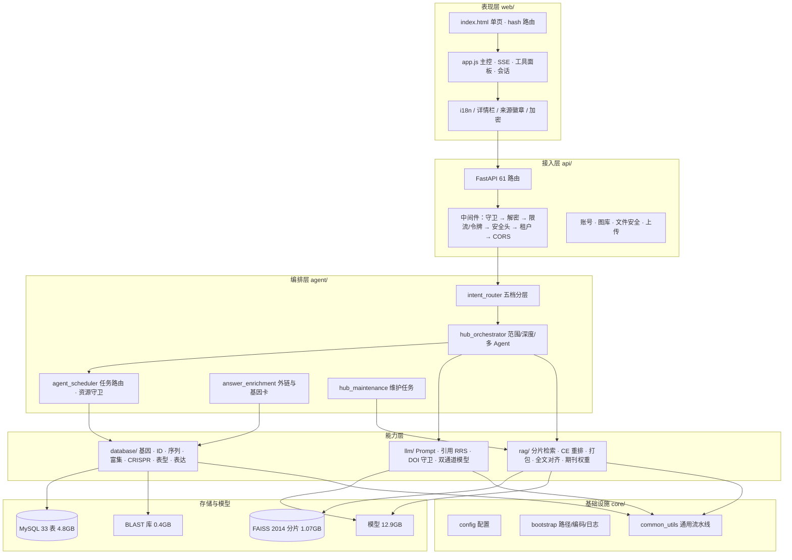
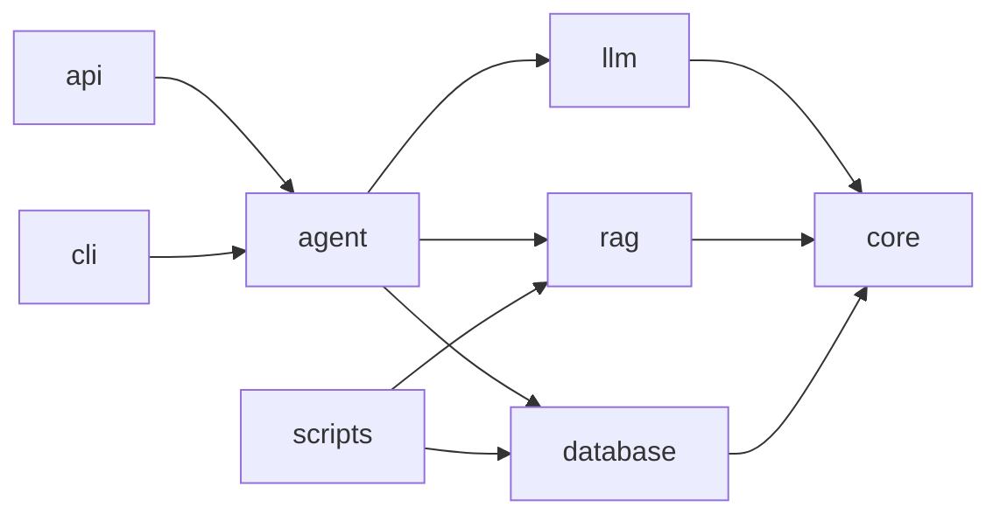
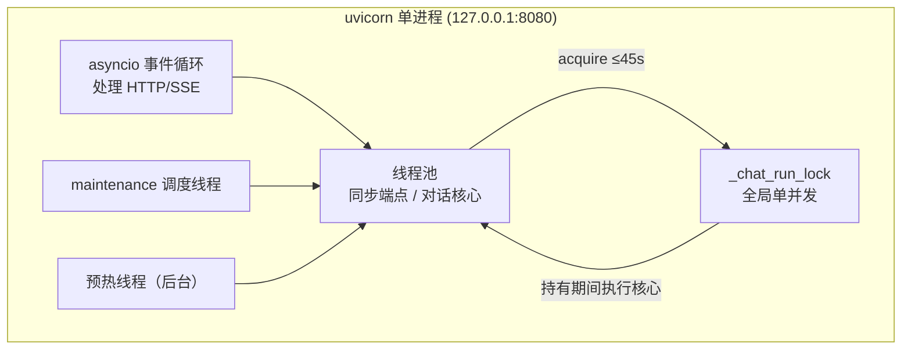
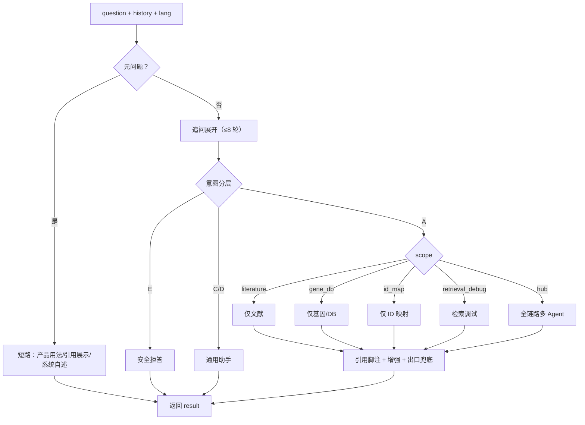
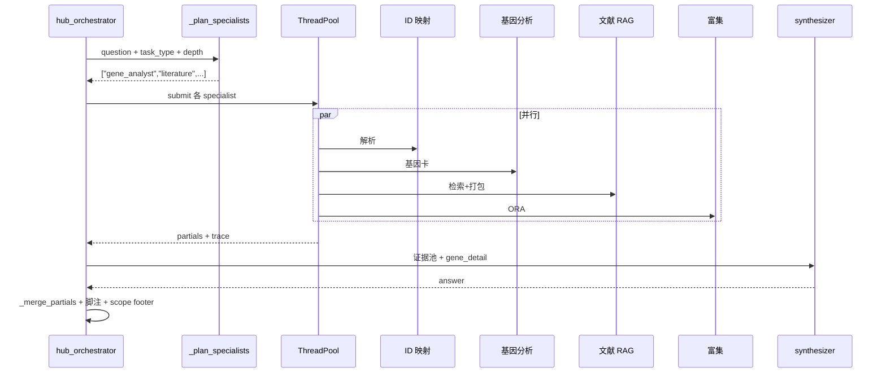
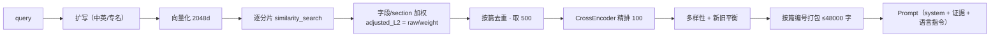
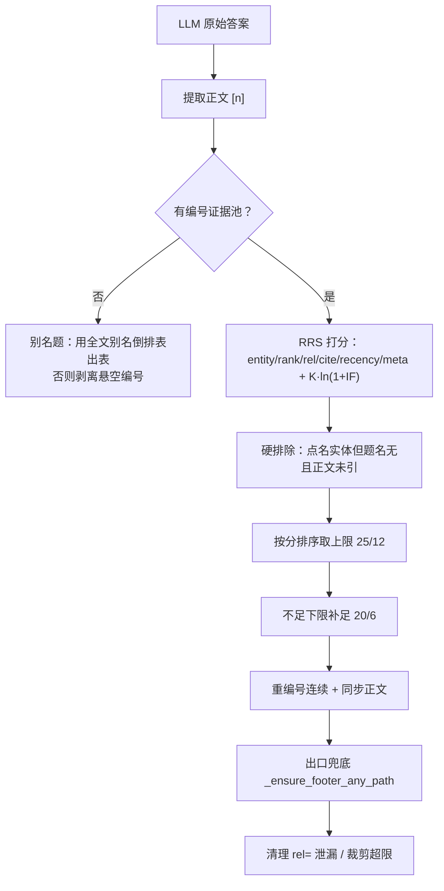
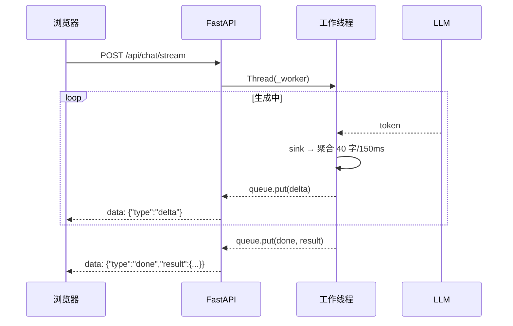
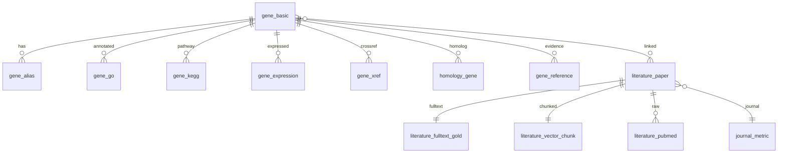

# 概要设计说明书
## 斑马鱼基因问答体（Zebrafish Hub）

| 项 | 内容 |
| --- | --- |
| 文档编号 | ZH-HLD-001 |
| 版本 | v1.0 |
| 编制日期 | 2026-10-17 |
| 上游文档 | `01_软件需求分析说明书.md`（ZH-SRS-001） |
| 下游文档 | `03_详细设计说明书.md`（ZH-LLD-001） |
| 设计依据 | 仓库现有实现（实测行数、端点、库表、部署脚本） |

---

## 1. 引言

### 1.1 目的

本文给出系统总体架构、模块划分、关键流程、数据与接口设计、部署与可靠性设计，回答"系统由哪些部分组成、如何协作、为什么这样分"。

### 1.2 设计范围

覆盖 `web/`（前端）、`api/`（接入）、`agent/`（编排）、`llm/`（语言）、`rag/`（检索）、`database/`（数据访问）、`core/`（基础设施）、`deploy/`（部署）、`scripts/`（数据工程与自检）。

### 1.3 设计输入摘要

| 输入 | 值 |
| --- | --- |
| 主要用例 | 机制问答、基因查询、工具使用、运维 |
| 硬约束 | 单进程、CPU 推理、35 GB 内存、单并发对话 |
| 规模 | 3.25 万篇文献 / 2.6 万基因 / 33 表 / 4.8 GB |
| 时延目标 | 热态 ≤60 s，冷态 ≤240 s，工具 ≤10 s |

---

## 2. 设计目标与原则

### 2.1 目标

| 编号 | 目标 | 对应需求 |
| --- | --- | --- |
| D1 | 用一条链路同时支撑"文献证据 + 结构化事实 + 工具计算" | FR-QA-02、FR-TOOL-12 |
| D2 | 任何答案都能回溯到表/文献/工具输出 | FR-RAG-05、NFR-M-03 |
| D3 | 资源受限下不崩溃：预热、闸门、降级 | FR-OPS-02/04/05 |
| D4 | 语料与索引可增量演进，不推倒重来 | FR-DATA-04/05/06 |
| D5 | 前端零构建、可直接部署，降低维护成本 | FR-UI-01/09 |

### 2.2 设计原则

1. **单向依赖**：`api → agent → {llm, rag, database} → core`，禁止反向 import。
2. **懒加载 + 预热**：重模型/索引不在 import 时加载，由预热钩子与首问按需触发。
3. **失败要显式**：捕获后返回"可读原因 + 已降级范围"，绝不静默编造。
4. **结构化优先**：工具返回对象，前端负责呈现；不让 LLM 自由发挥数字。
5. **配置外置**：所有阈值走环境变量，代码里只留默认值。
6. **可核对**：每个阶段留计数/清单/trace，供自检与论文复算。

---

## 3. 总体架构

### 3.1 分层视图



### 3.2 一句话分层

- **前端**：只负责"展示 + 流式接收 + 本地状态"；
- **接入层**：只负责"校验、限流、鉴权、序列化"，不含业务判断；
- **编排层**：决定"这问怎么答"（范围、深度、Agent 组合、融合策略）；
- **能力层**：只提供"可复用的能力函数"，不知道 HTTP；
- **基础设施**：配置、日志、编码、通用流水线。

### 3.3 技术选型

| 层 | 选型 | 理由 | 备选与否决原因 |
| --- | --- | --- | --- |
| 前端 | 原生 ES + hash 路由，无框架 | 零构建、改动即部署、调试直观 | React/Vue：引入构建链，收益不足以抵消维护成本 |
| Web 框架 | FastAPI + Uvicorn | 异步流式（SSE）友好、Pydantic 校验、生态成熟 | Flask：SSE/异步较弱 |
| 生成模型 | DeepSeek API（`deepseek-chat` / `reasoner`） | 中文科学写作质量高、成本可控、免运维 | 本地大模型：CPU 上不可接受 |
| 嵌入 | Qwen3-Embedding-4B（2048 维，CPU） | 多语言、长文本、检索效果稳定 | bge-small：维度与效果不足 |
| 重排 | bge-reranker-base（CrossEncoder） | 精排显著提升相关性 | 纯向量：长尾语义不足 |
| 向量库 | FAISS（分片 + manifest） | 单机、无服务依赖、可分片装载 | Milvus/Qdrant：需额外服务与内存 |
| 关系库 | MySQL 8.0（PyMySQL + SQLAlchemy Core） | 事务、复杂联表、成熟运维 | SQLite：并发与全文能力不足 |
| 本地比对 | BLAST+（子进程） | 标准、可解释 | 纯 k-mer：灵敏度不足 |
| 部署 | uvicorn 单进程 + shell 守护 + cloudflared | 简单、够用、故障面小 | K8s：单机场景过度设计 |

---

## 4. 模块划分

### 4.1 模块清单（实测行数）

| 模块 | 关键文件（行数） | 职责 | 对外暴露 |
| --- | --- | --- | --- |
| 接入 | `api_server.py`(2657)、`web_security.py`(445)、`hub_accounts.py`(294)、`gallery_feed.py`(785)、`file_security.py`(205)、`payload_crypto.py`(108) | 路由、中间件、账号、图库、上传安全 | HTTP/SSE |
| 编排 | `hub_orchestrator.py`(1723)、`answer_enrichment.py`(1018)、`agent_scheduler.py`(766)、`hub_maintenance.py`(673)、`workflow_engine.py`(327)、`intent_router.py`(248) | 意图、范围、Agent 调度、融合、维护 | `run_scoped_chat` 等 |
| 语言 | `zebrafish_prompt.py`(1557)、`ref_relevance.py`(519)、`llm_loader.py`(518)、`gene_alias_evidence.py`(366)、`gene_alias_fulltext.py`(337)、`doi_guard.py`(139)、`llm_api.py`(171) | Prompt、引用打分、模型加载、别名证据 | `build_complete_user_prompt`、`ensure_reference_footer`、`select_relevant` |
| 检索 | `pubmed_yes_retriever.py`(1314)、`pdf_fulltext_align.py`(1538)、`fulltext_cascade.py`(716)、`online_fulltext_fetch.py`(592)、`pubmed_yes_chunking.py`(494)、`rag_builder.py`(463)、`rerank.py`(192)、`journal_if.py`(229) | 检索、重排、打包、全文、切块、期刊权重 | `get_pubmed_yes_retriever().search/get_context` |
| 数据访问 | `gene_formatter.py`(1033)、`gene_id_mapper.py`(805)、`crispr_toolkit.py`(757)、`seq_toolkit.py`(646)、`enrichment_toolkit.py`(642)、`gene_toolkit.py`(657)、`expression_toolkit.py`(184)、`phenotype_toolkit.py`(369)、`genome_toolkit.py`(192) | 基因/ID/序列/富集/CRISPR/表型/表达/基因组 | 纯函数 + dict |
| 基础设施 | `common_utils.py`(784)、`config.py`(232)、`bootstrap.py`(124)、`log_io.py`(109)、`entry.py`(34) | 配置、日志、流式 sink、通用流水线 | 全局单例/函数 |
| 前端 | `app.js`(5400)、`i18n.js`(1101)、`home-feed.js`(461)、`crispr.js`(393)、`live-update.js`(391)、`phenotype.js`(374)、`provenance.js`(332)、`genes.js`(284)、`genomes.js`(307)、`expression.js`(305) | 路由、渲染、交互、双语 | 浏览器全局 |

### 4.2 依赖规则



**硬规则**

1. `database/` **不得** import `llm/`、`agent/`、`api/`；
2. `rag/` **不得** import `agent/`、`api/`；
3. `llm/` **不得** import `api/`；
4. 跨层只允许调用"能力函数"，不允许互相读私有变量；
5. 所有模块可通过 `bootstrap_app()` 统一修正 `sys.path` 与编码，业务代码用**扁平导入**（`from gene_toolkit import ...`）。

### 4.3 关键数据结构（跨模块契约）

| 名称 | 结构 | 生产方 | 消费方 |
| --- | --- | --- | --- |
| `result` | dict：`answer/task_type/context/gene_detail/agent_trace/answer_scope/answer_depth/specialists/...` | 编排层 | 接入层、前端 |
| `hit` | dict：`score/raw_score/field/text/pmid/entry_no/doc_id/title_zh/year/chunk_index/match` | 检索层 | 编排层、打包器 |
| `agent_trace[i]` | `{agent,label,status,summary,ms,detail}` | 编排层 | 前端详情栏 |
| `evidence excerpt` | 文本：`[n] 题名：… 期刊：… 年份：… PMID：… rel=0.83\n正文…` | 打包器 | LLM、脚注生成器 |
| `gene_detail` | dict：basic/go/kegg/expression/homology/xref/alias/paralog | 数据访问 | Prompt、前端基因卡 |
| `sse_event` | `{type: "delta" 或 "done" 或 "error", ...}` | 接入层 | 前端 |

---

## 5. 运行时视图

### 5.1 进程与线程



| 组件 | 模型 | 说明 |
| --- | --- | --- |
| HTTP 接入 | asyncio | 异步接受连接、SSE 生成器 |
| 对话核心 | 工作线程（`threading.Thread`） | 避免阻塞事件循环；流式通过 `queue` 回传 |
| 对话并发 | 全局锁 | 抢不到 → 503；等待 45 s |
| 单问内部并行 | `ThreadPoolExecutor`（≤5） | specialist 并行 |
| 维护任务 | 守护线程 + 定时循环 | 文献增量、图库、统计 |
| 预热 | 后台线程 + 内存闸门 | 不占对话锁 |

### 5.2 内存视图

| 阶段 | RSS | 组成 |
| --- | --- | --- |
| 冷态 | 2.5 GB | Python + FastAPI + 轻量模型 |
| 预热后 | ≈32 GB | + Qwen3-Embedding-4B（8.9 GB）+ CE（3.1 GB）+ FAISS 映射（1 GB+）+ 碎片 |
| 上限 | 35 GB（cgroup） | 超出 → OOM kill |

**关键设计**：预热前读 cgroup `memory.stat` 的 `anon` 与 `memory.max`，估算余量；不足则跳过并标记 `low_mem`。巡检在"anon ≥95% 且空闲 ≥15 min 且存活 >10 min"时回收。

---

## 6. 关键流程设计

### 6.1 问答总流程（scope/depth 决策）



**设计要点**

- 元问题、抱怨追问、语料统计在**检索之前**短路，省时省 token；
- 机制类问题强制走文献（即使 scope 选了 `id_map/gene_db` 也会改道）；
- `depth=partial` 只跑一条主路径，`full` 才叠加基因卡、富集、自动工具。

### 6.2 多 Agent 并行与融合



**规划规则（`_plan_specialists`）**

| 条件 | specialists |
| --- | --- |
| 机制题 + 含基因符号 | `gene_analyst, literature` |
| 机制题无基因符号 | `literature` |
| 品系/性状（AB/TU/WIK、体色、鳍长…） | 至少含 `literature`（防把 AB 当基因） |
| 普通题（full） | `id_mapper, gene_analyst, literature` |
| 含基因或"富集/KEGG/通路" | + `enrichment` |
| `task_type=数据库查询` | + `database` |
| `depth=partial` | 只保留一条主路径（文献/DB/基因之一） |
| 产品用法题 | `[]`（不检索） |

**融合策略**：文献证据为主干生成答案；`gene_detail` 供 Prompt 插入基因卡与表达；`id_mapping` 供名称统一；`enrichment/database` 作为附加块由 `_merge_partials` 并入。

### 6.3 两阶段检索与打包



**为什么两阶段**：全量 CE 太慢；全量向量召回太粗。粗排负责"不漏"，精排负责"排准"。

**打包细节**：每篇一个块，含编号、题名、期刊、年份、PMID/DOI、`rel=` 分数与摘录；前排给长摘录，后排只给题名，保证 100 篇能装进预算。

### 6.4 引用生成与兜底



**三条硬规则**

1. 点名实体但题名不含、正文也未引用 → 淘汰且不补回；
2. 无实体问句 → `entity` 权重按比例分摊；
3. 不足 2 条不出表，并清掉正文悬空 `[n]`。

### 6.5 SSE 流式



**设计要点**

- 小批量聚合避免隧道/浏览器把逐 token 缓冲成"整段蹦出"；
- 1 s 无数据发 `: keep-alive`；
- `hold_stream_before_refs` 在"参考文献"标题前暂扣尾部，避免先流出错误文献表再被改写；
- `done` 前用 `jsonable_encoder` 处理 Decimal/numpy，防序列化中断。

### 6.6 文献增量更新


---

## 7. 数据设计

### 7.1 概念模型



### 7.2 表分组

| 分组 | 表 | 设计要点 |
| --- | --- | --- |
| 基因身份 | `gene_basic` `gene_alias` `gene_xref` `gene_name_bundle` `name_hit_unique` `name_resolve_collision` `ensembl_id_version` | 以 `gene_id` 为枢纽；名称解析三态 |
| 基因注释 | `gene_go` `gene_kegg` `gene_expression` `gene_reference` `homology_gene` | 分表避免宽表稀疏 |
| 组装 | `assembly_registry` `gene_assembly_xref` | GRCz11 ↔ GRCz12tu 映射 |
| 文献主 | `literature_paper` | 只存元数据（24.5 MB） |
| 文献大字段 | `literature_pubmed`（1.7 GB）`literature_fulltext_gold`（2.7 GB） | 大字段独立，保主表查询快 |
| 文献辅助 | `literature_wos` `journal_metric` `literature_pubmed_judgement` | 判别与期刊权重 |
| 索引登记 | `literature_vector_chunk` `literature_vector_shard` | 与 FAISS 分片一一对应 |
| 运维 | `literature_pipeline_job` `literature_sync_log` `literature_import_job` `data_asset_registry` | 任务与资产台账 |
| 账号/租户 | `hub_user` `hub_user_session` `tenant` | 会话令牌 + 租户隔离 |
| 工作流 | `workflow_definition` `workflow_run` `workflow_run_step` | 可回放 |

### 7.3 索引与性能设计

| 场景 | 设计 |
| --- | --- |
| 按符号查基因 | `gene_basic.gene_symbol` 索引；先归一化再查 |
| 别名解析 | `gene_alias(alias)` + `name_hit_unique` 唯一命中表 |
| 按 PMID/DOI 查文献 | `literature_paper(pmid)`、`(doi)` 索引 |
| 全文读取 | 按 `doc_id` 回表，避免全表扫描 |
| 期刊权重 | 内存加载 52 行小表，进程内缓存 |
| 向量检索 | FAISS 分片 + manifest，避免一次全载 |

### 7.4 向量库设计

| 项 | 设计 |
| --- | --- |
| 索引类型 | FAISS（内积/L2 归一化） |
| 分片策略 | 每片约 5,000 篇；`manifest.json` 记录范围与版本 |
| 维度 | 2048（Qwen3-Embedding-4B，MRL 截断） |
| 元数据 | 每块带 `doc_id/pmid/title/year/section/field/has_fulltext/source` |
| 一致性 | `literature_vector_chunk` 与分片计数可交叉核对 |
| 备用索引 | `faiss_index`（Hub 小库）仅用于知识库问答，**不用于主答案** |

### 7.5 文件与目录

| 路径 | 内容 | 是否入库 |
| --- | --- | --- |
| `data/faiss_indexes/` | 主/旁路索引 | 否（Figshare） |
| `data/reference.fasta` | 参考序列 | 否 |
| `models/` | 模型权重 | 否 |
| `rag/knowledge.d/` | 知识条目（158 文件） | 是 |
| `rag/uploads/` | 用户上传 | 否 |
| `logs/` | 运行日志、访问令牌 | 否 |
| `Figure/` `results_md/` | 论文图件与统计 | 是 |

---

## 8. 接口设计

### 8.1 REST 分组（61 路由）

| 组 | 数量 | 代表端点 | 鉴权 |
| --- | --- | --- | --- |
| 健康与运维 | 6 | `/api/health`、`/api/warmup`、`/api/usage`、`/api/embed/warmup` | warmup 仅本机 |
| 对话 | 2 | `/api/chat`、`/api/chat/stream` | 限流 |
| 账号 | 8 | `/api/hub/register`、`/api/hub/login`、`/api/hub/logout`、`/api/hub/me`、`/api/hub/conversations`、`/api/auth/*` | 会话令牌 |
| 基因与搜索 | 5 | `/api/gene/{name}`、`/api/genes/search`、`/api/genes/orthologs`、`/api/genes/alias-literature` | 公开 |
| 工具 | 10 | `/api/tools/blast`、`/api/tools/enrichment`、`/api/tools/kegg`、`/api/tools/sequence`、`/api/tools/annotate`、`/api/tools/id-convert*`、`/api/tools/crispr/*`、`/api/tools/primer/design` | 限流 |
| 数据浏览 | 12 | `/api/genome/*`、`/api/expression/*`、`/api/phenotype/*` | 公开 |
| 库与维护 | 9 | `/api/hub/stats`、`/api/hub/maintenance/*`、`/api/hub/research-feed`、`/api/hub/gallery`、`/api/hub/events`、`/api/hub/stream-version` | 部分需登录 |
| 知识库 | 2 | `/api/knowledge/sources`、`/api/knowledge/upload` | 上传限流 |
| 租户/工作流 | 5 | `/api/tenants/current`、`/api/workflows/*` | 会话 |
| 静态 | 2 | `/`、`/static/*` | 公开 |

### 8.2 对话接口契约

**请求**

```json
{
  "question": "string(1..500)",
  "mode": "auto|hub|db|rag|fusion|gene|general",
  "answer_scope": "hub|literature|gene_db|id_map|retrieval_debug",
  "answer_depth": "partial|full",
  "history": [{"role": "user|assistant", "content": "..."}],
  "lang": "zh|en"
}
```

**响应（`/api/chat`）**：`ChatResponse`，核心字段：

| 字段 | 类型 | 说明 |
| --- | --- | --- |
| `answer` | string | 最终答案（含文末参考文献） |
| `task_type` | string | 路由结果 |
| `context` | string | 编号证据池（可审计） |
| `gene_detail` | object | 基因卡数据 |
| `agent_trace` | array | 各 Agent 状态/耗时 |
| `sql` / `data` / `row_count` | — | DB 路径产物 |
| `retrieval_debug` | object | 检索调试 |
| `answer_scope` / `answer_depth` | string | 实际生效值 |
| `followup_expanded` / `effective_question` | — | 追问展开 |
| `error` | string | 可读错误 |

**SSE 事件**

```
data: {"type":"delta","text":"..."}
data: {"type":"done","result":{...}}
data: {"type":"error","detail":"..."}
: keep-alive
```

### 8.3 错误码约定

| HTTP | 场景 | 响应体 |
| --- | --- | --- |
| 400 | 参数非法/空问题/坏上传 | `{detail}` 中文可读 |
| 401 | 未登录/令牌无效 | `{detail}` |
| 403 | 禁止的路径/来源 | `{detail}` |
| 404 | 基因/资源不存在 | 明确"未找到" |
| 405 | 方法不允许 | `{detail}` |
| 413 | 请求体/文件过大 | `{detail}` 含上限 |
| 429 | 限流 | `{detail, retry_after}` |
| 503 | 对话锁占用 / 模型未就绪 | `{detail}` 说明"不是限流" |
| 500 | 未捕获异常 | `{detail: "系统异常：…"}`，日志留栈 |

### 8.4 鉴权与头部

| 头 | 用途 |
| --- | --- |
| `X-Access-Token` / `Authorization` | 公网访问令牌（可选） |
| `X-Enc-Version` | 请求体加密版本 |
| `X-Tenant-Id` | 租户 slug（默认 `default`） |
| `Content-Type` | `application/json` / `multipart/form-data` |

---

## 9. 安全设计

### 9.1 中间件链（执行顺序）


### 9.2 控制点

| 层 | 控制 |
| --- | --- |
| 网络 | 仅监听 127.0.0.1；公网走 cloudflared/Nginx |
| 接入 | 方法白名单、路径黑名单（`..`/`.env`/`.git`）、体积上限（默认 600 KB，上传 5 MB+） |
| 身份 | 用户名密码（PBKDF2/加盐）、会话令牌 64 hex、过期时间 |
| 频率 | 分端点限流桶；鉴权失败计数封禁 |
| 内容 | 有害请求 Tier E；上传双扩展名/PDF 脚本检测 |
| 输出 | 安全响应头；严格模式 CSP；DOI 守卫 |
| 运维 | `/api/warmup` 仅本机；日志不落令牌 |

### 9.3 威胁与对策

| 威胁 | 对策 |
| --- | --- |
| 隧道明文窃听 | 可选请求体加密 + HTTPS |
| 恶意大文件 DoS | 体积上限 + 上传限流 + 解析前置校验 |
| Prompt 注入套取系统提示 | 元问题短路 + 系统提示不返回；上传内容不进入 system |
| 伪造文献引用 | 只允许证据池条目进脚注；DOI 冲突改走 PMID |
| 越权读他人会话 | 会话按 `user_id` 过滤 |

---

## 10. 可靠性与降级设计

### 10.1 降级矩阵

| 故障 | 检测 | 降级行为 | 用户可见 |
| --- | --- | --- | --- |
| 文献主索引未就绪 | `ready=false` / loading | 若有基因卡 → 只答基因库并声明；否则提示稍后 | "文献检索这次没有完成…" |
| 主索引异常 | 异常捕获 | **不**回退小库编答案 | 同上 |
| 嵌入模型加载竞态 | `meta tensor` 异常 | 重试 3 次 | 无感 |
| LLM API 失败 | 超时/非 200 | 回退本地 0.5B（hybrid）或报错 | 质量下降提示 |
| 对话锁占用 | 45 s 超时 | 503 | "上一问仍在处理中" |
| 内存不足 | 预热闸门 | 跳过预热，按需加载 | 首问变慢 |
| 内存吃紧 | 巡检 | 回收进程并重拉 | 短暂不可用 |
| BLAST 不可用 | 库/二进制检查 | k-mer 兜底 | 注明"近似比对" |
| 图库外网失败 | 超时 | 本地缓存/占位 | 无感 |
| 维护任务失败 | 状态文件 | 记录错误，下次重试 | Dashboard 可见 |

### 10.2 幂等与恢复

- 预热：`_warmup_started/_done` 状态机，重复调用不重复加载；
- 入库：按 `doc_id/PMID/DOI` 去重；
- 维护：`state.json` 记录上次成功时间；
- 会话：前端本地 + 云端双写，失败不阻塞回答。

### 10.3 数据备份

| 对象 | 方式 | 频率 |
| --- | --- | --- |
| MySQL | `scripts/backup_database.bat` / mysqldump | 手动/发布前 |
| 索引 | 分片目录 + manifest 可重建 | 重建脚本 |
| 配置 | `.env` 不入库；`.env.example` 入库 | 变更即更新 |

---

## 11. 性能设计

### 11.1 关键路径耗时（目标）

| 阶段 | 目标 | 手段 |
| --- | --- | --- |
| 中间件 | <10 ms | 纯内存判断 |
| 意图分层 | <5 ms | 正则 + 关键词打分，无模型调用 |
| 基因解析 | 50–200 ms | 索引查询 + 别名表 |
| 粗排 500 | 1–3 s | 分片并行 + 每片限 k |
| 精排 100 | 5–20 s（CPU） | CE batch；必要时降级混合打分 |
| 打包 | <100 ms | 纯字符串预算分配 |
| 生成 | 10–40 s | 流式；max_tokens 4096 |
| 脚注重建 | <300 ms | 内存打分 + 规则 |

### 11.2 优化手段

| 手段 | 效果 |
| --- | --- |
| 模型常驻（热态） | 省去每次加载 |
| 预热（后台） | 首问从 238 s → ~50 s |
| 嵌入复用 `get_shared_embedding` | 避免双载 OOM |
| 检索只 search 一次（hits 复用） | 省一次 FAISS+CE |
| 元问题/统计短路 | 完全跳过检索 |
| `partial` 深度 | 少 specialist、跳富集 |
| 期刊表内存缓存 | 避免每问查库 |
| 负缓存（刊名补全 6 h） | 减少外网调用 |

### 11.3 容量扩展路径

| 规模 | 方案 |
| --- | --- |
| 文献 10 万 | 分片数线性增；按需装载 + LRU |
| 并发 5–10 | 拆多进程 + 共享模型服务（Triton/HTTP） |
| 多租户 | 索引按租户命名空间隔离；库表加 `tenant_id` |
| GPU 可用 | `EMBEDDING_DEVICE=cuda`，CE batch 提升 |

---

## 12. 可扩展性设计

### 12.1 扩展点

| 想加什么 | 改哪里 | 不需要改什么 |
| --- | --- | --- |
| 新工具 | `database/xxx_toolkit.py` + `api_server` 一个路由 + 前端一个面板 | 编排层（除非要进 Agent 自动调用） |
| 新 specialist | `hub_orchestrator._plan_specialists` + `_dispatch_specialist` + `AGENT_LABELS` | 接入层 |
| 新检索源 | 实现 `search()` 返回统一 `hit` 结构 | 打包器、Prompt |
| 新模型 | 实现 `BaseLLM.generate()` | 编排层 |
| 新语言 | `i18n.js` 加词条 + `build_language_directive` | 业务逻辑 |
| 新组装版本 | `assembly_registry` 加行 + 配置 | 查询逻辑（按版本取） |
| 新文献源 | `rag/*_collector.py` | 入库与索引 |

### 12.2 扩展约束

- 新 specialist 必须返回 `(agent_id, trace_step, payload)` 三元组；
- 新工具必须返回 JSON 可序列化对象（Decimal/numpy 需转换）；
- 新 Prompt 必须保留 `[n]` 引用契约，否则脚注生成器失效。

---

## 13. 关键设计决策（ADR）

### ADR-01 为什么单进程而不是多 worker

- **背景**：模型常驻需 30 GB；多 worker 会各载一份 → OOM。
- **决策**：单进程 + 全局对话锁。
- **代价**：并发=1，第二问 503。
- **复审条件**：内存 ≥80 GB 或模型服务化后改为多 worker。

### ADR-02 为什么主库失败不回退小库

- **背景**：Hub 小库是另一套索引（0.53 GB），覆盖范围与主库不同。
- **决策**：宁可少答，不跨库拼凑。
- **收益**：避免"离题文章被写成正式答案"的学术风险。
- **代价**：主库故障时体验下降（已用预热/巡检降低概率）。

### ADR-03 为什么引用要重新打分而不是信任模型

- **背景**：模型会漏引、错引、把 100 篇整表贴出。
- **决策**：`ensure_reference_footer` 以证据池为准重建，RRS 六维排序 + 实体硬排除。
- **收益**：条数可控、编号一致、可核对。
- **代价**：多一次内存计算（<300 ms）。

### ADR-04 为什么前端不用框架

- **背景**：单页、交互集中在聊天与工具面板；维护者少。
- **决策**：原生 ES + hash 路由 + 全局模块。
- **收益**：零构建、改动即部署、便于论文附带的可复现演示。
- **代价**：状态管理靠约定；大改需谨慎。

### ADR-05 为什么 section 感知切块

- **背景**：方法/参考文献段落对答案贡献低，标题/结论贡献高。
- **决策**：切块带 section 标签，检索按 section 加权（0.4–2.0）。
- **收益**：同等相关下优先命中结论/结果。
- **代价**：切块逻辑复杂、依赖章节识别质量。

### ADR-06 为什么要"内存闸门"而不是"失败重试"

- **背景**：2026-10 OOM 循环（714 次 oom_kill），守护脚本被一起杀掉。
- **决策**：预热前算余量，不足则跳过；巡检按 anon 判据回收。
- **收益**：从"每 2–3 分钟死一次"变为稳定运行。
- **代价**：极低内存时首问变慢（可接受）。

---

## 14. 风险与技术债

| 编号 | 项 | 类型 | 影响 | 建议 |
| --- | --- | --- | --- | --- |
| TD-01 | `api_server.py` 2657 行、`app.js` 5400 行 | 结构债 | 改动冲突、测试困难 | 按域拆 router / 前端拆模块 |
| TD-02 | 扁平导入依赖 `sys.path` | 结构债 | 包化困难、IDE 跳转弱 | 逐步迁移为包内相对导入 |
| TD-03 | 全局单例（retriever、scheduler） | 测试债 | 难并行测试 | 引入工厂 + 依赖注入 |
| TD-04 | 规则式意图/路由 | 质量债 | 边界样本误判 | 用日志样本迭代规则或小模型分类 |
| TD-05 | 前端多份 `index.html.bak*` | 卫生债 | 误改、仓库膨胀 | 归档到 `项目阶段/` |
| TD-06 | 备份索引与实验索引混放 | 运维债 | 误指向 | 用配置白名单 + 启动校验 |
| TD-07 | 缺端到端自动化测试 | 测试债 | 回归靠手工 | 增加 Playwright/接口契约测试 |

---

## 15. 与详细设计的衔接

| 本文小节 | 详细设计对应 |
| --- | --- |
| §4 模块划分 | LLD §2–§9（逐模块类/函数） |
| §6 关键流程 | LLD §4–§7（算法与伪代码） |
| §7 数据设计 | LLD §10（DDL、索引、典型 SQL） |
| §8 接口设计 | LLD §3（端点实现、模型、错误） |
| §10 降级 | LLD §12（错误处理与日志） |
| §11 性能 | LLD §14（算法复杂度与预算） |
