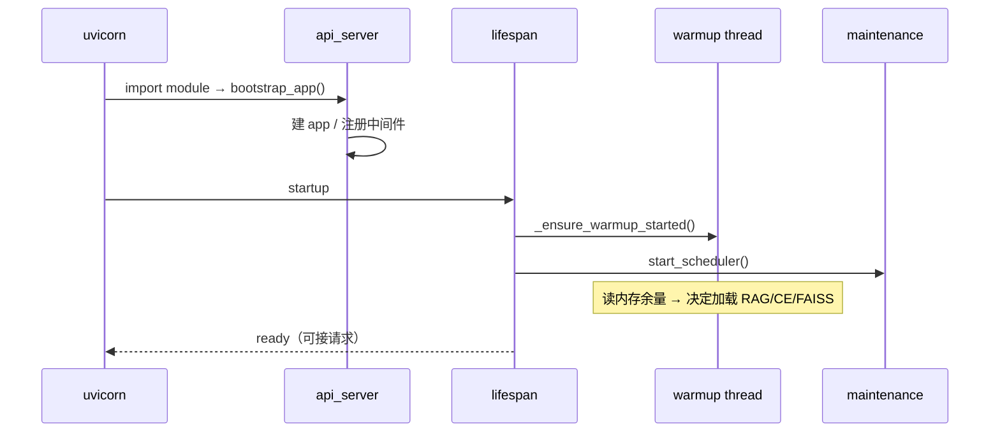
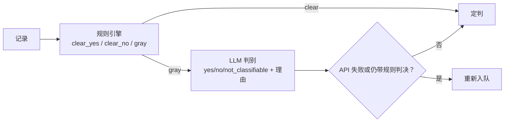

# 详细设计说明书
## 斑马鱼基因问答体（Zebrafish Hub）

| 项 | 内容 |
| --- | --- |
| 文档编号 | ZH-LLD-001 |
| 版本 | v1.0 |
| 编制日期 | 2026-10-17 |
| 上游文档 | `01_软件需求分析说明书.md`、`02_概要设计说明书.md` |
| 代码基线 | 当前仓库（`api` `agent` `llm` `rag` `database` `core` `web`） |
| 说明 | 函数签名与常量均取自源码；伪代码为**等价表达**，不替代源码 |

---

## 1. 说明

### 1.1 本文范围

逐模块给出：文件职责、关键函数签名、数据结构、算法步骤、异常路径、配置项与测试点。读者应能据此定位代码、修改行为、评估影响面。

### 1.2 代码地图

| 路径 | 行数量级 | 入口 |
| --- | --- | --- |
| `api/api_server.py` | 2,657 | `app = FastAPI(...)` |
| `agent/hub_orchestrator.py` | 1,723 | `run_scoped_chat()` |
| `llm/zebrafish_prompt.py` | 1,557 | `build_complete_user_prompt()` / `ensure_reference_footer()` |
| `database/gene_formatter.py` | 1,033 | `answer_from_gene_detail()` |
| `agent/answer_enrichment.py` | 1,018 | `enrich_chat_result()` |
| `rag/pubmed_yes_retriever.py` | 1,314 | `get_pubmed_yes_retriever()` |
| `rag/pdf_fulltext_align.py` | 1,538 | 清洗/对齐流水线 |
| `database/gene_id_mapper.py` | 805 | `resolve()` 系列 |
| `api/gallery_feed.py` | 785 | `feed()` |
| `core/common_utils.py` | 784 | `_synthesize_rag_answer()` 等 |
| `database/crispr_toolkit.py` | 757 | `design_sgrna()` / `design_primers()` |
| `agent/agent_scheduler.py` | 766 | `route_task()` / `AgentScheduler` |
| `web/js/app.js` | 5,400 | DOMContentLoaded 初始化 |

---

## 2. 代码组织与启动

### 2.1 路径与导入约定

```python
# api/api_server.py 顶部
from core.entry import bootstrap_app
bootstrap_app()          # 必须在 import torch/transformers 之前
```

`core/entry.py` → `core/bootstrap.py`：

1. 设置 `PYTHONIOENCODING/PYTHONUTF8`；
2. Windows 控制台切 UTF-8（`SetConsoleOutputCP(65001)`）；
3. 把 `core/ api/ agent/ llm/ rag/ database/ cli/` 加入 `sys.path`（`path_setup.py`）；
4. 中文静默日志（屏蔽第三方英文 INFO）。

**约定**：业务代码使用**扁平导入**（`from gene_toolkit import get_gene_detail`），而非 `from database.gene_toolkit import ...`。原因：部署树与仓库结构略有差异，扁平导入对两者都成立。

### 2.2 启动时序



**设计要点**：服务**不等**预热完成即可接请求；未就绪路径由 `peek_pubmed_yes_retriever()` 判断并降级。

---

## 3. 接入层详细设计（`api/`）

### 3.1 应用装配

```python
app = FastAPI(title="斑马鱼基因智能问答", version="1.0.0", lifespan=lifespan)

# 注册顺序（后注册的先执行）
app.add_middleware(SecurityHeadersMiddleware)
app.add_middleware(WebSecurityMiddleware)
app.add_middleware(PayloadCryptoMiddleware)
app.add_middleware(RequestGuardMiddleware)
app.add_middleware(CORSMiddleware, allow_methods=["GET","POST","HEAD","OPTIONS"], ...)
app.add_middleware(_TenantMiddleware)
```

**实际请求穿过顺序**（Starlette 后进先出）：`Tenant → CORS → RequestGuard → PayloadCrypto → WebSecurity → SecurityHeaders → 端点`。

| 中间件 | 关键行为 | 失败响应 |
| --- | --- | --- |
| `RequestGuardMiddleware` | 方法白名单；`_path_is_safe()` 拦截 `..`、`.env`、`.git`、`/proc/`；体积上限 | 405 / 400 / 413 |
| `PayloadCryptoMiddleware` | 按 `X-Enc-Version` 解密 JSON；可选加密响应 | 400 解密失败 |
| `WebSecurityMiddleware` | 令牌校验；分端点限流；鉴权失败计数封禁 | 401 / 429 |
| `SecurityHeadersMiddleware` | nosniff / XFO DENY / referrer / permissions；严格模式 CSP | — |
| `_TenantMiddleware` | 解析 `X-Tenant-Id` → `request.state.tenant_id` | 失败回落默认租户 |

### 3.2 限流参数

| 桶 | 默认 | 环境变量 |
| --- | --- | --- |
| chat | 30/min | `WEB_RATE_LIMIT_CHAT` |
| tools | 30/min | `WEB_RATE_LIMIT_TOOLS` |
| api | 120/min | `WEB_RATE_LIMIT_API` |
| upload | 5/min | `WEB_RATE_LIMIT_UPLOAD` |
| 鉴权失败封禁 | 25 次 / 900 s | `WEB_AUTH_FAIL_MAX` / `WEB_AUTH_BAN_SECONDS` |
| 免限流路径 | `/api/health`、`/api/auth/config` | 常量 |

**限流键**：`f"{client_ip}:{bucket}"`；封禁键为裸 IP（`key.split(":")[0]`），故一次封禁影响该 IP 全桶。

### 3.3 对话核心

```python
def _run_chat_core(req: ChatRequest) -> dict
```

**步骤**

1. `question.strip()`；空 → 400。
2. `_ensure_warmup_started()`（幂等）。
3. `_apply_answer_language(req.lang)`：设 ContextVar；**每次都要设**（线程复用会继承上一请求）。
4. `_chat_run_lock.acquire(timeout=45)`；失败 → 503（文案含已等待秒数）。
5. `_mark_chat_busy(question)`。
6. 路由三选一：
   - 有 `answer_scope` → `run_scoped_chat(question, scope, depth, history)`；
   - 有 legacy `mode`（db/rag/fusion/gene/general/blast/enrichment）→ 先过意图门，再 `agent_scheduler.run_task_detail`；
   - 默认 → `run_scoped_chat(question, "hub", depth, history)`。
7. `finally`：释放锁 + `_mark_chat_idle()`。
8. 若 `skip_enrich != True` → `enrich_chat_result(question, result)`。
9. `_ensure_footer_any_path(result, question)`（任何路径都做）。
10. 返回 `result`。

**为什么锁在 enrich 之前释放**：增强（外链/基因卡）是幂等的读操作，不应占用对话锁；但脚注兜底在锁外执行是安全的（纯文本处理）。

### 3.4 请求/响应模型

```python
class ChatRequest(BaseModel):
    question: str = Field(..., min_length=1, max_length=500)
    mode: Optional[str]          # auto|hub|db|rag|fusion|gene|general
    answer_scope: Optional[str]  # hub|literature|gene_db|id_map|retrieval_debug
    answer_depth: Optional[str]  # partial|full
    usage_strategy: Optional[str]
    history: Optional[list]      # [{role, content}] ≤8 轮
    lang: Optional[str]          # zh|en
```

`ChatResponse` 22 个字段（见 SRS/HLD），全部可选除 `answer/task_type`。**兼容性约定**：新增字段必须可选，不得重命名既有字段（旧前端会忽略未知字段）。

### 3.5 SSE 实现

```python
@app.post("/api/chat/stream")
async def chat_stream(req: ChatRequest):
    q = queue.Queue()
    threading.Thread(target=_worker, daemon=True).start()
    return StreamingResponse(_gen(), media_type="text/event-stream", headers={...})
```

**`_sink(text)` 聚合逻辑**

| 参数 | 值 | 作用 |
| --- | --- | --- |
| `_CHUNK_CHARS` | 40 | 攒够 40 字推一块 |
| `_CHUNK_MS` | 0.15 | 或距上次推送 ≥150 ms |
| `hold_stream_before_refs` | — | 检测到"参考文献"标题前暂扣尾部 |

**`_gen()` 循环**

- `q.get(timeout=1)` 超时 → `": keep-alive\n\n"`；
- `delta` → `data: {"type":"delta","text":...}`；
- `error` → `data: {"type":"error","detail":...}` 并 break；
- `done` → `jsonable_encoder(ChatResponse.model_dump())` 后发送并 break。

**边界**：客户端断开时生成器被取消，工作线程仍会跑完（daemon），结果丢弃；不会写坏会话。

### 3.6 预热与内存闸门

```python
def _mem_gate(need_mb: float, what: str) -> bool
def _warmup_resources()
def _warmup_pubmed_yes_faiss_ce()
```

**`_mem_gate` 判据**

1. 读 cgroup v2 `memory.max`（祖先）与 `memory.stat` 的 `anon`；
2. 可分配余量 = `max - anon - 安全余量`；
3. 余量 < `need_mb` → 返回 False，记 `skip_reason="low_mem"`。

**状态机**

| 变量 | 含义 |
| --- | --- |
| `_warmup_started/_done/_error` | RAG 预热 |
| `_pubmed_warmup_started/_done/_error` | 文献索引预热 |
| `_pubmed_warmup_skipped` + `_pubmed_warmup_skip_reason` | 主动跳过（`disabled` / `low_mem`） |

`/api/health` 暴露这些字段，运维可区分"按配置不预热"与"装不下"。

### 3.7 端点实现要点（按族）

| 族 | 实现要点 |
| --- | --- |
| 基因 `GET /api/gene/{name}` | `validate_path_param` 防路径注入 → `normalize_gene_name` → `get_gene_detail` → 附 `alias_block`/`paralog_block` |
| 搜索 `GET /api/genes/search` | `q` 空且 `browse=1` → 列表模式；否则关键词匹配 |
| 同源 `GET /api/genes/orthologs` | 输入斑马鱼符号 → 正向；输入人/鼠符号（大写为主）→ 反向 |
| 工具 `POST /api/tools/blast` | 序列校验（长度/字符集）→ `run_local_blast` → 失败走 k-mer |
| sgRNA `POST /api/tools/crispr/design` | 模板解析 → 枚举 → 打分 → 脱靶 → 排序；`capabilities` 返回库状态 |
| 富集 `GET /api/tools/enrichment` | 基因列表 → ORA；无基因 → 400 |
| 上传 `POST /api/knowledge/upload` | `file_security` 三重校验 → 解析 → 清洗 → 切块 → 入索引 |
| 维护 `POST /api/hub/maintenance/run` | 后台任务，立即返回 job 状态；前端轮询 |
| 图库 `GET /api/hub/gallery` | 本地/缓存瞬时返回；后台拉外网镜像 |
| 事件 `GET /api/hub/events` | SSE 长连接推送维护状态/版本变化 |

### 3.8 静态资源

```python
app.mount("/static", StaticFiles(directory=WEB_DIR), name="static")

@app.get("/")
def index():
    return FileResponse(os.path.join(WEB_DIR, "index.html"))
```

**版本约定**：`index.html` 中所有 `src/href` 带 `?v=YYYYMMDDx`；改 `web/` 下任意文件必须同步 bump，否则浏览器复用旧缓存。

---

## 4. 编排层详细设计（`agent/`）

### 4.1 意图分层算法（`intent_router.py`）

```python
def classify_question_intent(question: str, history=None) -> dict:
    return {"tier": "A|B|C|D|E", "name": str, "confidence": float, "reasons": [str]}
```

**判定顺序（短路）**

| 序 | 条件 | 结果 |
| --- | --- | --- |
| 1 | 空串 | D / 0.4 |
| 2 | `_HARMFUL_RE` 命中 | E / 0.95 |
| 3 | 元问题（系统自述/产品用法/引用展示） | B / 0.95 |
| 4 | `_zebrafish_science_score ≥ 0.55` | A / `min(0.98, 0.55+score*0.3)` |
| 5 | 短追问（<40 字）且上一轮为 A 且以"那/还有/为什么/它…"开头 | A / 0.75 |
| 6 | `_GENERAL_RE` 且 zf_score < 0.35 | D / 0.85 |
| 7 | `_ADJACENT_BIO_RE` 且无斑马鱼显式词 | C / 0.8 |
| 8 | zf_score ≥ 0.35 | A / 0.65 |
| 9 | 其他 | D / 0.55 |

**打分表（`_zebrafish_science_score`）**

| 信号 | 加分 | 例 |
| --- | --- | --- |
| 显式斑马鱼词 | +0.70 | 斑马鱼、zebrafish、danio rerio、ZFIN、GRCz12 |
| 基因/序列 ID | +0.45 | ZDB-GENE-、ENSG…、NM_… |
| 常见斑马鱼基因 | +0.35 | tp53、sox9b、myl7… |
| 科学关键词 | +min(0.25, 0.06×命中数) | 基因、表达、敲除、表型… |
| 机制问句 + 物种/基因信号 | +0.35 | `is_biology_mechanism_question()` |
| 基因问答句式 | +0.30 | "…基因是什么/哪些组织表达" |

**设计约束**

- 纯正则/词典，**不调模型**（<5 ms，且可离线复现）；
- 误判代价不对称：把 A 误判为 D → 用户得不到文献（严重）；把 D 误判为 A → 多跑一次检索（可接受）。因此阈值偏向 A（0.55）。
- 新增触发词只需改 `_ZF_SCIENCE_KW` / `_ZF_GENE_MARKERS`，不动流程。

### 4.2 追问展开（`expand_question_with_history`）

```python
def expand_question_with_history(question, history, *, max_turns=8) -> tuple[str, list, bool]
```

**步骤**

1. `_normalize_history`：只保留 `role in {user, assistant}`，截断到 8 轮，单条 ≤2000 字。
2. 若 `_is_complete_new_topic(question)`（含主语+动词+对象，非指代）→ 不展开，返回 `(question, hist, False)`。
3. 若 `_looks_like_followup(question)`（含 `_FOLLOWUP_MARKERS`）→ 用最近用户问 + 最近助手要点拼成 `effective`。
4. 机制题强制不展开（`run_scoped_chat` 中显式覆盖），避免"它"把机制题带偏。

**返回**：`(effective_question, normalized_history, expanded: bool)`；`expanded=True` 时 result 附 `followup_expanded/effective_question`。

### 4.3 范围与深度归一化

| 输入 | 归一化 |
| --- | --- |
| `"" / auto / default` | `hub`（scope）/ `full`（depth） |
| `rag / lit / pubmed` | `literature` |
| `gene / db` | `gene_db` |
| `id / idmap / id_mapping / mapping` | `id_map` |
| `full` | `hub` |
| `debug / retrieval` | `retrieval_debug` |
| `部分 / 部分回答 / fast / quick` | `partial` |
| `整体 / 整体回答 / complete / comprehensive` | `full` |
| 未知值 | 默认值（不报错） |

### 4.4 Specialist 规划（`_plan_specialists`）

**输入**：`question`、`task_type`、`depth`
**输出**：有序 agent_id 列表（去重）

| 条件（按优先级） | 输出 |
| --- | --- |
| 产品用法题 | `[]` |
| `depth=partial` + 机制/性状 | `["literature"]` |
| `depth=partial` + DB 查询 | `["database"]` |
| `depth=partial` + 基因详情 | `["gene_analyst"]` |
| `depth=partial` + 富集词 | `["gene_analyst"]`（不做 ORA） |
| `depth=partial` + 默认 | `["literature"]` |
| `depth=partial` + ID 词且非机制 | 前插 `id_mapper` |
| 机制题 + 有基因符号 | `["gene_analyst","literature"]` |
| 机制题 + 无基因符号 | `["literature"]` |
| 默认（full） | `["id_mapper","gene_analyst","literature"]` |
| + 有基因或富集词 | 追加 `enrichment` |
| + `task_type=数据库查询` | 追加 `database` |
| + 性状/品系且无 literature | 追加 `literature` |

### 4.5 `run_scoped_chat` 控制流

```python
def run_scoped_chat(question, answer_scope=None, answer_depth=None, history=None) -> dict
```

**短路（按序）**

1. 引用展示元问题 → `answer_citation_display_question`；
2. 产品用法 → `answer_hub_product_howto`；
3. 抱怨追问（"你答错了/答非所问"）→ 若上一轮是机制题：用上一问重跑 `run_literature_only` 并加说明；否则给"走错路"解释；
4. 语料统计 → `answer_corpus_stats`；
5. 系统元问题 → `SYSTEM_META_REPLY`。

**主流程**

```
effective, hist, expanded = expand_question_with_history(question, history)
if is_mechanism(question): effective = question; expanded = False; hist = []
    if scope in (id_map, gene_db): scope = literature
tier = classify(effective, history)
if tier == E: return 安全拒答
if tier in (C, D): return run_general_assistant(effective, tier, hist)
dispatch(scope) → literature | gene_db | id_map | retrieval_debug | hub
result.intent_tier = tier
if expanded: result.followup_expanded/effective_question
```

**为什么机制题丢弃 history**：机制问句通常自足；带历史反而会把"它"解析成上一轮的基因，造成"答非所问"。这是踩过坑后的硬编码。

### 4.6 `run_hub_orchestration`

```python
def run_hub_orchestration(question, *, task_type_override=None, depth="full") -> dict
```

**阶段**

| 阶段 | 动作 | trace |
| --- | --- | --- |
| 1 路由 | `route_task` → `task_type` | `router` |
| 2 规划 | `_plan_specialists` | — |
| 3 并行 | `ThreadPoolExecutor(max_workers=min(5,n))`；`as_completed` 收集 | 每个 specialist 一条 |
| 4 文献重试 | 性状/品系题且摘录 ≤40 字 → 追加 "zebrafish strain morphology AB TU phenotype" 再检索 | `literature` |
| 5 合成 | 有摘录 → `_synthesize_rag_answer`；主库失败 → 分支降级（见下） | `synthesizer` |
| 6 自动工具 | `depth=full` → `augment_chat_result` | — |
| 7 脚注 | `ensure_reference_footer`（有 context 或别名/复制体题） | — |
| 8 收尾 | `_scope_footer` + `agent_trace/specialists/answer_scope` | — |

**主库失败分支（关键）**

```
if lit_failed:
    if 产品用法题:      → answer_hub_product_howto
    elif 有基因卡:      → answer_from_gene_detail + "文献检索没完成"
    elif 需要文献:
        trait 题 → G×E 框架草稿（明确未附文献）
        其他     → "文献库未加载，没有改用别的库编答案"
    else:              → agent_scheduler.run_task_detail（非文献主任务）
```

**绝不**调用 `rag_builder` 生成正式答案（仅 `_run_literature` 在"主库未报错但未命中"时用极小预算兜底，且标注来源）。

### 4.7 `_run_literature`

**返回结构**

```python
{
  "chars": int, "excerpt": str, "has_hits": bool,
  "source": "pubmed_yes" | "hub_faiss" | "pubmed_yes_failed" | "none",
  "error": str, "pmids": [str], "max_chars": int, "retrieve_candidates": int|None
}
```

**步骤**

1. `peek_pubmed_yes_retriever()`：预热中不阻塞，直接回落；
2. `ready` 时 `search(question, top_k=None, expand, candidates)` **只调一次**；
3. 别名题：`extra_alias_queries(limit=2)` 再检索，去重合并进 `hits`；
4. 收集 `pmids`（`pmid` 优先，否则 `eno:` / `doc_id`）；
5. `get_context(..., hits=hits)` → `truncate_context(max_chars=budget)`；
6. 异常 → `source="pubmed_yes_failed"`，**不回退**小库编答案。

### 4.8 `AgentScheduler` 与 `route_task`

`route_task` 是**加权关键词 + 模式匹配**的分类器，输出 `TASK_TYPES` 七类之一。

| 规则（按序） | 输出 |
| --- | --- |
| 引用展示/机制题 | 知识库查询 |
| 参考基因组/版本题 | 基因详情 |
| ZDB-GENE / ENS / NM_ / 纯数字 | 基因详情 |
| 命名/别名/跨库/对比 词 | 基因详情 |
| ≥2 基因符号 + 比较词 | 基因详情 |
| ≥20 nt 序列或 blast/cDNA | 序列比对 |
| 富集/KEGG/通路 | 功能富集 |
| CRISPR/编辑/protocol/原理 | 知识库查询 |
| 基因符号 + "是什么/功能" | 基因详情 |
| 基因符号 + 表达/组织 | 基因详情 |
| 其他基因详情词 | 基因详情 |
| 排除词（什么是/为什么/介绍） | 知识库/多模型 |
| DB 分 > RAG 分 且 ≥2 | 数据库查询（**无基因符号则降级 RAG**） |
| RAG 分 > DB 分 且 ≥2 | 知识库查询 |
| 有分但低 | 含英文/数字 → RAG；否则多模型 |
| 无信号 | 通用 |

`AgentScheduler` 负责：资源状态、单飞重任务、内存守卫、`run_task_detail` 分派、忙碌状态。

### 4.9 融合与 trace

```python
def _merge_partials(result: dict, partials: Dict[str, Any]) -> dict
```

- `id_mapper` → `result["id_mapping"]`、`name_mapping`；
- `gene_analyst.detail` → `result["gene_detail"]`（若主路径未设）；
- `enrichment` → `result["enrichment"]`；
- `database` → 若主答案空则采用其 `answer/data/sql`；
- 不覆盖已有非空答案。

```python
def _trace_step(agent_id, status, summary, *, ms=0, detail=None) -> dict
```

`status ∈ {ok, miss, skip, error}`；前端据此显示绿/灰/黄/红。

### 4.10 回答增强（`answer_enrichment.py`）

`enrich_chat_result(question, result)`：

1. `_collect_gene_symbols`（问句 + 答案 + 基因卡）；
2. 为每个符号生成外链：Ensembl / ZFIN / NCBI / UniProt / Bgee / Expression Atlas / QuickGO / KEGG / PubMed；
3. `_mapping_markdown` 生成 ID 映射表；
4. `_infer_db_usage` / `_databases_used` 生成"使用到的数据库"段；
5. `_linkify_gene_symbols` 把正文基因符号变链接（带 `_LinkBudget` 限制，避免刷屏）；
6. `_protect_links` / `_restore_links` 保护已生成的 Markdown 链接不被二次处理。

**预算**：`_LinkBudget` 控制总链接数；超预算按优先级丢弃（PubMed/Ensembl 优先）。

---

## 5. 语言层详细设计（`llm/`）

### 5.1 Prompt 组装

```python
def build_complete_user_prompt(question, *, draft_hint=None, db_text=None,
                               gene_detail=None, rag_context=None, history=None) -> str
```

**结构**

```
[角色与范围]            ← ZEBRAFISH_SYSTEM_PROMPT（system）
[答案契约]              ← 首句直答 / 分因素 / 行内 [n] / 文末表
[语言指令]              ← build_language_directive(question)
[基因卡块]              ← _format_gene_detail_block(gene_detail)
[数据库结果块]          ← db_text
[编号证据池]            ← rag_context（[n] 题名 期刊 年份 PMID rel=）
[历史摘要]              ← 最近 ≤8 轮
[用户问题]
```

**答案模式**

| 模式 | system prompt | 用途 |
| --- | --- | --- |
| `balanced`（默认） | `ZEBRAFISH_BALANCED_SYSTEM_PROMPT` | 短、先答、可读 |
| `academic` | `ZEBRAFISH_ACADEMIC_SYSTEM_PROMPT` | 数字到论文精度 |

### 5.2 语言控制

```python
_ANSWER_LANG: ContextVar[str|None]
def set_answer_language(lang) -> None
def current_answer_language(question="") -> str   # "zh"|"en"
def build_language_directive(question) -> str
```

**优先级**：请求 `lang` > 问句语言检测（`detect_question_language`）。

**约束**

- 英文界面：全英文，基因符号/ID/库名保留原文；
- 中文界面：除专有名词外全中文；
- 语言指令**必须**在 system 或 user prompt 中显式出现（`has_language_rule` 校验）。

**ContextVar 陷阱**：`/api/chat/stream` 在工作线程执行，路由层设的 ContextVar 不传播 → 必须在 `_run_chat_core` 内设置；线程池复用会继承旧值 → 空值也要显式 `set(None)`。

### 5.3 答案类型分类

```python
def classify_answer_type(question) -> str   # "fact" | "mechanism" | "trait" | "general"
```

影响：文献条数上下限（fact 6–12；其他 20–25）、G×E 公式注入（trait）、是否走机制题路由。

### 5.4 参考文献重建（核心算法）

```python
def ensure_reference_footer(answer: str, context: str = "", question: str = "") -> str
```

**输入**：模型答案（可能含错误文献表）、编号证据池、问句
**输出**：正文编号与文末表一致的答案

**步骤**

1. 归一化换行；清除 `rel=` 泄漏。
2. 系统元问题 → 原样返回（不补脚注）。
3. `_split_body_and_refs(ans)` 拆正文与旧文献段；`_strip_residual_ref_sections` 去掉残留"参考文献"标题。
4. `papers_from_numbered_context(context)` 解析证据池：
   - 逐行匹配 `^\[n\]`；
   - 提取题名（`题名：`）、期刊（`期刊：`）、年份、PMID/DOI、`rel=`。
5. 若无证据池：
   - 别名/复制体题 → `_alias_reference_tuples`（全文倒排表）→ `_rebuild_footer`；
   - 否则剥离正文悬空 `[n]` 并返回。
6. `_cited_in_body(body)` 取正文引用集合。
7. `select_relevant(...)`：
   - 对每条 `score_paper` 打分；
   - 硬排除（`blocked_by_entity`）；
   - 按分排序；
   - 优先保留正文已引用的条目，再按分数补足。
8. 取 `max_n = _ref_footer_max(question)`，补到 `min_n = _ref_footer_min(question)`。
9. `_pick_footer_ns` 选最终编号集合；`_apply_cite_map` 把正文旧编号映射为新连续编号。
10. 重建文末表（题名/期刊/年份/DOI 链接）。
11. 返回"正文 + 空行 + 参考文献"。

**上下限**

| 题型 | 下限 | 上限 |
| --- | --- | --- |
| fact | 6 | 12 |
| mechanism / trait / general | `max(20, REF_FOOTER_MIN)` | 25 |

**边界条件**

- 证据池 <2 条 → 不出表，清正文 `[n]`；
- 模型自己贴的 100 篇整表 → 只在其含"题名："或 `ZFQA-` 时采信，否则丢弃；
- 正文有编号但文末缺失 → 用证据池重建；
- 文末超上限 → 裁剪并同步正文。

### 5.5 RRS 打分

```python
def score_paper(paper, *, question="", entities=None, cited_ns=None,
                pool_size=0, rel=None) -> dict
```

**公式**

```
RRS = 0.30·entity + 0.15·rank + 0.10·rel + 0.20·cite + 0.15·recency + 0.10·meta
      + K·ln(1 + IF)          K = REF_RRS_IF_K（默认 0.01）
```

| 维度 | 计算 |
| --- | --- |
| `entity` | 问句实体（基因/ID）是否独立词出现在题名 → 1/0 |
| `rank` | `_rank_score(n, pool_size)`：池内位次归一化 |
| `rel` | 证据池 `rel=`（0–1）；缺失 → 该 0.10 退给 `rank` |
| `cite` | `n in cited_ns` → 1/0 |
| `recency` | `_recency_score(year)`：近 5 年高分，衰减 |
| `meta` | 年份/来源标签/真实刊名/DOI 完整度 |
| `if` | `ln(1+IF)`，未知刊 0（不加不扣） |

**权重自适应**

- 无实体问句：移除 `entity`，其 0.30 按比例分给其余维；
- 无 `rel`：0.10 转给 `rank`，保证总分尺度不变（有回归测试锁定）。

**硬规则**

```python
blocked = has_entity and hard_entity_enabled() and entity == 0 and cite == 0
```

即"点名了基因，但题名没有、正文也没引用"→ 淘汰，且**永不补回**。

### 5.6 DOI 守卫（`doi_guard.py`）

- 检测"一 DOI 对应多篇"的冲突集合；
- 冲突 DOI 不生成可点击外链，改走 PMID；
- 结果缓存，避免反复查库。

### 5.7 模型加载与降级（`llm_loader.py` / `llm_api.py`）

| 类 | 说明 |
| --- | --- |
| `BaseLLM` | `generate(prompt, max_new_tokens) -> str` |
| `TransformersLLM` | 本地 transformers 推理；按 tier 选模型 |
| `LlamaCppLLM` | GGUF 兜底 |
| `ApiLLM` | DeepSeek HTTP；流式回调 |
| `HybridReasoningLLM` | 云端优先，失败回退本地 |

**tier 策略**

- `light`：Qwen-0.5B（分类/SQL 兜底）；
- `heavy`：DeepSeek（生成）；
- 内存不足时 `should_skip_local_heavy()` → 只用 API。

---

## 6. 检索层详细设计（`rag/`）

### 6.1 索引装载

```python
class PubmedYesRetriever:
    def _load_shards(self) -> None
    def _ensure_id_indexes(self) -> None
    @property
    def ready(self) -> bool
```

**装载逻辑**

1. 读索引目录下 `manifest.json`（分片清单/覆盖范围/版本）；
2. 逐片 `FAISS.load_local(allow_dangerous_deserialization=True)`；
3. 建 `pmid → doc`、`entry_no → doc` 倒排（用于精确命中）；
4. 任一片失败：记录并跳过（不整体失败）；
5. `ready=True` 条件：至少一片可用。

**内存控制**：分片按需装载；`peek_*` 不触发加载；`*_loading()` 供编排层判断"预热中"。

### 6.2 检索主流程

```python
def search(self, query, top_k=None, *, expand=None, candidates=None) -> list[dict]
```

**步骤**

1. `coarse_n = candidates or 500`；`fine_n = top_k or 100`；`coarse_n = max(fine_n, coarse_n)`。
2. **精确命中**：`extract_pmids/extract_enos(query)` → `lookup_*`，去重取 `≤fine_n`。
3. **查询扩写**：`expand_queries(query)`（中英/专名扩写，可关）。
4. **粗排**：
   ```
   per_q = clamp((coarse_n*4)//len(shards), 8, 48)
   for q in queries:
     vec = embed(q)
     for shard in shards:
       pairs = shard.similarity_search_with_score_by_vector(vec, k=per_q)
       for doc, score:
         field = infer_field_from_text(text, meta)
         boost = keyword_title_boost(...) ; topic = topical_match_boost(...)
         adj = adjust_l2_score(score, field, section) / max(1, boost) / max(0.1, topic)
         best[key] = min(adj)
   ```
5. 排序取 `coarse_n`，**按篇去重**（`_paper_key`：pmid/entry_no/doc_id）。
6. **精排**：`rerank_hits(query, merged, top_n=fine_n)`：
   - 优先 CrossEncoder 分批打分；
   - 模型不可用 → `hybrid_rerank_score`（词法 + 向量混合）。
7. **多样性 + 新旧平衡**：`diversify_and_recency(unique_papers=100, max_chunks=100)`。

**关键常量**

| 常量 | 默认 | 说明 |
| --- | --- | --- |
| `PUBMED_YES_RETRIEVE_CANDIDATES` | 500 | 粗排篇数 |
| `PUBMED_YES_RERANK_TOP_N` | 100 | 精排篇数 |
| `PUBMED_YES_UNIQUE_PAPERS` | 100 | 最终去重篇数 |
| `PUBMED_YES_SHARD_PAPERS` | 5000 | 分片粒度 |

### 6.3 字段与章节权重

```python
def infer_field_from_text(text, meta) -> str
def field_weight(field, section=None) -> float
def adjust_l2_score(raw_score, field, section=None) -> float  # raw / weight
```

| field / section | 权重 |
| --- | --- |
| title | 2.0 |
| abstract | 1.5 |
| conclusion | 1.5 |
| results | 1.45 |
| discussion | 1.25 |
| mixed | 1.2 |
| keywords | 1.1 |
| body | 1.0 |
| figure_captions | 0.9 |
| methods | 0.85 |
| other | 0.8 |
| introduction | 0.75 |
| references | 0.4 |

**含义**：`adjusted_L2 = raw_L2 / weight`，距离越小越前 → 权重越大越优先。

### 6.4 重排

```python
def rerank_hits(query, hits, *, top_n=10) -> list[dict]
def cross_encoder_scores(query, texts, *, batch_size=None) -> list[float] | None
def hybrid_rerank_score(query, hit) -> float
def lexical_score(query, text) -> float
```

**策略**

1. 若候选已 ≤top_n 且全为精确命中（`pmid_exact/eno_exact`）→ 直接返回，不做 CE。
2. CE 打分（batch，CPU 默认较小批量）；
3. 融合：`score = 0.85·CE + 0.15·lexical_score`；精确命中额外 `+50` 置顶；
4. CE 不可用 → `hybrid_rerank_score`（词法 + 语义混合），并标记 `rerank_method="hybrid"`；
5. 按 `rerank_score` 降序取 `top_n`，每条写回 `rerank_score/rerank_method` 便于审计。

### 6.5 打包 `pack_for_ai`

```python
def pack_for_ai(self, hits, *, max_chars=None) -> dict
def _paper_block(self, i, g, excerpt_n, title_n) -> str
def _excerpt_budget(self, rank) -> int
```

**预算分配（`_excerpt_budget`）**

| 排名 | 摘录上限 |
| --- | --- |
| 1–20 | 520 字 |
| 21–45 | 300 字 |
| 46–75 | 180 字 |
| 76–100 | 90 字（近似只保题名与元数据） |

> 设计意图：100 篇时若每篇平均分配，只会每篇剩 ~120 字；按"前列给够、后列保题名"分配，既保证主证据完整，又保住覆盖面。

**块格式**

```
[n] 题名：<title> 期刊：<journal> 年份：<year> PMID：<pmid> DOI：<doi> rel=<0.83>
<正文摘录>
```

**为什么带 `rel=`**：供 RRS 的 `rel` 维使用；出口会清理，避免泄漏到答案。

### 6.6 上下文与调试

| 方法 | 用途 |
| --- | --- |
| `get_context(question, top_k, max_chars, hits=None)` | 复用已有 hits 打包，避免二次检索 |
| `debug_search(question, ...)` | 返回 `{coarse: [...], reranked: [...], packed: {...}, params: {...}}` |
| `lookup_pmid/lookup_eno` | 精确命中 |
| `_fill_years_from_db` / `_fill_titles_from_db` / `_fill_journal_from_db` | 元数据补全（证据可读性） |

### 6.7 全文链路

| 模块 | 职责 |
| --- | --- |
| `online_fulltext_fetch.py` | 按 DOI/PMCID 抓 HTML/PDF |
| `fulltext_cascade.py` | 多源级联（PMC XML → publisher HTML → PDF） |
| `pdf_fulltext_align.py` | PDF 文本抽取 + 页眉页脚去除 + 章节对齐（1,538 行） |
| `fulltext_sections.py` | 章节切分（abstract/methods/results/…） |
| `text_clean.py` | NFKC、连字、断行修复 |

**清洗位置门控**（`pdf_fulltext_align.py`）

- 参考文献标题出现在文档 >35% 处才截断；
- 致谢标题出现在 >25% 且位于后半段才截断；
- 目的：防止正文中出现的 "References" 一词误截真正内容。

---

## 7. 数据访问层详细设计（`database/`）

### 7.1 基因详情装配

```python
def get_gene_detail(gene_name: str) -> Optional[dict]
```

**返回结构**

```python
{
  "basic": {gene_id, gene_name, gene_symbol, ensembl_id, zfin_id, chromosome,
            gene_function, interpro_domain, uniprot_id, expression_summary},
  "go": [{go_term, go_category}],
  "kegg": [{pathway_id, pathway_name, category, source}],
  "expression": [{tissue, expression_stage, expression_level, data_source}],
  "homology": [...],
  "xref": [{db_name, db_id, db_label, source}],
  "alias": {...}, "paralog": {...}
}
```

**查询策略**：主表 1 次 + 各注释表各 1 次（按 `gene_id` 索引）；单基因 ≤3 s。

### 7.2 别名块（`alias_block`）

**来源优先级**：`gene_name_bundle`（ZFIN/NCBI/UniProt/Ensembl/描述名五类 JSON）→ `gene_alias` 补充。
**输出**：`{items: [{alias, source, kind}], count}`，按来源分组、去重、去自身符号。
**用途**：基因卡 chips；别名题首句证据。

### 7.3 复制体块（`paralog_block` / `co_orthologs_by_human`）

**推导**

```
人类/小鼠基因 H 在 homology_gene 中对应斑马鱼集合 Z = {z1, z2, ...}
若 |Z| >= 2 → Z 内基因互为"共直系同源"（通常即 WGD 保留的复制体）
```

**正向**：斑马鱼基因 → 其人类同源 H → H 对应的全部斑马鱼基因（除自身）
**反向**：人/鼠符号 → 全部斑马鱼复制体
**输出**：`{human_symbol, members: [{symbol, similarity, evidence}], note}`

### 7.4 ID 映射三态（`gene_id_mapper.py` / `gene_toolkit.id_convert`）

```python
def id_convert(identifier: str) -> dict
def batch_id_convert(identifiers: list) -> dict
```

**三态**

| 状态 | 含义 | 返回 |
| --- | --- | --- |
| `unique` | 唯一命中 | 标准符号 + 元数据 |
| `ambiguous` | 多候选 | **全部候选**（不擅自选择） |
| `not_found` | 未命中 | 原因 + 建议 |

**归一化**：去空格、大小写策略（基因符号小写、人符号大写）、去版本后缀（`ENSG...\.\d+`）。

### 7.5 富集分析（`enrichment_toolkit.py`）

```python
def go_enrichment(genes, ...) -> dict
def kegg_enrichment(genes, ...) -> dict
def _ora_test(query_set, background_set, annotations, ...) -> list
```

**ORA 算法**

```
for each term t:
    a = |query ∩ annotated(t)|
    b = |query| - a
    c = |background ∩ annotated(t)| - a
    d = |background| - a - b - c
    p = fisher_exact([[a,b],[c,d]], alternative="greater")
p_adj = benjamini_hochberg(p_values)
显著 = p_adj < alpha (默认 0.05) 且 a >= min_hits
```

**背景**：本地库有注释的全部基因（不是全基因组），口径写入回答。
**输出**：term、name、p、fdr、命中基因、外链（QuickGO/KEGG/WikiPathways）。

### 7.6 BLAST（`seq_toolkit.py`）

```python
def run_local_blast(query: str, top_k=10, evalue=10.0) -> dict
def _run_blastn(...) -> dict
def _run_blast_fallback(...) -> dict
def blast_library_status() -> dict
```

**策略**

1. `_pick_blast_fasta()`：优先 GRCz12tu CDS/转录组；`_fasta_ok` 校验存在与非空；
2. `_blast_bin("blastn")` 存在 → 子进程 `blastn -outfmt 6`；
3. 解析 tabular → 过滤弱命中（`_filter_weak_hits`）→ 附基因名；
4. 无 BLAST → k-mer 索引（k=11）近似打分 + E 值估算；
5. 返回 `{success, hits: [...], method: "blastn"|"kmer", db: {...}}`。

**注意**：k-mer 兜底必须标注 `method="kmer"`，前端显示"近似比对"。

### 7.7 CRISPR 设计（`crispr_toolkit.py`）

```python
def design_sgrna(target, *, enzyme="NGG", top_n=20, ...) -> dict
def enumerate_candidates(seq, enzyme="NGG") -> list[dict]
def score_candidate(cand, *, cds_len, add_t7=False) -> dict
def offtarget_scan(candidates, *, max_mismatch=3, db="cdna") -> list[dict]
def resolve_template(target: str) -> dict
```

**PAM 表**

| enzyme | motif | side | spacer | 说明 |
| --- | --- | --- | --- | --- |
| NGG | NGG | 3' | 20 | SpCas9 标准 |
| NAG | NAG | 3' | 20 | 非经典，备选 |
| TTTV | TTTV | 5' | 23 | Cas12a |
| NNGRRT | NNGRRT | 3' | 21 | SaCas9 |

**打分维度（透明规则，0–100）**

| 维度 | 规则 | 权重 |
| --- | --- | --- |
| GC 含量 | 40–60% 满分；低于 40% 按 `(gc-25)/15` 线性衰减；高于 60% 按 `(75-gc)/15` 衰减 | 0.30 |
| polyT（U6 终止） | 含 `TTTT` → 0.15，否则 1.0 | 0.18 |
| 位置偏好 | CDS 前 10% → 1.0；≤33% → 0.9；≤66% → 0.7；更后 → 0.5；无 CDS 长度 → 0.75 | 0.22 |
| 同聚物 | ≥5 连续同碱基 → 0.2 | 0.10 |
| 发夹 | ≥4 bp 茎环 → 0.35 | 0.10 |
| 种子区 GC | PAM 近端 8 nt，30–70% → 1.0，否则 0.6 | 0.10 |
| PAM 类型 | 乘子：NGG 1.0 / TTTV 0.95 / NAG·NNGRRT 0.9 | × |

`efficiency_score = 100 × Σ(part × weight) × pam_factor`，各分项原样返回（`score_parts`），可解释、可复核。

**脱靶**

1. 取前 N 候选（基因组库限 12）；
2. 一次批量 `blastn`（`_batch_blastn`，`max_targets=60`）；
3. 解析命中，保留 ≤3 错配、近全长；
4. cDNA 库 → 返回基因名；基因组库 → 返回 `NC_xxx:start-end (mmN)`。

**T7/SP6 模板**：`T7 = TAATACGACTCACTATAG + (spacer 首碱基非 G 时补 "G") + spacer`；SP6 同理用 `ATTTAGGTGACACTATAG`。

### 7.8 引物设计（`design_primers`）

```python
def design_primers(template, *, amplicon_min=80, amplicon_max=300, ...) -> dict
def tm_nearest_neighbor(seq) -> float      # SantaLucia 1998
def _dimer_risk(fwd, rev, tail=5) -> bool
def _best_primer_at(seq, start, *, forward) -> Optional[dict]
```

**Tm（最近邻）**

```
Tm = ΔH / (ΔS + R·ln(C_T/4)) - 273.15
ΔH, ΔS 由 10 种二核苷酸最近邻参数累加 + 末端校正
```

**硬约束**：长度 18–25 nt、GC 40–70%、无 ≥5 连续同碱基、3' 端非 `AAA/TTT/CCC/GGG`、Tm 50–68 °C；产物 80–300 bp；ΔTm >3 °C 直接淘汰。
**打分**：`score = 100 - 6·ΔTm - penalty`，penalty 含二聚体（+6）、发夹（+4）、产物长度偏离中点、Tm 偏离 60 °C。
**可选**：T7 尾（`TAATACGACTCACTATAG`）、特异性 BLAST 筛查。
**边界**：不做完整 NN 二聚体搜索（文档已声明）。

### 7.9 表型 / 表达 / 基因组

| 模块 | 关键函数 | 数据源 | 注意 |
| --- | --- | --- | --- |
| 表型 | `gene_phenotypes`、`term_index`、`term_search`、`literature_hits`、`build_index` | ZFIN `phenoGeneCleanData_fish.txt` → SQLite | ZFIN 符号与本地主符号可能不同 → 多候选匹配取命中最多的 |
| 表达 | `gene_profile`、`tissue_index`、`top_in_tissue`、`compare_genes` | `gene_expression` | Bgee score（0–100）与 Atlas TPM **不可混比**，返回 `source` |
| 基因组 | `overview`、`chromosome_overview`、`chromosome_genes`、`assembly_table` | `genome_info.json` + `assembly_registry` + `gene_basic` | 长度=GRCz12tu；基因数=GRCz11 坐标，界面须标注 |

---

## 8. 数据工程流水线详细设计

### 8.1 采集

| 模块 | 输入 | 输出 |
| --- | --- | --- |
| `literature_collector.py` | PubMed 检索式 | 记录 JSON |
| `multi_literature_collector.py` | 多源合并 | 去重记录 |
| `europepmc_collector.py` | Europe PMC API | 记录 + PMCID |
| `wos_collector.py` | WoS RIS 导出 | 记录 |
| `pubmed_live_refs.py` | 实时引用 | 补充元数据 |

### 8.2 判别



**质量守卫**：禁止"因 API 失败而静默降级为规则判决"。

### 8.3 解析

| 格式 | 首选 | 兜底 |
| --- | --- | --- |
| PDF | PyMuPDF `page.get_text("text")` | pypdf → pdfplumber |
| PMC XML | lxml（JATS） | 正则兜底 |

**规范化**：NFKC、连字修复、断行合并、空白折叠。

### 8.4 切块

```python
def split_record_to_section_chunks(rec, ...) -> list[dict]
def split_record_to_field_chunks(rec, ...) -> list[dict]
```

**规则**：自然段优先；单块 ≤360 字符、≥110 字符；重叠 48；带 `section` 标签。
**降级**：无章节结构 → `recursive` 切分（`PUBMED_YES_SPLIT_MODE`）。

### 8.5 向量化与索引

```
for chunk in chunks:
    vec = embed(chunk.text)          # 2048 维，batch 64
每 5000 篇 → 新分片
写 FAISS index + manifest.json
登记 literature_vector_chunk / literature_vector_shard
```

**幂等**：按 `doc_id` 判断是否已索引；重建时先写临时目录再原子替换。

### 8.6 增量更新

`hub_maintenance.refresh_recent_papers()`：

1. 读候选清单（`_recent_papers_candidates`）；
2. 去重（doc_id/PMID/DOI）；
3. 插入 `literature_paper`（`gold_status=pending`）；
4. 触发全文/向量任务（可异步）；
5. 写 `state.json` + 日志；
6. 前端轮询 `/api/hub/maintenance/status`。

---

## 9. 前端详细设计（`web/`）

### 9.1 加载顺序

```html
<link rel="stylesheet" href="/static/css/style.css?v=...">
<link rel="stylesheet" href="/static/css/refine.css?v=...">
...
<link rel="stylesheet" href="/static/css/theme-agent.css?v=...">  <!-- 最后，统一主题 -->
<script src="/static/js/i18n.js?v=..."></script>
<script src="/static/js/app.js?v=..."></script>
<script src="/static/js/nav-menu.js?v=..."></script>
```

**主题覆盖**：`theme-agent.css` 必须最后加载，用于覆盖旧动效/照片背景。

### 9.2 路由与视图

```js
// hash 路由
const routes = {
  "#/home": showHome, "#/chat": showChat, "#/literature": showFeature,
  "#/gene": ..., "#/genes": ..., "#/genomes": ..., "#/expression": ...,
  "#/phenotype": ..., "#/crispr": ..., "#/ops": ..., "#/about": ...
};
window.addEventListener("hashchange", dispatch);
```

**三个 `data-view`**：`home` / `chat` / `feature`；`feature` 通过 `data-feature` 切换具体工具页。

### 9.3 状态与存储

| 键 | 存储 | 内容 |
| --- | --- | --- |
| `hub_lang` | localStorage | `zh` / `en` |
| `hub_conversations` | localStorage | 会话数组（游客） |
| `hub_device_id` | localStorage | 设备标识 |
| `hub_user` | localStorage | 会话令牌与用户信息 |
| 草稿 | 内存 + localStorage | 每个会话的输入草稿 |

**同步策略**：游客只写本地；登录后 `POST /api/hub/conversations` 全量覆盖（按 `user_id` 隔离）。

### 9.4 SSE 渲染

```js
const res = await fetch("/api/chat/stream", {method:"POST", body: JSON.stringify(payload)});
const reader = res.body.getReader();
// 逐块解析 "data: {...}\n\n"
// delta → 追加到当前气泡（Markdown 增量渲染）
// done  → 替换为最终 HTML，渲染详情栏、来源徽章、操作按钮
// error → 显示错误气泡 + 重试按钮
```

**性能**：增量渲染按 40 字/150 ms 聚合；避免每个 token 触发重排。

### 9.5 i18n 机制

| 机制 | 说明 |
| --- | --- |
| `ZH2EN` 词典 | 400+ 词条 |
| `RULES` 句型 | 18 条正则替换 |
| `MutationObserver` | 动态插入的文案自动翻译 |
| `data-no-i18n` | 显式跳过（答案正文、代码、工具结果） |
| `data-i18n-live` | 状态/错误提示显式放行 |
| `hub-lang-change` 事件 | 各模块自行换文案 |

**边界**：`#chatLog`、`.md-body`、`pre/code` **永不翻译**（保护用户数据）。

### 9.6 工具面板

| 面板 | 主文件 | 关键交互 |
| --- | --- | --- |
| 基因工作台 | `app.js` + `genes.js` | 搜索 → 卡片 → 别名 chips / 复制体列表 |
| BLAST | `app.js` | 粘贴序列 → 结果表 → 导出 TSV |
| 富集 | `app.js` | 基因列表 → GO/KEGG 表 → 外链 |
| KEGG | `app.js` | 通路搜索 → 基因列表 |
| ID 映射 | `app.js` | 单条/批量/文本 → 三态结果 |
| 序列 | `app.js` | 基因 → cDNA/启动子/区间 |
| 注释 | `app.js` | 一键整合 |
| sgRNA/引物 | `crispr.js` | 参数表单 → 候选表 → 复制 T7 → 外站跳转 |
| 检索调试 | `app.js` | 展示粗排/精排/打包 |
| 入库 | `app.js` | 拖拽上传 → 校验 → 进度 → 结果 |

### 9.7 缓存与版本

- 所有静态资源 `?v=YYYYMMDDx`；
- `GET /api/hub/stream-version` 返回前端版本，页面检测到新版本提示刷新；
- 改 `web/` 任意文件 → bump `index.html` 中对应 `?v=`。

---

## 10. 数据库详细设计

### 10.1 关键表 DDL 摘要

```sql
-- 基因主表
CREATE TABLE gene_basic (
  gene_id INT PRIMARY KEY,
  gene_name VARCHAR(128),
  gene_symbol VARCHAR(128),
  ensembl_id VARCHAR(64),
  zfin_id VARCHAR(64),
  chromosome VARCHAR(16),
  gene_function TEXT,
  interpro_domain TEXT,
  uniprot_id VARCHAR(64),
  expression_summary TEXT,
  KEY idx_symbol (gene_symbol),
  KEY idx_ensembl (ensembl_id)
) ENGINE=InnoDB DEFAULT CHARSET=utf8mb4;

-- 文献主表（只存元数据）
CREATE TABLE literature_paper (
  doc_id VARCHAR(64) PRIMARY KEY,
  zfqa_id VARCHAR(16),
  pmid VARCHAR(32),
  entry_no VARCHAR(64),
  doi VARCHAR(255),
  pmcid VARCHAR(32),
  source VARCHAR(32),
  title_en TEXT,
  title_zh TEXT,
  year SMALLINT,
  journal VARCHAR(255),
  judgement VARCHAR(32),
  has_fulltext TINYINT,
  gold_status VARCHAR(32),
  created_at DATETIME,
  updated_at DATETIME,
  KEY idx_pmid (pmid),
  KEY idx_doi (doi),
  KEY idx_year (year)
) ENGINE=InnoDB DEFAULT CHARSET=utf8mb4;

-- 金标全文（大字段独立）
CREATE TABLE literature_fulltext_gold (
  id BIGINT PRIMARY KEY AUTO_INCREMENT,
  doc_id VARCHAR(64),
  gold_version VARCHAR(32),
  source_tier VARCHAR(32),
  body_path VARCHAR(512),
  body_text LONGTEXT,
  sections_json JSON,
  content_sha256 CHAR(64),
  campaign_id VARCHAR(64),
  created_at DATETIME,
  updated_at DATETIME,
  KEY idx_doc (doc_id)
) ENGINE=InnoDB DEFAULT CHARSET=utf8mb4;

-- 期刊权重
CREATE TABLE journal_metric (
  id INT PRIMARY KEY AUTO_INCREMENT,
  journal_key VARCHAR(255),
  display_name VARCHAR(255),
  issn_print VARCHAR(16),
  issn_electronic VARCHAR(16),
  if_value DECIMAL(8,3),
  if_year SMALLINT,
  if_source VARCHAR(64),
  tier VARCHAR(16),
  tier_boost DECIMAL(6,3),
  if_norm DECIMAL(8,4),
  updated_at DATETIME,
  KEY idx_key (journal_key)
) ENGINE=InnoDB DEFAULT CHARSET=utf8mb4;

-- 会话
CREATE TABLE hub_user_session (
  session_token CHAR(64) PRIMARY KEY,
  user_id INT NOT NULL,
  expires_at DATETIME NOT NULL,
  created_at DATETIME DEFAULT CURRENT_TIMESTAMP,
  KEY idx_user (user_id)
) ENGINE=InnoDB DEFAULT CHARSET=utf8mb4;
```

### 10.2 索引设计原则

| 场景 | 索引 |
| --- | --- |
| 符号/ID 精确查 | `gene_symbol`、`ensembl_id`、`zfin_id` |
| 别名解析 | `gene_alias(alias)`、`name_hit_unique(name)` |
| 文献唯一定位 | `pmid`、`doi`、`doc_id` |
| 时间/增量 | `year`、`created_at` |
| 关联 | `gene_id`、`doc_id` |

### 10.3 典型 SQL

**基因详情**

```sql
SELECT * FROM gene_basic WHERE gene_symbol = %s OR gene_name = %s LIMIT 1;
SELECT go_term, go_category FROM gene_go WHERE gene_id = %s;
SELECT pathway_id, pathway_name, source FROM gene_kegg WHERE gene_id = %s;
SELECT tissue, expression_stage, expression_level, data_source
FROM gene_expression WHERE gene_id = %s ORDER BY expression_level DESC LIMIT 50;
```

**别名**

```sql
SELECT alias, source FROM gene_alias WHERE gene_id = %s;
SELECT bundle_json FROM gene_name_bundle WHERE gene_id = %s;
```

**复制体推导**

```sql
SELECT human_symbol, zebrafish_symbol, similarity
FROM homology_gene WHERE human_symbol = %s;
```

**文献命中**

```sql
SELECT doc_id, title_en, year, journal, doi, pmid
FROM literature_paper WHERE pmid = %s OR doi = %s LIMIT 5;
```

### 10.4 迁移

- 迁移脚本在 `sql/*_migration.sql`；
- `tenant_service._apply_migration()` 在首次使用时执行（幂等）；
- 新增列必须给默认值，避免旧数据阻塞。

---

## 11. 配置字典（关键项）

| 变量 | 默认 | 作用 | 影响面 |
| --- | --- | --- | --- |
| `MYSQL_HOST/USER/PASSWORD/DATABASE/PORT` | localhost/root/.../zebrafish_db/3306 | 数据库 | 全局 |
| `EMBEDDING_MODEL_PATH` | `models/bge-small-zh-v1.5` | 嵌入模型 | 检索 |
| `EMBEDDING_DIM` | 空（模型原生） | MRL 截断维 | 检索 |
| `EMBEDDING_DEVICE` | cpu | 设备 | 性能 |
| `FAISS_PUBMED_YES_DIR` | `data/faiss_indexes/faiss_pubmed_yes` | 主索引 | 检索 |
| `PUBMED_YES_SHARD_PAPERS` | 5000 | 分片粒度 | 索引 |
| `PUBMED_YES_RETRIEVE_CANDIDATES` | 500 | 粗排 | 相关性/时延 |
| `PUBMED_YES_RERANK_TOP_N` | 100 | 精排 | 相关性/时延 |
| `PUBMED_YES_PACK_CHARS` | 48000 | 证据预算 | 上下文质量 |
| `PUBMED_YES_BLEND_W_REL/YEAR/IF` | .57/.39/.04 | 合并权重 | 排序 |
| `REF_FOOTER_MIN/MAX` | 20/25 | 文献条数 | 答案形态 |
| `REF_RRS_IF_K` | 0.01 | IF 加成系数 | 排序 |
| `REF_RRS_HARD_ENTITY` | 1 | 实体硬排除 | 引用可信 |
| `CHAT_LOCK_WAIT_SEC` | 45 | 锁等待 | 并发体验 |
| `ANSWER_MAX_CHARS` | 8000 | 答案截断 | 展示 |
| `LLM_REASONING_MAX_TOKENS` | 4096 | 生成长度 | 成本/完整度 |
| `LLM_MODE` | hybrid | 本地/云端 | 可用性 |
| `HUB_WARMUP_RAG` / `HUB_PUBMED_WARMUP` | 0 | 启动预热 | 内存/时延 |
| `WEB_RATE_LIMIT_CHAT/TOOLS/API/UPLOAD` | 30/30/120/5 | 限流 | 稳定性 |
| `WEB_MAX_BODY_BYTES` | 600000 | 请求体上限 | 安全 |
| `PUBLIC_TUNNEL` | 0 | 公网模式 | 安全/日志 |

---

## 12. 错误处理与日志规范

### 12.1 异常分层

| 层 | 处理 | 用户可见 |
| --- | --- | --- |
| 中间件 | 直接返回 JSON 错误 | 明确原因 + 状态码 |
| 端点 | `HTTPException` / 捕获后返回 `{detail}` | 中文可读 |
| 编排 | 捕获单 Agent 异常 → `trace.status=error`，继续 | 部分结果 + 说明 |
| 检索 | 主库失败 → 标记 `source=pubmed_yes_failed` | "文献没完成" |
| 增强 | 失败仅告警，返回原文 | 无感 |
| 脚注 | 失败保留原文，不影响回答 | 无感 |

### 12.2 日志格式

```
[模块] 动作：细节
```

| 前缀 | 场景 |
| --- | --- |
| `[对话]` | 提问、异常 |
| `[路由]` | scope/depth/意图 |
| `[Hub]` | 编排、别名补检、脚注 |
| `[引用]` | 脚注重建、rel 清理 |
| `[安全]` | 令牌、封禁 |
| `[maintenance]` | 维护任务 |

**禁止**：日志中出现令牌、密码、完整请求体、`body_text` 全文。

### 12.3 关键埋点

| 埋点 | 位置 | 用途 |
| --- | --- | --- |
| 提问原文（前 80 字） | `_run_chat_core` | 复现 |
| 路由结果 | `run_scoped_chat` | 意图分析 |
| 候选/精排数 | `_run_literature` trace | 检索质量 |
| 脚注条数 | `ensure_reference_footer` | 引用质量 |
| 锁等待秒数 | 503 分支 | 并发压力 |
| 预热跳过原因 | `/api/health` | 容量判断 |

---

## 13. 测试设计

### 13.1 现有测试与自检

| 脚本 | 覆盖 | 断言数 |
| --- | --- | --- |
| `scripts/selfcheck.py --git` | 依赖版本、METHODS 数字、数据包、JS 语法、Python 编译、RRS、富集标注、图件、凭据、提交清单 | 10 项 |
| `scripts/test_ref_relevance.py` | RRS 六维、对数 IF、rel 维、DOI 守卫 | 17 项 |
| `scripts/test_phase_a_references.py` | 引用脚注 | 8 项 |
| `scripts/test_mechanism_citation_routing.py` | 机制题路由 | — |
| `scripts/test_enrichment_labels.py` | 富集标注 | — |
| `scripts/check_database_health.py` | 结构/规模/一致性/功能 | 41 项（PASS 37/WARN 4/FAIL 0） |

### 13.2 建议补充

| 层级 | 用例 | 工具 |
| --- | --- | --- |
| 单元 | `classify_question_intent` 边界样本 | pytest |
| 单元 | `_plan_specialists` 决策表 | pytest 参数化 |
| 单元 | `score_paper` 权重自适应 | pytest |
| 单元 | `ensure_reference_footer` 悬空/超限/别名 | pytest |
| 集成 | `/api/chat` 各 scope × depth | httpx |
| 集成 | SSE 事件序列 | httpx stream |
| 集成 | 并发锁 503 | 双线程 |
| 集成 | 上传安全 | 构造伪装文件 |
| 前端 | 路由/语言/会话 | Playwright |
| 性能 | 冷/热启动、单问时延 | 脚本计时 |

### 13.3 回归门禁

1. `selfcheck --git` 必须 10/10；
2. `check_database_health.py` 必须 FAIL=0；
3. 引用测试 17 项必须全过；
4. 新增/修改检索参数必须附前后对比（同一批问题）。

---

## 14. 算法复杂度与预算

| 环节 | 复杂度 | 预算 | 备注 |
| --- | --- | --- | --- |
| 意图分层 | O(len(q)) | <5 ms | 正则 |
| 粗排 | O(Q × S × k) | 1–3 s | Q 扩写数、S 分片数 |
| 精排 | O(N × L) | 5–20 s | N=100，L=文本长度 |
| 打包 | O(N) | <100 ms | 字符串拼接 |
| RRS | O(N log N) | <300 ms | 排序 |
| 脚注重建 | O(N) | <50 ms | 除排序外 |
| 基因详情 | O(1) 次多表查询 | 50–300 ms | 索引 |
| ORA | O(T × G) | 100–500 ms | T=term 数 |
| BLAST | 依赖库 | 2–10 s | 子进程 |
| sgRNA | O(L) 枚举 + BLAST | 3–10 s | 批量 |

**内存预算**

| 对象 | 占用 |
| --- | --- |
| 嵌入模型 | 8.9 GB |
| CE 模型 | 3.1 GB |
| FAISS 映射 | 1–2 GB |
| Python + 框架 | ~2 GB |
| 单问上下文 | <100 MB |
| 合计（热态） | ≈32 GB |

---

## 15. 编码规范与禁忌

### 15.1 规范

1. 文件头 `# -*- coding: utf-8 -*-` + 模块 docstring（说明"为什么"而非"是什么"）；
2. 公共函数写类型注解；返回 dict 时在 docstring 列字段；
3. 配置只从 `config.py` 读，不在业务代码里 `os.getenv`（例外：模块私有开关）；
4. 日志用中文，带模块前缀；
5. 新增端点必须有：参数校验、异常捕获、可读错误。

### 15.2 禁忌（踩过坑）

| 禁忌 | 原因 |
| --- | --- |
| 在 `api_server` 里写业务逻辑 | 无法复用、难测试 |
| 主库失败回退小库编答案 | 学术风险 |
| 在路由层设 ContextVar 给工作线程用 | 不传播 |
| 改 `web/` 不 bump `?v=` | 浏览器缓存旧文件 |
| 用 `pkill -f hub_watchdog.sh` 与启动写同一行 | 会匹配自己 |
| 预热不看内存余量 | OOM 循环 |
| 把 `rel=` 留在答案里 | 泄漏内部评分 |
| 用 `rm`/`sqlite3` 操作系统自动化配置 | 破坏运行环境 |

---

## 附录 A 关键函数索引

| 功能 | 函数 | 文件 |
| --- | --- | --- |
| 对话入口 | `_run_chat_core` | `api/api_server.py` |
| 流式 | `chat_stream` / `_sink` / `_gen` | 同上 |
| 出口兜底 | `_ensure_footer_any_path` | 同上 |
| 意图 | `classify_question_intent` | `agent/intent_router.py` |
| 范围分发 | `run_scoped_chat` | `agent/hub_orchestrator.py` |
| 全链路 | `run_hub_orchestration` | 同上 |
| 文献 | `_run_literature` | 同上 |
| 规划 | `_plan_specialists` | 同上 |
| 融合 | `_merge_partials` | 同上 |
| 追问 | `expand_question_with_history` | 同上 |
| 任务路由 | `route_task` | `agent/agent_scheduler.py` |
| 增强 | `enrich_chat_result` | `agent/answer_enrichment.py` |
| 检索 | `PubmedYesRetriever.search` | `rag/pubmed_yes_retriever.py` |
| 打包 | `pack_for_ai` | 同上 |
| 重排 | `rerank_hits` | `rag/rerank.py` |
| 脚注 | `ensure_reference_footer` | `llm/zebrafish_prompt.py` |
| 打分 | `score_paper` / `select_relevant` | `llm/ref_relevance.py` |
| 基因详情 | `get_gene_detail` | `database/gene_toolkit.py` |
| 别名 | `alias_block` | 同上 |
| 复制体 | `paralog_block` / `co_orthologs_by_human` | 同上 |
| 富集 | `go_enrichment` / `kegg_enrichment` | `database/enrichment_toolkit.py` |
| sgRNA | `design_sgrna` | `database/crispr_toolkit.py` |
| 引物 | `design_primers` / `tm_nearest_neighbor` | 同上 |
| BLAST | `run_local_blast` | `database/seq_toolkit.py` |
| 表型 | `gene_phenotypes` | `database/phenotype_toolkit.py` |
| 表达 | `gene_profile` | `database/expression_toolkit.py` |
| 基因组 | `overview` | `database/genome_toolkit.py` |

## 附录 B 一次问答的完整调用链（示例）

```
POST /api/chat/stream
 └─ RequestGuard → PayloadCrypto → WebSecurity → SecurityHeaders → Tenant
 └─ chat_stream
     └─ Thread(_worker)
         └─ _run_chat_core
             ├─ _apply_answer_language("zh")
             ├─ _chat_run_lock.acquire(45)
             ├─ run_scoped_chat(question, "hub", "full", history)
             │   ├─ expand_question_with_history
             │   ├─ classify_question_intent → A
             │   └─ run_hub_orchestration
             │       ├─ route_task → "基因详情"
             │       ├─ _plan_specialists → [gene_analyst, literature]
             │       ├─ ThreadPool
             │       │   ├─ _run_gene_analyst → get_gene_detail
             │       │   └─ _run_literature → search(500→100) → pack_for_ai
             │       ├─ _synthesize_rag_answer → LLM (stream delta)
             │       ├─ ensure_reference_footer → RRS → 20~25 条
             │       └─ _merge_partials + _scope_footer
             ├─ enrich_chat_result（外链/基因卡）
             ├─ _ensure_footer_any_path（兜底）
             └─ release lock
     └─ queue(delta...) → SSE → 浏览器
     └─ queue(done, result) → SSE
```
