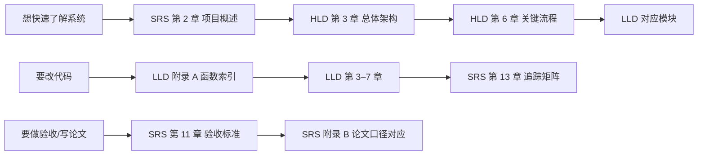

# Zebrafish Hub 需求与设计文档集

> 本目录是「斑马鱼基因问答体（Zebrafish Hub）」的**软件工程三件套**：
> 需求分析 → 概要设计 → 详细设计。全部内容基于**当前仓库真实代码与实测数据**反向梳理，
> 不是模板化设想；凡与代码不一致处，以代码为准，并在 SRS 第 14 章登记待确认项。

---

## 1. 文档清单

| 序号 | 文档 | 编号 | 内容 | 适合谁读 |
| --- | --- | --- | --- | --- |
| 01 | [软件需求分析说明书](01_软件需求分析说明书.md) | ZH-SRS-001 | 背景、干系人、业务流程、**79 条功能需求**、非功能需求、数据/接口需求、验收标准、追踪矩阵 | 产品、负责人、测试、论文写作 |
| 02 | [概要设计说明书](02_概要设计说明书.md) | ZH-HLD-001 | 分层架构、模块划分、运行时视图、6 条关键流程、数据设计、接口设计、安全/可靠性/性能、ADR | 后端、架构评审、运维 |
| 03 | [详细设计说明书](03_详细设计说明书.md) | ZH-LLD-001 | 逐模块函数签名、算法步骤与伪代码、数据库 DDL、配置字典、错误处理、测试设计 | 开发、维护者、接手人 |

---

## 2. 建议阅读路径

---

## 3. 系统速览卡

| 维度 | 事实 |
| --- | --- |
| 定位 | 斑马鱼功能基因组学的问答与数据中枢（文献 RAG + 结构化基因库 + 工具集） |
| 形态 | FastAPI 单进程 + 零构建单页前端（hash 路由、中英双语、SSE 流式） |
| 文献 | 32,549 篇；2,014 个 FAISS 分片；1.07 GB；2048 维（Qwen3-Embedding-4B） |
| 基因 | 26,321 基因；145,439 别名；319,344 表达行；110,966 GO；36,794 通路 |
| 数据库 | MySQL 8.0；33 表；4,788 MB |
| 检索 | 粗排 500 篇 → CrossEncoder 精排 100 篇 → 按篇编号打包 ≤48,000 字 |
| 引用 | RRS 六维加权 + `K·ln(1+IF)`；机制类 20–25 条、事实类 6–12 条 |
| 工具 | 基因工作台 / BLAST / GO·KEGG 富集 / 通路 / ID 映射 / 序列 / 注释 / sgRNA / 引物 / 检索调试 / 入库 + 基因组·表达·表型浏览 |
| 接口 | 61 个路由（含 GET/POST 别名）；SSE：`delta` / `done` / `error` |
| 运行 | 单并发对话锁（45 s）；CPU 推理；热态 RSS ≈32 GB；冷启动 238 s → 预热后 ≈50 s |
| 质量 | 自检 10/10；数据库体检 41 项（PASS 37 / WARN 4 / FAIL 0）；RRS 回归 17 项 |

---

## 4. 需求条目分布

| 域 | 含义 | 条目 |
| --- | --- | ---: |
| FR-QA | 问答与编排 | 10 |
| FR-RAG | 检索与引用 | 12 |
| FR-GENE | 基因库与数据浏览 | 9 |
| FR-TOOL | 生物信息工具 | 12 |
| FR-UI | 前端与交互 | 9 |
| FR-ACC | 账号/会话/租户 | 5 |
| FR-OPS | 运维与自愈 | 7 |
| FR-SEC | 安全 | 8 |
| FR-DATA | 数据工程 | 7 |
| **合计** | | **79** |

优先级：P0 = 32，P1 = 35，P2 = 12。

---

## 5. 三条贯穿全系统的硬约束

理解这三条，就理解了大部分设计取舍：

1. **宁缺毋滥**：主文献库不可用时，**不**改用备用小库编答案；宁可在回答里明说"文献检索没完成"。
2. **不编造**：坐标、表达量、PMID、DOI 必须来自本地表或可核验外链；证据不足就写证据不足。
3. **可核对**：每个答案带 `agent_trace`（走了哪些 Agent、耗时、命中数）与 `context`（编号证据池），
   前端详情栏可展开，自检脚本可复算。

---

## 6. 与既有文档的关系

| 既有文档 | 关系 |
| --- | --- |
| `docs/系统架构总览.md` | **实现视角**的架构快照（端点/表/部署实测）；本目录是**工程视角**的规范化（需求→设计→详细） |
| `docs/METHODS/METHODS.md` | 论文方法学口径；SRS 附录 B 给出逐节对应 |
| `docs/引用相关性打分RRS.md` | RRS 规则细节；LLD §5.5 给出实现与权重自适应 |
| `docs/sgRNA与引物设计.md` | 引擎口径与边界；LLD §7.7–7.8 给出算法 |
| `docs/paper/DELIVERY_STATUS.md` | 交付与事故记录；HLD ADR-06 引用 OOM 事故 |

---

## 7. 维护约定

- 本目录文档随代码演进更新；**接口/算法变更必须同步对应章节**。
- 需求编号（`FR-*`）不复用；废弃需求标记 `[DEPRECATED]` 并保留说明。
- 设计决策（ADR）只增不改；若推翻，新增一条并注明"取代 ADR-xx"。
- SRS 第 14 章的"待确认项"由负责人定期清理，关闭后移入正文。

---

*编制：2026-10-17 · 依据：仓库代码、`docs/系统架构总览.md`、`docs/METHODS/METHODS.md`、实测行数与端点统计*
